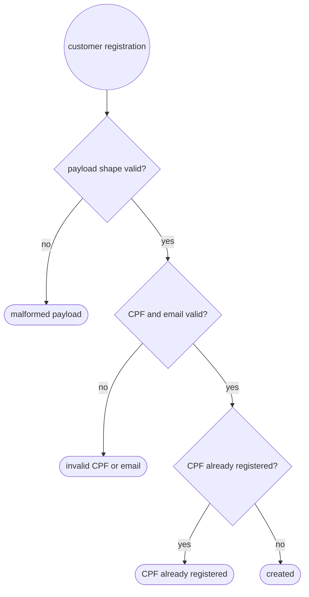
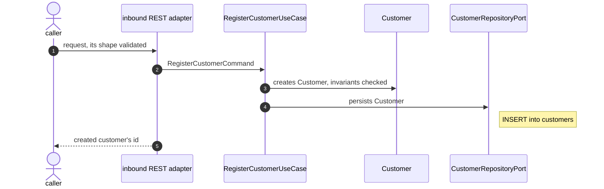

# UC-901 · Register customer

> Parent spec. Fixes the boundary and the names; **doesn't** detail any layer.
> Per-layer detail lives in this folder's partials, each with its own owner.

| Field | Value |
|---|---|
| Identifier | `UC-901-register-customer` |
| Date | 2026-10-16 |
| Trigger | `POST /api/v1/customers` receives CPF and email and registers a customer in the `customers` table. Requested HTTP success: 201 with the customer id. Inbound protocol: `inbound REST adapter`. The REST path, verb, status and response shape are detailed by `rest-api-architect` in `30-rest.md` |
| Access | public — any caller may register a customer without authentication (chosen by the user). Whether the project-wide filter chain needs an explicit public exception belongs to `security-architect`, in `32-security.md` |
| Side effects | **1** — `INSERT` into the `customers` table |
| Storage | `Customer` → relational — chosen by: request (the request names a table). The table, columns and relational engine belong to `persistence-architect`, in `20-persistence.md` |
| Search index | none |
| Audit | none — the request asks nothing about who changed the data |
| Admission | none — the request states no limit |
| External calls | none — no side effect reaches a system this service does not own |
| Transaction | opens at the inbound application port and closes before the response |
| Repetition | a customer with the same CPF must not be created twice (chosen by the user). The duplicate response and any HTTP idempotency mechanism belong to `rest-api-architect` |
| Concurrency | CPF uniqueness must hold for concurrent registrations; the persistence design defines the database arbiter |
| Freshness | none — this use case only writes and returns the id it just created |
| Active blueprint | `hexagonal-single-module` |

## Trigger, payload, and response

**In**

| Field | Type | Required | Rule |
|---|---|---|---|
| `cpf` | string | yes | must be a valid CPF; domain representation and validation are detailed by `domain-modeling` |
| `email` | string | yes | must be a valid email address; no uniqueness constraint was requested (the user chose CPF only); domain representation and validation are detailed by `domain-modeling` |

**Out**

Situations, not statuses. The HTTP code for each is `rest-api-architect`'s decision.

| Situation | Result |
|---|---|
| created | customer id |
| malformed payload | rejected before the domain is called |
| invalid CPF or email | rejected by domain invariants |
| CPF already registered | conflict with existing state |

## Flow

1. The inbound REST adapter receives the request and validates its shape.
2. It translates the request into `RegisterCustomerCommand`.
3. `RegisterCustomerUseCase` creates a `Customer` and enforces its invariants.
4. The use case persists the customer through `CustomerRepositoryPort`; the port rejects a duplicate CPF as a conflict.
5. The inbound adapter returns the created customer's id.

## Components

State: **NEW** to be created · **CHANGE** already exists and changes · **REUSE**
already exists and serves.

| File | Layer | Role | State | Detailed by |
|---|---|---|---|---|
| `adapter/in/rest/CustomerController.java` | inbound adapter | receives the HTTP request | NEW | `rest-api-architect` |
| `adapter/in/rest/dto/RegisterCustomerRequest.java` | inbound adapter | request DTO | NEW | `rest-api-architect` |
| `adapter/in/rest/dto/CustomerResponse.java` | inbound adapter | response DTO carrying the id | NEW | `rest-api-architect` |
| `adapter/in/rest/CustomerMapper.java` | inbound adapter | maps REST DTOs and application/domain types | NEW | `rest-api-architect` |
| `application/port/in/customer/RegisterCustomerUseCase.java` | application | inbound port | NEW | `domain-modeling` |
| `application/port/in/customer/RegisterCustomerCommand.java` | application | input command | NEW | `domain-modeling` |
| `application/service/customer/RegisterCustomerService.java` | application | creates and persists the customer; owns the transaction | NEW | `domain-modeling` |
| `application/port/out/CustomerRepositoryPort.java` | application | persistence port | NEW | `domain-modeling` |
| `domain/model/Customer.java` | domain | customer aggregate and its local invariants | NEW | `domain-modeling` |
| `adapter/out/persistence/customer/CustomerRepositoryAdapter.java` | outbound adapter | implements the persistence port | NEW | `persistence-architect` |
| `adapter/out/persistence/customer/CustomerEntity.java` | outbound adapter | persistence mapping | NEW | `persistence-architect` |
| `adapter/out/persistence/customer/CustomerJpaRepository.java` | outbound adapter | Spring Data persistence interface | NEW | `persistence-architect` |
| `db/migration/` | infrastructure | versioned migration creating `customers` and enforcing CPF uniqueness | NEW | `persistence-architect` |

Paths follow the active blueprint's package map and grouping convention. Domain field
types, including whether CPF and email require separate value-object classes, are detailed
by `domain-modeling`. Mapping mechanism follows `@.claude/rules/mapping.md`.

## Invariants

| Rule | Guaranteed by | Who violates it |
|---|---|---|
| CPF is valid | `Customer` and the domain representation chosen by `domain-modeling` | caller with an invalid CPF |
| Email is valid | `Customer` and the domain representation chosen by `domain-modeling` | caller with an invalid email |
| At most one customer exists for a CPF | persistence uniqueness and the use case's duplicate check | concurrent or repeated registration |

## Errors

| Situation | Kind |
|---|---|
| invalid CPF | validation |
| invalid email | validation |
| CPF already registered | conflict with existing state |
| required field missing or malformed payload | shape — rejected in the adapter, never reaches the domain |

Situations and kinds, never exception names or statuses. The exception class and
`errorCode` belong to `domain-modeling` in `10-domain.md`; HTTP mapping belongs to
`rest-api-architect` in `30-rest.md`.

## Expected tests

| Level | Target | Detailed by |
|---|---|---|
| unit | `Customer` rejects invalid CPF and email | `test-architect` |
| unit | registration rejects a CPF already in use | `test-architect` |
| slice | REST creation returns the id; malformed, invalid and duplicate inputs are handled | `test-architect` |
| integration | customer persistence and CPF uniqueness against the configured relational database | `test-architect` |

## Out of scope for this use case

- Reading, updating, or deleting customers; each requires its own use case.
- Calling an external system or publishing an event; neither is part of the request.

## Impact on approved use cases

none — `UC-900-probe` does not define or implement a customer aggregate; this case adds one.

## Implementation order

- [ ] 1. `domain/model/Customer.java` and its domain invariants
- [ ] 2. `application/port/in/customer/` and `application/port/out/CustomerRepositoryPort.java`
- [ ] 3. `application/service/customer/RegisterCustomerService.java`
- [ ] 4. migration and `adapter/out/persistence/customer/`
- [ ] 5. REST request/response mapping and controller
- [ ] 6. tests for the domain, application, REST, and persistence layers
- [ ] 7. `./mvnw clean verify` green
