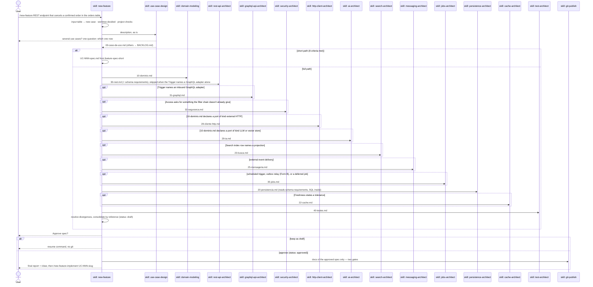
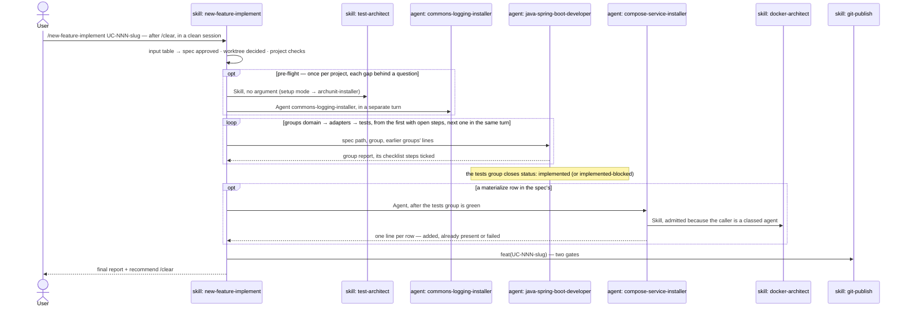

# `/new-feature` — design a spec, then implement it

Primary source: `.claude/skills/new-feature/SKILL.md`,
`.claude/agents/java-spring-boot-developer.md`, the design skills (`use-case-design`,
`domain-modeling`, `rest-api-architect`, `graphql-api-architect`, `security-architect`, `http-client-architect`,
`messaging-architect`, `jobs-architect`, `persistence-architect`, `cache-architect`,
`ai-architect`, `search-architect`, `test-architect`), and the
`guard` mode of `.claude/hooks/ArchHook.java`.

## What it does

Designs **one use case per run** and consolidates it into a single `UC-NNN-spec.md` —
ready for the executor agent to implement once the user approves it. **This command
only makes sense inside an already-generated project**, created by `/init-project`: it
reads `pom.xml`, `.claude/forbidden-imports.txt`, and discovers the domain package in the
real project.

**Two flows, one command — the argument decides which, and they never share a session.**

| Flow | Command | Ends with |
|---|---|---|
| 1 · Create the spec | `/new-feature <description>` (or `UC-NNN-slug` of a draft to resume) | the spec approved and committed by `git-publish`, and the two commands to type next: `/clear` · `/new-feature-implement UC-NNN-slug` |
| 2 · Implement the spec | `/new-feature-implement UC-NNN-slug` over an `approved` spec, after `/clear` | the pre-flight, then `java-spring-boot-developer` in three chained groups — `domain` (blocks 1–2) → `adapters` (H, 3, S, M, J) → `tests` (block 4) — `status: implemented`, and the feature commit |

The design leaves the main thread at 250–370k tokens of context; implementing on top of it
would pay for that on every hand-back and on `git-publish`. Each executor group starts again
from the spec and the disk instead of carrying the earlier blocks
(`.claude/decisions/0130-executor-split-by-block-group-implement-in-clean-session.md`).
Since decision 0135 the implement flow is its own skill, `new-feature-implement`: it runs on
`sonnet`, writes nothing itself, and never loads the design procedure
(`.claude/decisions/0135-new-feature-split-spec-and-implement.md`).

These boundaries hold on every run, and none of them is prose — the `guard` hook blocks
with `exit 2`, `permissions.ask` prompts, or consolidation stops:

- **A run writes only under `docs/`.** Territory is an allowlist, deny by default: each
  pipeline skill writes only its class's `write_allow` (`skill_classes` in
  `.claude/schemas/extensions.json`). Migration SQL lives inside `20-persistencia.md`;
  every file under `src/` comes from the executor.
- **A design run materializes no file outside `docs/`.** `guard` refuses the *call* itself
  to a `build`-class skill — `docker-architect` included — while the run is open. A missing
  compose service is **recorded** in the partial, with the command that creates it.
- **Git goes only through `git-publish`**, behind its two confirmations — on every end
  of the flow, including the one without the executor. `git push` is always `ask`.
- **An approved spec is immutable.** A later case records the change it needs in its
  own `## Impact on approved use cases` section, plus one line in the `CHANGELOG.md` of
  every altered case's folder. `guard` freezes the files — and exempts exactly that
  `CHANGELOG.md`, so the log a frozen folder is supposed to receive is the one write it
  still accepts (`guard.frozen_exempt_basenames`), besides the spec's own `status:` close
  and checklist toggles.
- **An impact row that adds a precondition names its satisfier.** A `Satisfied by` column:
  an approved `UC-NNN`, this case, or a **named** backlog case — and in that last situation the
  spec and the final report both state that the earlier case is unreachable end to end until
  that one ships. With no satisfier, consolidation stops. A fixture that fabricates the state
  is not a satisfier.
- **The final report carries four findings nobody should have to reconstruct:** an approved
  case this run left unreachable, every item a partial deferred with the owner it left it to,
  a dedupe guarantee delegated to an external consumer with no contract, and personal data
  crossing a boundary in clear, with its receiver.
- **Design patterns are decided in the design, not by the executor.** Every design partial
  carries a `## Design patterns` section — `none` when nothing applies, and absence stops
  consolidation — naming the spec line or `file:line` that forces each pattern and the
  classes it creates.

## Why it's a manual skill, not an agent

`new-feature/SKILL.md` documents the decision itself: axis 2 (manual trigger) + axis 5
(procedural) + axis 8 (both). The "agent" form was rejected — none of the three valid
reasons applies (context, tools, model). `disable-model-invocation: true` means the model
can't call it: the user types the command.

## Input — a closed table

The argument is classified by command (`grep -E`, `test -d`, `grep '^status:'`), never
interpreted. First matching row wins; anything else is an error.

| Input | Result |
|---|---|
| empty | lists the use cases with their `status` |
| `UC-NNN-slug`, folder exists, spec `draft` or missing | resumes: only the missing partials, then consolidation |
| `UC-NNN-slug`, spec `approved` | ❌ approved — prints `/clear` + `/new-feature-implement UC-NNN-slug` |
| `UC-NNN-slug`, spec `implemented` or `implemented-blocked` | ❌ already implemented — describe the change as a new feature |
| no folder, but the argument's `UC-NNN` has exactly one folder on disk | ❌ names the real slug and status, plus the exact command — the case exists, the argument named it wrongly |
| `UC-NNN-slug`, no folder, number matching zero or several | ❌ not found — describe the feature to create one |
| contains `UC-` + digit but isn't exact | ❌ ambiguous argument |
| free text, some case still open | ❌ resume or approve it first |
| free text, no open case | new use case — the text goes as is to `use-case-design` |

An error prints the reason and the usage, and ends the run: no side effect after it — no
skill call, no write, no question. Reading is allowed, which is what lets a near miss answer
with the real slug instead of "not found".

## Sequence diagram

The two flows below are two runs, with `/clear` between them.

### Flow 1 — create the spec: `/new-feature <description>`

### Flow 2 — implement the spec: `/new-feature-implement UC-NNN-slug` over an approved spec

## Pieces and what each writes

| Order | Skill/Agent | Depends on | File it produces |
|---|---|---|---|
| 1 | `use-case-design` | — | `00-caso-de-uso.md`, `BACKLOG.md` entries — owns number and slug. Its `Storage` row records, per aggregate, `relational` or `document (MongoDB)`, and its `Search index` row names a search projection or `none`; both come from the request, or from one bare factual question ("SQL or NoSQL?") — never weighed, that decision belongs to a planned solution-design skill |
| 2 | `domain-modeling` | 1 | `10-dominio.md` — owns exception names |
| 3 | `rest-api-architect` | 1, 2 | `30-rest.md` — including the schema requirements transport creates; skipped when the `Trigger` names an inbound GraphQL adapter alone |
| optional | `graphql-api-architect` | 1, 2, and 3 when present, when `00-caso-de-uso.md`'s `Trigger` row ends in `inbound GraphQL adapter` or `inbound REST and GraphQL adapters` (step 3 is skipped when it names the GraphQL adapter alone) | `31-graphql.md` — root fields and the input port each calls, types and nullability, mutation inputs and payloads with `userErrors`, connections with a page ceiling, `@BatchMapping` child fields and the batch ports they ask for, the error map, field-level access, personal data per output field, and on the project's first GraphQL case the demand limits and setup. Its spec block is `## 4.1 GraphQL`, implemented by the executor's Block G (G1-G3), right after Block 3 and before Block S. The protocol itself is chosen by `use-case-design` with the criteria of `.claude/rules/api-graphql.md` § Choosing the inbound protocol |
| optional | `security-architect` | 1, 2, 3, and `00-caso-de-uso.md`'s `Access` row | `32-seguranca.md` — mechanism, access per endpoint, the `permitAll` list, ownership, 401/403, CORS/Actuator/OpenAPI exposure |
| optional | `http-client-architect` | 2, when `10-dominio.md` declares a port of kind `external HTTP` | `28-cliente-http.md` — client and engine, timeouts, retrying layer and resilience, outbound authentication, the integration failure table per operation, declared dependencies, and the WireMock test cases |
| optional | `ai-architect` | 2, when `10-dominio.md` declares a port of kind `LLM` or `vector store` | `29-ia.md` — provider and model per port, the prompts as `classpath:/prompts/` resources, the answer type with closed fields and what an unusable answer becomes, which fields go to the provider, the vector store and who re-indexes it, timeout and the one retrying layer, the failure table, metrics, the `pgvector` image variant of the `postgres` compose row. Its spec block is `## 3.7 AI`, implemented by the executor's Block A, right after Block H |
| optional | `search-architect` | 1, 2, when `00-caso-de-uso.md`'s `Search index` row names a projection | `23-busca.md` — the search document and its strict mapping, the versioned index behind an alias, the query and its cursor, the indexer's write rules with the source's version, the rebuild with the alias swap, the lag it consumes of `Freshness`, the failure table, and the engine's compose row. Its spec block is `## 3.8 Search`, implemented by the executor's Block I, right after Block A. The source's version and outbox event are `20-persistencia.md`'s, the indexer consumer `25-mensageria.md`'s, the rebuild job `35-jobs.md`'s; norms in `.claude/rules/search.md` |
| optional | `messaging-architect` | 2, if external delivery | `25-mensageria.md` |
| optional | `jobs-architect` | 1 (schedule trigger), messaging's Form B, a reconciliation pass `28-cliente-http.md` § 10 asks for, or a deferred job | `35-jobs.md` — tool, trigger/cadence, cluster coordination, overlap/misfire, gate property, job metrics; owns the outbox relay's schedule and the prune job |
| 4 | `persistence-architect` | 1, 2, 3, security, http-client, and messaging/jobs when they ran | `20-persistencia.md` — in the family the `Storage` row records (it stops without the row): migration SQL inside it for relational, or collections, indexes and validators ensured at startup, `@Version` and transactions on a replica set for document (MongoDB); stamps or an Envers history when the `Audit` row asks (stamps only on MongoDB); reads `32-seguranca.md` § 7 (a credentials or API-key store) when security-architect ran, `28-cliente-http.md` § 10 (a stored idempotency key or an unknown-outcome column) when http-client-architect ran, and `35-jobs.md`'s tool tables (`shedlock`, `QRTZ_*`, `BATCH_*`) as schema requirements and its replica count for the outbox claim strategy, when jobs-architect ran |
| optional | `cache-architect` | 1, 2, 4, when `00-caso-de-uso.md`'s `Freshness` row states a tolerance | `22-cache.md` — which reads are cached and the key of each, Caffeine or Redis, expiry and size per cache next to the tolerance, every writer that must evict, failure and load without the cache, serialization, metrics, the `redis` compose row |
| 5 | `test-architect` | 1–4, and cache, GraphQL, AI and search when they ran | `40-testes.md` — three cases per cached read when `22-cache.md` exists; the controller slice test, the HTTP IT and the schema snapshot test when `31-graphql.md` exists; the adapter contract test, the provider IT and, with a store, the vector store IT when `29-ia.md` exists; the MongoDB IT on a replica set for a document aggregate, and the search index IT when `23-busca.md` exists |
| — | `new-feature` (consolidation) | all above | `UC-NNN-spec.md` |
| 6 | `java-spring-boot-developer` (agent) | `approved` spec | code and migrations in `src/**` |
| 7 | `compose-service-installer` (agent) | `implemented` code, and a `materialize` row in `## Infrastructure` | the service block in `docker-compose.yml`, written by `docker-architect` |
| — | `git-publish` | end of flow | commit + push, behind two gates |

**Diagrams in the spec.** `00-caso-de-uso.md` carries two. A `sequenceDiagram` under `## Flow`
draws who calls whom on the path that succeeds, one message per step of the numbered list. A
`flowchart TD` under the **Out** table draws every check of the flow and where it ends, one end
node per situation of the table. `10-dominio.md` carries a `classDiagram` of the
aggregate and its value objects and, when a state field has more than one value, a
`stateDiagram-v2` of the *State reachability* table. They are Mermaid blocks inside the
markdown, which GitHub renders in the PR. There is no `.drawio` or `.excalidraw` file, and
nothing is installed. A diagram uses only names the same file's text already defines and adds
no fact. Where the two disagree, the text wins (`.claude/rules/spec-diagrams.md`, decision
0143). `UC-NNN-spec.md` consolidates by reference and copies no diagram. Syntax and worked variants
live in each skill: `use-case-design/references/mermaid-use-case-diagrams.md` with
`templates/use-case-diagram-variants.md.example` (`external HTTP` port with its outcomes, event, schedule), and
`domain-modeling/references/mermaid-class-and-state.md` with
`templates/domain-diagram-variants.md.example` (child entity with multiplicity, sealed type,
final states).

**Why REST before persistence.** REST generates schema requirements (`Idempotency-Key`
needs the shared key table); persistence generates none for REST. In the old order the
table was discovered after the persistence partial was written, and persistence ran
twice.

`docker-architect` is **not** chained by the design run, which is docs-only: `ArchHook.java`'s
`guard` mode refuses the call while a design phase is open —
`.claude/decisions/0058-skill-classes-territory-schema.md`. What the design run does is ask.
When `persistence-architect` or `messaging-architect` finds its service missing from
`docker-compose.yml`, step 9 asks whether to add it, whether it runs elsewhere, or whether the
user will add it, and records the answer (`materialize`, `external` or `pending`) in the
partial's `## Compose services`. Consolidation copies those rows into the spec's
`## Infrastructure`; absence stops consolidation. `/new-feature-implement` then launches
`compose-service-installer` for every `materialize` row, after the `tests` group ends green
and before `git-publish`. The agent runs `docker-architect` through `Skill` — the guard admits
it because a classed agent's call is skipped, while the implement thread's own call stays
refused — and `git-publish` commits the compose change with the code. The final report lists
every `## Infrastructure` row with what the run did to it
(`.claude/decisions/0137-pending-compose-service-decided-at-design-materialized-at-implement.md`).

**Design patterns are decided inside that phase too.** `domain-modeling`,
`persistence-architect`, `rest-api-architect`, `graphql-api-architect`, `security-architect`, `http-client-architect`,
`messaging-architect`, `jobs-architect`, `cache-architect`, `ai-architect` and `search-architect`
each read `gof-design-patterns` § Design-time use — read, never invoked: it is a `build`
skill — and write a `## Design patterns` section into their own partial: the spec line or
`file:line` that forces the pattern, the pattern, the classes and interfaces it creates, the
"When not" checked. Consolidation collects every row into the spec's own `## Design
patterns`, so the classes a pattern creates are in what the user approves. The executor
implements those rows, and adopts one on its own only for a symptom already on disk; the
catalog reaches it at `SubagentStart`
(`.claude/decisions/0089-design-patterns-decided-at-design-time.md`).

## Pre-flight — infrastructure installed once, on the first implement run

Before delegating to the executor, `new-feature-implement` detects (by command, never by
assumption) two gaps that only matter when the first `.java` is about to be written
under `src/`:

| Gap | How it's detected | Installed via |
|---|---|---|
| ArchUnit missing | `grep -rl "ArchRule\|ArchTest" src/test/` is empty | `Skill(test-architect)` with no argument — setup mode, which delegates to `archunit-installer` (ArchUnit + JaCoCo gate) |
| Logging/masking classes missing | no `commons` folder, or only `package-info.java` in it | `Agent(commons-logging-installer)` — thirteen exemplars from `new-feature-implement/templates/commons/` translated into the real package, plus `AutoConfiguration.imports` and the AOP dependencies |

Each gap found becomes an `AskUserQuestion` (**Install now** / **Skip for this run**);
no gap, no question. The two may fire in the same turn — and could not before:
`Skill(test-architect)` opened a design phase in the `guard` hook and
`Agent(commons-logging-installer)` closed one, with no ordering guarantee between the two
`PreToolUse` hooks, and the loser blocked every write under `src/` by the other agent (it
happened: 138k tokens, zero files written). `agent_classes` retired it: a subagent's write is
judged by its own `agent_type`, so no phase reaches it and nothing closes a phase on an
`Agent` call any more.

## Spec lifecycle

| `status:` | Written by | When |
|---|---|---|
| `draft` | `new-feature` | at consolidation |
| `approved` | `new-feature` | only after explicit user approval |
| `implemented` | `java-spring-boot-developer` | with `./mvnw verify` green |
| `implemented-blocked` | `java-spring-boot-developer` | with a green build, when the run left an approved case unreachable end to end — the `Satisfied by` the spec named isn't there yet |

Either closed state can revert to `approved` — the exit a run that closed by mistake needs
(`.claude/decisions/0066-spec-state-machine.md`).

A spec defect found by the executor in an approved spec: the user sets `status: draft`
by hand, then `/new-feature UC-NNN-slug` resumes and re-approves.

**An approved spec is never edited to record that another case changed its behavior.** The
case that alters already-approved cases — including the one that creates no use-case class
at all, and still gets its own `UC-NNN` — writes one line in the `CHANGELOG.md` **of every
altered case's folder**: the date, the `UC-NNN` that changed it, and what changed. Without
it, immutability protects the text and loses the history: whoever opens
`UC-001-register-customer/` has no way to learn its behavior changed elsewhere. `guard`
freezes the folder; the changelog is the separate file that records the change without
breaking the freeze.

## Short path

When the case reuses an approved aggregate, needs no new table, column, or migration,
no new exception, and no question to the user, `new-feature` skips the partials and
writes one spec where every row names its source — an approved spec or a rule.

## Precedence rule during consolidation

| Fact | Who wins |
|---|---|
| HTTP path, verb, status, body shape | `30-rest.md` |
| Client, engine and pool, timeouts, retrying layer, breaker and bulkhead, outbound authentication | `28-cliente-http.md` |
| GraphQL root fields and the port each calls, types, nullability, inputs, payloads and `userErrors`, connections and ceilings, batch loads, the GraphQL error map, the project's GraphQL limits | `31-graphql.md` — except who may read each field (`32-seguranca.md`'s). A batch port it asked for becomes `10-dominio.md`'s port at consolidation; the batch statement and the index a connection's order needs are `20-persistencia.md`'s |
| Table, column, key, index, migration | `20-persistencia.md` |
| Topic, serialization, delivery guarantee, consumer retry/DLQ | `25-mensageria.md` |
| The outbox table, its columns, the claim query, attempt ceiling/backoff, and retention window | `20-persistencia.md` — messaging **declares** that the case needs an outbox and which guarantee the relay must honour, and never a column name. A § 6 row naming columns is a divergence, and a column decision that would drop the declared guarantee **stops** the pipeline instead of being settled by precedence |
| Scheduling tool, trigger and cadence, cluster coordination, overlap/misfire handling, job metrics, the prune job | `35-jobs.md` — including the outbox relay's own poll interval and coordination, which no longer lives in `20-persistencia.md` |
| Which reads are cached, each key, Caffeine or Redis, expiry and size per cache, the writers that must evict, cache serialization and metrics | `22-cache.md` — the freshness tolerance stays `00-caso-de-uso.md`'s, and an expiry longer than it **stops** the pipeline instead of being settled by precedence |
| Provider, model, prompt resources, answer type and its closed fields, which fields reach the provider, timeout and the retrying layer | `29-ia.md` — the port, its "could not decide" value and the review state stay `10-dominio.md`'s; the vector store's migration is `20-persistencia.md`'s (`29-ia.md` § 9 only asks); a re-index trigger or an ingestion job is `25-mensageria.md`'s or `35-jobs.md`'s |
| The search document, its mapping and alias, the query and cursor, the indexer's write rules, the rebuild and the lag | `23-busca.md` — the lag is at most `Freshness`, and a larger one is a divergence. The source's version and change event are `20-persistencia.md`'s; the indexer consumer is `25-mensageria.md`'s and the rebuild job `35-jobs.md`'s |
| Aggregate name, value object, port, event | `10-dominio.md` |
| Exception class and `errorCode` | `10-dominio.md` |
| Use case boundary, invariants, error situations | `00-caso-de-uso.md` |
| Name and level of each test | `40-testes.md` |
| A design pattern and the classes it creates | The partial of the layer those classes live in — two partials adopting different patterns for the same class **stops** the pipeline |

The spec is consolidated **by reference**: each block holds the final decisions and
the partial's path, never a copy of its tables. Discarded values go to
`## Resolved divergences`. `## Impact on approved use cases` and `## Design patterns` collect
every row of the same section of each partial.

## Cost discipline

In a real run on a two-field aggregate, the executor took 203 turns and re-read 58.8M cache
tokens: the lever is turns × context size. So: no progress messages between steps, independent writes in one
turn, versions read from `pom.xml`, one use case per run, and `/clear` between runs. A design
run ends at approval, so the implement run starts in a clean session, and the executor runs
as three chained groups — `domain`, `adapters`, `tests` — each starting again from the spec
and the disk instead of carrying the earlier blocks' context
(`.claude/decisions/0130-executor-split-by-block-group-implement-in-clean-session.md`).

## Operational note — long-running background work

An executor running in the background **doesn't survive the machine sleeping**. Before
delegating in the background, `new-feature-implement/SKILL.md` says to offer keeping the machine
awake (`caffeinate -i` on macOS) or running on the main thread, which is resumable.

## Entry into generated projects

`/new-feature` travels into every project generated by `/init-project`
(`project-bootstrap` step 6.6, which writes skills, agents and hooks through
`ArchHook.java export`), with the `guard` hook wired. Once `pedidos-api`
exists, `/new-feature <description>` runs **inside** it, without
Nerviz on the machine.

Every run leaves a report under `.claude/audit-usage/` — active duration, time waiting
on the user, tokens per chained skill and for the executor, files touched, failures.
That's how the cost discipline above stops being an estimate: `/audit-usage` shows
which piece is eating the budget. See [08-audit-usage.md](08-audit-usage.md).
