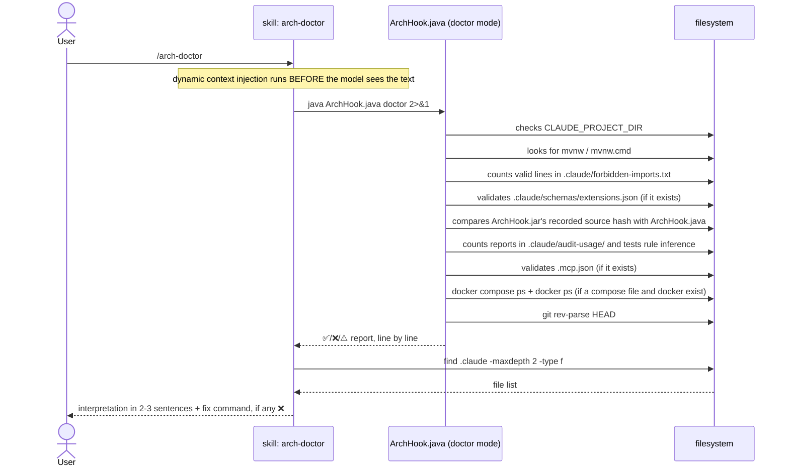

# `/arch-doctor` — setup diagnostics

Primary source: `.claude/skills/arch-doctor/SKILL.md`,
`.claude/hooks/ArchHook.java` (`doctor()` method).

## What it does

Diagnoses whether architecture enforcement is actually working on the current
machine: active hooks, loaded boundaries, build wrapper, `java` on PATH, valid
frontmatter schema, the audit trail, declared MCP servers, and whether every service in
`docker-compose.yml` is actually `running` with no container from another project on
the same ports — and whether each host-published port is reachable from there. It doesn't fix anything on its own — it only reports, and suggests the
exact command to fix each item marked ❌.

## Why it's the simplest of the three skills

`arch-doctor/SKILL.md` doesn't delegate to any agent — there's no verbose output to
hide and no sensitive tools to restrict (`CLAUDE.md` § Invariant 5, none of the three
reasons applies). The skill body only embeds, via dynamic context injection
(`` !`command` ``, see [01-file-types.md § Skill](01-file-types.md#skill)), the real
output of two commands:

```markdown
## Diagnosis
!`java "${CLAUDE_PROJECT_DIR:-.}/.claude/hooks/ArchHook.java" doctor 2>&1`

## AI files
!`find "${CLAUDE_PROJECT_DIR:-.}/.claude" -maxdepth 2 -type f | sort`
```

The model then reads the already-ready result and interprets it in 2-3 sentences — it
doesn't run anything by its own decision during the invocation, both commands already
ran before the model saw the text.

## Sequence diagram



## What each diagnostic line checks

| Line | ✅ condition | ❌/⚠️ condition |
|---|---|---|
| `OS` | — informational | On Windows, notes it runs in exec form (no shell) |
| `Java` | — informational | JVM version in use |
| `Project root` | — informational | resolved from `CLAUDE_PROJECT_DIR` or current directory |
| `CLAUDE_PROJECT_DIR` | variable set | ❌ not set — hooks use the current directory |
| `Build wrapper` | `mvnw`/`mvnw.cmd` or `gradlew`/`gradlew.bat` found (`build_tools` in `extensions.json`), the tool in parentheses | ❌ missing — run `/init-project` (`starter.tgz` already brings the wrapper) |
| `Boundaries` | ≥ 1 valid rule in `.claude/forbidden-imports.txt` | ❌ 0 rules — enforcement OFF, generated by `/init-project` |
| `Boundary violations` | no source file imports what `forbidden-imports.txt` forbids its module — `check`'s own match, over everything git tracks or would track (without git, the tree minus `target/`, `build/` and the like) | ❌ counts the files and lists up to 8 as `file → prefix (module)`. In `doctor gate`: the generated project's `architectural boundaries` job fails on a forbidden import written by any agent. No rules, ✅ "nothing to sweep" (decision 0140) |
| `Schema` | every extension file passes | ❌ N files with invalid frontmatter, or ⚠️ no `extensions.json` — validation OFF |
| `Hook jar` | `.claude/hooks/ArchHook.jar` carries the hash of the current `ArchHook.java` | ❌ missing, unreadable, or stale — built from another version of the source, so every hook runs the old code; `java .claude/hooks/ArchHook.java build` rebuilds it |
| `Audit` | N runs recorded in `.claude/audit-usage/` | ⚪ no directory — trail OFF (optional; the case in this meta-repo) |
| `Audit rule inference` | rule inference renders without error for a synthetic `.java` | ❌ `auditRules()` throws — every report would freeze once a run touched `src/**` |
| `MCP` | N servers declared in `.mcp.json`, all valid | ❌ N problems — run `java ArchHook.java schema`; or "no .mcp.json" (optional) |
| `Hooks` | N valid registrations across M events | ❌ an unknown event, a `matcher` on an event that reads none, or a shell string in `command` — the four ways a hook fails in silence. Also when `enabledPlugins` lacks `"<id>": false` for a plugin of `settings.blocked_plugins` (decision 0138) |
| `Skill shadowing` | no folder of the personal skills directory (`$CLAUDE_CONFIG_DIR/skills`, or `~/.claude/skills`) is named like a skill of `.claude/skills/` | ❌ lists the personal skills that replace the project's — Claude Code resolves one name as enterprise > personal > project, so the personal one runs instead, with no warning. Rename or remove the personal one. ⚪ without the directory. Machine state: never in `doctor gate` (decision 0138) |
| `Agent instructions` | the root `AGENTS.md`, `.github/copilot-instructions.md`, and for every module of the active blueprint with `forbidden_imports` an `AGENTS.md` listing every prefix, next to a `CLAUDE.md` holding `@AGENTS.md`; every path cited in backticks exists | ⚠️ names the missing file, the prefix not listed, the `CLAUDE.md` that does not import — without it Claude Code skips the module `AGENTS.md` — and the dead path. Silent without a provenance stamp. Reports only, never in `doctor gate`: the build is what refuses a forbidden import (decision 0139) |
| `Provenance` | no file under `.claude/` edited after the `.claude/.arch-provenance.json` stamp | ❌ lists the locally edited files — an `arch-adopt` update would overwrite each one; ⚠️ no stamp — this `.claude/` was not written by `export`. In the origin repository: `⚪ origin repository — writes stamps, carries none` |
| `Compose` | every compose service `running`, no declared port held by a foreign container, no `image:` tag disagreeing with the one `src/test` pins in `DockerImageName.parse`, and every host-published port advertised at an address the host resolves, and every `${VAR:default}` pointing at a compose service holding on the host and in the `app` container | ❌ a service in `created`/`exited`, a port published by another project once a container of this project exists (before that, a ⚠️ warning), a divergent tag, or a service that publishes a port while advertising only its compose-network hostname, or a placeholder whose default the host cannot reach or that `app` does not override — detail line by line. The tag comparison, the advertised-address check and the placeholder check need no Docker: they read files |
| `git HEAD` | at least 1 commit exists | ❌ no commits — the `tests` hook doesn't run (`git diff HEAD` fails) |
| `UC references` | every `docs/use-cases/UC-NNN-slug/` folder cited by a versioned file exists on disk | ❌ an orphan citation, with file and line — deleting or renaming a use case leaves its citations behind, and each was correct in the commit that wrote it. With no `docs/use-cases/`, "nothing to check (optional)" — the case in this meta-repo |
| `BL references` | every `BL-NN` a spec cites exists in `docs/use-cases/BACKLOG.md`, in its active or retired table | ❌ N citations name a backlog row the file does not have, listed one per line. Same data block (`doctor.bl_references`); with no `docs/use-cases/`, "nothing to check (optional)" |

The final line summarizes: `✅ Setup operational.` only appears when **both**
`Boundaries` has rules > 0 **and** the build wrapper (Maven or Gradle) was found. Any other combination
becomes `⚠️ Setup incomplete — see marked lines above.`

## What blocks CI and what does not

`doctor` has two forms, and only one of them blocks anything:

| Form | Exit | Where it runs |
|---|---|---|
| `java .claude/hooks/ArchHook.java doctor` (what `/arch-doctor` injects) | always 0 — it only prints | on the machine of whoever asked |
| `java .claude/hooks/ArchHook.java doctor gate` | 1 when a line listed in `doctor.gate.labels` printed ❌ | the generated project's `architectural boundaries` CI job |

`doctor` takes no part in the Maven or Gradle build: it is the build itself that refuses
to compile (Checkstyle, ArchUnit, JaCoCo). What `doctor gate` blocks is the CI job. The
`Setup incomplete` footer blocks nothing either — the gate's verdict comes from the lines
listed below, not from the footer.

The cut-off rule (decision 0128): a check enters the gate when it reads a **versioned file
a push can break**. What is runner or machine state, or only a documentation defect, stays
out. The list is data — `doctor.gate.labels` in `.claude/schemas/extensions.json` — and
each label matches the first argument of `report(...)` in `ArchHook.java`.

### Blocks CI

| Line | Why it blocks |
|---|---|
| `Boundaries` | `forbidden-imports.txt` is versioned; with no rule, the boundary is enforced on nobody |
| `Boundary violations` | a committed forbidden import breaks whoever clones; the only line that reads source code (decision 0140) |
| `Schema` | invalid frontmatter is a broken versioned file |
| `Hook jar` | with a stale jar every hook exits 1, which does not block: the protection disappears silently |
| `Hooks` | the runtime silently ignores an unknown event or a `matcher` the event does not read |
| `MCP` | includes the literal-secret scan of `.mcp.json` (invariant 11) |
| `Audit overrides` | the overrides live in a versioned file |
| `Compose overrides` | `.claude/compose-gate.json` is a versioned file; a malformed one would switch nothing in silence (decision 0186) |

### Does not block CI

| Line | Why it does not block |
|---|---|
| `CLAUDE_PROJECT_DIR` | runner state — CI never sets the variable |
| `Compose` | runner state — CI does not start the services |
| `Build wrapper` | the build job already fails without it |
| `Audit` | only prices runs; gates nothing |
| `git HEAD` | always true on a CI checkout |
| `UC references`, `BL references` | documentation defects |
| `Mods` | machine state — depends on which `claude` is on PATH; silent where there is no mods folder, as in a generated project |
| `Skill shadowing` | a CI runner has no personal skills |
| `Agent instructions` | gating it would turn every project adopted without those files red (decision 0139) |
| `Platform`, `Virtual threads` | they print ⚠️ or ⚪, never ❌ — there is no way for them to fail the gate |
| `Provenance`, `Plan limits`, `Audit rule inference` | not in `doctor.gate.labels` |

Four details that change the outcome:

- **The gate only sees a ❌ printed by `report(...)`.** A ⚠️ or ⚪ line does not block even
  if someone lists it in `gate.labels`: the line's code would have to change too.
- **A line that is not printed passes.** With no `.mcp.json`, no `.claude/audit-usage/`,
  no mods folder, the line does not appear and the gate carries on.
- **An empty or missing list fails closed**, with exit 1. An `/arch-adopt` update rewrites
  the list.
- **A ❌ outside the gate is still a ❌.** It does not fail CI, but it is what
  `/arch-doctor` points at — and the `Setup incomplete` footer only considers
  `Boundaries` and the wrapper.

### A project adopted with `/arch-adopt`

`export` does not write `.claude/forbidden-imports.txt`. `boundary-map` writes it, and
`project-bootstrap` § 5 runs that at generation. On an adopted project, `doctor` shows:

```
  Boundaries          ❌ 0 rules — ENFORCEMENT OFF. Generated by /init-project
  Boundary violations ✅ nothing to sweep — no boundary rule
  ...
⚠️  Setup incomplete — see marked lines above.
```

`Boundaries` is in the gate. If the project has a CI job that runs `doctor gate`, it fails
on that line until the file exists — and `arch-adopt` writes only under `.claude/`, so
that job has to come from somewhere else. To generate the file:

```bash
java .claude/hooks/ArchHook.java boundary-map . --blueprint <id> --package <base.package>
```

With the file in place, `Boundary violations` starts sweeping the existing code. A project
whose architecture departs from the blueprint fails the gate, listing up to 8
`file → prefix` lines. That is the gate working, not a defect of the adoption.

## Example invocation and output (fictional, `pedidos-api` project)

```
/arch-doctor
```

```
ArchHook doctor
  OS ................ Mac OS X
  Java .............. 21.0.4
  Project root ...... /Users/dev/projects/pedidos-api
  CLAUDE_PROJECT_DIR  ✅ set
  Build wrapper       ✅ ./mvnw  (maven)
  Boundaries          ✅ 9 active rules
  Schema              ✅ all extension files pass
  Hook jar .......... ✅ built from the current .claude/hooks/ArchHook.java
  Audit ............. ✅ 3 execution(s) recorded
  Audit rule inference ✅ renders without error on a touched .java file
  MCP ................ no .mcp.json — nothing declared (optional)
  Compose ........... ✅ 3/3 services running · no foreign container on declared ports
  git HEAD            ✅ exists

✅ Setup operational.

AI files
.claude/audit-usage/GENESIS.md
.claude/forbidden-imports.txt
.claude/hooks/ArchHook.java
.claude/schemas/extensions.json
.claude/settings.json
```

Interpretation the model returns to the user (2-3 sentences, as instructed in the
skill body):

> Setup operational — build wrapper present, 9 active boundary rules, frontmatter
> schema validating with no errors, three compose services up. The audit trail holds 3
> runs.

## Example output with a problem

If the project hadn't gone through `/init-project` yet (or the boundaries file had
been deleted by mistake):

```
ArchHook doctor
  OS ................ Mac OS X
  Java .............. 21.0.4
  Project root ...... /Users/dev/projects/pedidos-api
  CLAUDE_PROJECT_DIR  ✅ set
  Build wrapper       ✅ ./mvnw  (maven)
  Boundaries          ❌ 0 rules — ENFORCEMENT OFF. Generated by /init-project
  Schema              ✅ all extension files pass
  git HEAD            ✅ exists

⚠️  Setup incomplete — see marked lines above.
```

Expected model response — naming the concrete command, not describing the problem in
general terms (explicit rule in the skill body):

> Boundaries are off — `.claude/forbidden-imports.txt` is empty or missing. Run
> `/init-project` again over this project to regenerate it, or restore the file from
> the original blueprint if it was deleted by mistake.

`arch-doctor` **fixes nothing without the user asking** — that's the last line of the
skill body, and it applies to the boundaries file just as much as to any other item
marked ❌.
