# `validate.yml` — CI for the invariants

Primary source: `.github/workflows/validate.yml`, `.claude/hooks/ArchHook.java`
(`schema()` method), `CLAUDE.md` § Invariants.

## Why it exists

The invariants in `CLAUDE.md` and the norms under `rules/` are prose, not code —
nothing stops an edit from violating one silently. `ArchHook.java check` only guards
the Java boundary of a **generated** project; it never runs against this repository's
own prompt graph. `validate.yml` is what turns each invariant into a deterministic,
repo-wide check on every `push` and `pull_request`, instead of a claim that only holds
as long as whoever writes the next skill remembers it.

## Job diagram

```mermaid
flowchart TD
    T[push / pull_request / workflow_dispatch] --> J1
    T --> J2
    T --> J3
    T --> J4

    subgraph J1["hooks-cross-platform (matrix: ubuntu · macos · windows)"]
        H1[ArchHook.java doctor]
        H0[build --verify — committed ArchHook.jar = what the source compiles to]
        H2[BoundaryTest.java — forbidden import → exit 2, from the payload and from `check <path>`]
        H2b[BuildToolTest.java — check compiles with mvnw or gradlew; doctor names the tool]
        H3[InjectionPathTest.java — cwd-relative injection → exit 2]
        H4[ComposeTagTest.java — image tag disagreeing with src/test → reported]
        H5[SkillTerritoryTest.java — write outside the class's write_allow → exit 2]
        H6[AgentTerritoryTest.java — agent_type outside its class's write_allow → exit 2]
        H7[BashGuardTest.java — force push / shell write outside the phase → exit 2]
        H8[SweepTest.java — this turn's out-of-territory write → exit 2 at Stop]
        H9[ComposeGateTest.java — published port advertised only in-network, or a placeholder the host or app cannot reach → exit 2]
        H10[SubagentContextTest.java — catalog to pattern_catalog agents only]
        H11[AuditRenderTest.java — where the run spent, redacted errors, observer classes skipped]
        H12[MigrationsSchemaTest.java — migrations entry no project would see → exit 2]
        H13[ModuleMapTest.java — edited file → the Maven module format, check and tests hand to -pl]
        H14[TestsDeferTest.java — writer subagent of the session running → tests deferred, Maven not called]
        H15[GenesisTest.java — GENESIS figures from the transcripts, filled once]
        H16[DoctorGateTest.java — a gated doctor line red → exit 1; runner-state lines never gate]
        H17[GuardStatusTest.java — guard status prints the open phase, its class and territory]
        H18[ModsSchemaTest.java — a mod that would load half-way → exit 2]
        H19[PluginBlockTest.java — a settings file without a blocked plugin's false → exit 2]
        H20[SkillShadowTest.java — a personal skill named like a project skill → named; never gates]
        H21[VirtualThreadsDoctorTest.java — a JDK 21+ build without virtual threads → warned; never gates]
        H22[PlatformLineTest.java — export onto a Spring Boot line below the floor → exit 2, nothing written; doctor reports it]
        H23[BoundaryMapTest.java — every blueprint derives a boundary map, and check enforces it]
        H24[FrontmatterYamlTest.java — frontmatter a strict YAML parser refuses → exit 2, by file and line]
        H25[UpgradeRecipeTest.java — upgrade-recipe writes the bump and the property renames from data; refuses a target below the floor]
        H26[TestDiffTest.java — test-diff exits 2 on a regression, a vanished test or a new failure; never 0 on a build that ran no tests]
        H27[FootprintTest.java — footprint counts what loads every session the way the runtime loads it; writes nothing]
    end

    subgraph J2["design (ubuntu-latest)"]
        D1[schema — frontmatter, native-command shadow, export manifest vs disk]
        D4[blueprint doesn't touch prompts]
        D5[rules is a leaf]
        D6[norm has no code boilerplate]
        D7[no commands/]
        D8[.example suffix]
        D10[XmlTemplatesTest.java — every *.xml.example parses]
        D17[SpecDiagramTemplateTest.java — spec template diagrams name only what their text defines]
        D18[CacheTemplateTest.java — cache exemplars decide every library default, and only they cache]
        D19[AiTemplateTest.java — AI exemplars decide every library default, and only they reach the library]
        D20[GraphQlTemplateTest.java — GraphQL exemplars decide every limit and batch every child list]
        D21[PersistenceTemplateTest.java — document-family exemplars name collection, alias and version, and run a replica set]
        D22[SearchTemplateTest.java — search exemplars keep the index a strict, versioned projection]
        D23[AuditTemplateTest.java — auditing exemplars keep the history whole, its actor named and its prune safe]
        D24[ApiVersionTemplateTest.java — REST exemplars version every handler from one configuration]
        D25[AdmissionTemplateTest.java — admission exemplars keep one bounded limiter per caller and the inbound cap ahead of idempotency]
        D26[MessagingRetryTemplateTest.java — Kafka consumer exemplars leave retry and commit to the container and retry a lost race]
        D27[AsyncApiTemplateTest.java — AsyncAPI exemplars annotate both sides explicitly and gate the served document against a snapshot]
        D28[BlueprintSkeletonTest.java selftest — the blueprints workflow generates only what a change impacts]
        D29[DiagramsTest.java — committed diagrams equal a fresh render of the data they cite]
        D16[exemplar bodies carry no comment but Javadoc]
        D9[blueprint templates exist]
        D15[compose service templates merge and parse]
        D10[norm has a single owner]
        D11[no dependency outside the Java ecosystem]
        D12[decisions/ is isolated]
        D13[no hardcoded version]
        D14[paths matches a blueprint]
    end

    subgraph J3["exemplar-imports (ubuntu-latest)"]
        E1[downloads a real starter.tgz from the Initializr]
        E2[every import in a .java.example resolves in the classpath]
        E3[no symbol denylisted as deprecated]
    end

    subgraph J4["export-determinism (ubuntu-latest)"]
        X1[export twice per blueprint → identical trees]
        X2[exported tree carries ArchHook.jar, byte-identical, and only what a project needs]
        X3[exported jar runs schema + doctor on its own tree]
        X4[re-export deletes every export.retired path]
    end
```



## What each check covers

| Job / step | Verifies | Against what |
|---|---|---|
| `hooks-cross-platform` | `ArchHook.java doctor`, `build --verify`, then seventeen tests on all three OSes, every one spawning `java -jar .claude/hooks/ArchHook.jar` — the exact command the registrations run | Decision D8 — "cross-platform" as a fact, not a claim — and decision 0084: a test of the source proves nothing about the jar the hooks launch |
| `committed ArchHook.jar is what the source compiles to` | `build --verify` recompiles under the pinned `hook_build.javac_feature` and compares byte for byte | Decision 0075 — an edit to `ArchHook.java` without a rebuild changes nothing any hook executes. Runs before the tests, so they exercise reviewed bytes |
| `hook blocks forbidden import, from the payload and from argv` | `BoundaryTest.java`, a throwaway project with a `forbidden-imports.txt`: the stdin payload and `check <path>` both exit 2 on a forbidden import, the argv form with stdin left open; a clean file exits 0, a missing one 1 | Decision 0123 — `check <path>` read stdin first, hung until the tool timeout, then passed in silence; the bootstrap's boundary probe reported a ✓ no hook produced (lessons-learned-020 § 3) |
| `check compiles with the project's Maven or Gradle wrapper` | `BuildToolTest.java`, throwaway projects with the real `extensions.json` and a fake wrapper that records its arguments and exits 1: Gradle multi-module gets `-q --offline :domain:compileTestJava`, Gradle single-module `-q --offline compileTestJava`, Maven `-q -o -pl domain -am test-compile`, each failing `check` with exit 2; `doctor` prints `Build wrapper` green with `(gradle)` | Issue #167, decision 0180 — `wrapper()` resolved `mvnw` only, so a Gradle project got no incremental compile and a red `Maven wrapper` on every run |
| `format, check and tests hand Maven the module the edited file belongs to` | `ModuleMapTest.java`, throwaway projects with a stub `mvnw` that records its arguments: a file under the root `src/main` or `src/test` of a single-module project reaches `format`, `check` and `tests` as `-pl .`, a multi-module file as `-pl <module>`; a `.java` under `.claude/` and a project with no `pom.xml` never call Maven; after `-am`, `tests` hands Maven the goals of `tests.stop_maven_args` from the project's own `extensions.json`, and blocks with no Maven call when the key is gone | Decision 0107, issue #60 — `moduleOf` never looked at the root POM, so those three hooks returned before calling Maven in every single-module project since the first commit, and a hook that does nothing looks like a hook that passed. Decision 0142, issue #126 — the gate stopped at `test` while `spotless:check` and `checkstyle-test` sit at `verify`, and printed green on a tree CI rejected |
| `tests defers while a writer subagent of the session runs, and only then` | `TestsDeferTest.java`, throwaway projects with a stub `mvnw` and a copy of the real `extensions.json`: after `tests agent-start` for an agent whose class has `executor: true`, `Stop` does not call Maven and prints `Tests deferred` — also when a first writer stopped and a second one already started, the chained executor groups of 0130; a read-only agent, an agent no class lists, a writer that already stopped, another session's writer and a marker past `tests.writer_agent_max_minutes` call Maven as before, and so do three groups that all stopped | Decisions 0116 and 0130, issue #76 — a main-thread `Stop` during a background executor ran Maven over its half-written tree and blocked a thread that cannot write `src/`. A marker never written brings that back, one never cleared turns the gate off — both silently |
| `guard bash refuses force pushes and holds shell writes to the phase` | `BashGuardTest.java`, 29 cases: every force-push spelling in `guard.force_push` (`-f`, `-uf`, `--force-with-lease`, `+ref`, `git -C`, `sh -c "…"`) refused, a redirect / `sed -i` outside a design phase's territory refused, a plain `sed`, an unresolvable `$OUT` target and `ls` let through; in `sonar-lessons`' phase, `./mvnw -q` and `gh issue create` let through and the scan redirected to `target/` refused; for `java-spring-boot-developer`, its documented test run logged under `$TMPDIR` and an absolute path outside the project let through, a log under `target/` refused; `sed -i ''`, `-i '' -e`, two `-e` scripts and `--expression=` on a file in the executor's territory let through, the same spellings on a file outside it refused | Decisions 0076, 0117 and 0118. The mode runs before every shell command in every session: it fails expensively in both directions, and the parser is data a JSON edit can change |
| `guard status prints the open phase the cockpit draws` | `GuardStatusTest.java`: no phase prints an empty `phase` and a `null` class, and calling `status` opens nothing; `/claude-code-architect-designer` opens a phase that prints its skill, class `meta` and `.claude/**`; a same-class `Skill` call keeps the class; `deny_markers` come out equal to `mods.deny_markers`; the next prompt empties the phase | Decision 0131 — the `nerviz-cockpit` band draws from this one JSON line, and the mod's own tests can only stub it: a renamed key would empty the band with nothing failing |
| `footprint counts what loads every session the way the runtime loads it` | `FootprintTest.java`: on a fixture tree, an `@path` import outside code counts and one in backticks does not; a rule without `paths` is in the session total, one with `paths` is listed as on demand; a `disable-model-invocation: true` skill stays out of the listing; a body past `footprint.limits`, a reference past the contents threshold with no contents list, and a tool-event hook with neither `matcher` nor `if` are marked; an agent's preloaded skills are summed; the tree is unchanged after the run | Decision 0188 — `harness-lessons` judges the harness from these numbers and never recomputes them: a miscount would file a saving that does not exist |
| `schema blocks a mod that would load half-way` | `ModsSchemaTest.java`, a throwaway copy of `.claude/`: the shipped mods pass; an unknown event, a gating hook without `.catch`, a `$.http.fetch`, a `$.process.run` of `sh`, a mod the marketplace does not list, a mod `enabledPlugins` leaves off, a mod with no tests, and a `deny_markers` entry no longer in `ArchHook.java` each exit 2 naming the defect; a comment inside a hook is not one; a tree with no `.claude/mods/` is silent | Decision 0131 — every one of those defects is silent at runtime (a skipped hook is a debug-log line), and `claude plugin validate` only runs where the CLI is, the `mods` workflow below |
| `guard sweep reports this turn's writes, never pre-existing dirt` | `SweepTest.java` in a throwaway git repo: a file dirty before the prompt is never named, an out-of-territory write in the turn exits 2, `stop_hook_active` does not block twice, an in-territory write is silent, the `audit` trail written during the turn is not reported while a `Write` to it is still refused, a `/new-feature` → design skill → `git-publish` chain whose spec, partials and executor `src/` write were admitted at tool time is silent with the folder approved since, and a file no tool-time guard saw in that same turn is still named | Decisions 0065, 0105 and 0114 — the sweep is only as good as the `guard prompt` baseline, and a broken baseline fails quietly either way |
| `compose gate blocks a published service no host client can reach` | `ComposeGateTest.java`: `9092:9092` + `PLAINTEXT://kafka:9092` exits 2 naming the advertised-address line, `stop_hook_active` exits 0, a `localhost` listener clears that line, no compose file is silent; a collector with no published port and an `app` without `OTLP_METRICS_ENDPOINT` exit 2 through question 5, while their fixed variants, `SPRING_DATASOURCE_URL` overriding `${DB_URL:…}` and Kafka's host-first default (fixed and variable host ports) stay quiet; in the report form, a datasource whose database or user disagrees with its `postgres` service, or that has no password where the service requires one, is a warning, never a gate line, and the password literal never reaches the output; the same for a MongoDB URI against a `mongo` service — user and password read from the URI, the password placeholder with no default kept as set | Decisions 0064, 0110, 0124 and 0147. Needs no Docker — the advertised-address and placeholder checks read files |
| `doctor gate fails on every gated line and only on those` | `DoctorGateTest.java` in a throwaway project holding copies of the real `extensions.json`, `ArchHook.java` and `ArchHook.jar`, `CLAUDE_PROJECT_DIR` unset: healthy exits 0 although `CLAUDE_PROJECT_DIR`, `Build wrapper`, `Compose` and `git HEAD` are red; breaking `Boundaries`, `Boundary violations`, `Schema`, `Hook jar`, `Hooks`, `MCP` or `Audit overrides` exits 1 naming the line; every label of `doctor.gate.labels` must appear in the healthy output; the bare `doctor` exits 0 on `ENFORCEMENT OFF`; an empty list fails closed | Decision 0128 (issue #104). The generated project's `architectural boundaries` job is `doctor gate`; the bare `doctor` only prints, so that job went green on `ENFORCEMENT OFF`. A label is matched by text, so a rename would drop it from the gate in silence |
| `config writes only valid project settings, and guard leaves it the only writer` | `ProjectConfigTest.java` in a throwaway git project holding a copy of the real `extensions.json`, running `ArchHook.jar`: `config list` names every `project_config` file and expands its key patterns; `set` writes a valid value and refuses (exit 2, file untouched) an unknown key, a value outside its set, a skill with no file, `skills.arch-adopt` and a setting of a switched-off audit trail; `unset` of the last key deletes the file; `guard write` and `guard bash` refuse a direct write into each registered path naming `config set`; `guard sweep` passes the write `config` made during a `/project-config` phase and still catches a stray file (decision 0187) |
| `schema blocks a settings file that re-enables a colliding plugin` | `PluginBlockTest.java`, a throwaway copy of `.claude/`: both shipped files pass; removing, or switching to `true`, the `false` of a `settings.blocked_plugins` plugin in `.claude/settings.json` or `settings.json.example` exits 2 naming the file and the id; an id added to the list becomes required in both; an empty list requires nothing | Decision 0138 — a plugin enabled at user level loads again, in silence, once the project's `false` is gone, and the same list in two files drifts on the first edit to one of them |
| `doctor names a personal skill that shadows a project skill, and never gates` | `SkillShadowTest.java` with `CLAUDE_CONFIG_DIR` in a throwaway directory: a personal skill named like a project one shows on the `Skill shadowing ... ❌` line; a distinct name and a folder with no `SKILL.md` do not; no collision ✅; no directory ⚪; `doctor gate` never names the line | Decision 0138 — Claude Code resolves one name as personal > project, with no warning; nothing in the project can refuse the personal directory, and a developer's machine state must not fail CI |
| `doctor checks the agent instruction files against the blueprint, and never gates` | `AgentInstructionsTest.java` in a throwaway project holding the `hexagonal` blueprint and a stamp: everything present ✅ and modules with no directory skipped; a prefix not listed, a module `CLAUDE.md` missing or without `@AGENTS.md`, a dead cited path and missing root pointers named; no stamp, silent; the inline `forbidden_imports` list read; `doctor gate` never names the line | Decision 0139 — a module `AGENTS.md` alone is skipped by Claude Code while the root has a `CLAUDE.md`, in silence; the files are rendered by the model, so a module left out only shows here |
| `doctor warns when a JDK 21+ build lacks virtual threads, and never gates` | `VirtualThreadsDoctorTest.java` in throwaway projects: Maven 21 with `spring.threads.virtual.enabled` and `spring.main.keep-alive` in `application.yml` ✅, and bootstrap's `application.yml.example` too; neither, ⚠️ naming each; a profile setting `false` named; `.properties` read with `=` and `:`; Gradle `sourceCompatibility` and toolchain read, and a module's `application.yml` found; Maven 17, a build with no version and no build ⚪; `doctor gate` never names the line | Decision 0155 — the norm was set in advance, with no failure observed, and a profile may turn it off with a reason; the target is the build's, never the JVM running doctor |
| `export refuses a Spring Boot line below the floor, and doctor reports it` | `PlatformLineTest.java`, `export --dry-run` onto throwaway destinations: a starter parent, an imported Boot BOM, a `spring-boot.version` property, a Gradle plugin in Groovy and Kotlin, and a version catalog, all below `doctor.platform.min_line` → exit 2, the line, the floor and the way out named, and without `--dry-run` no `.claude/` written; the floor itself, later lines, a version no pattern reads, a build file that says nothing and no build file → exit 0. `doctor` in throwaway projects: ⚠️ below the floor, ✅ at it, ⚪ with nothing detected; `doctor gate` never names the line | Decision 0161 — `arch-adopt` installed this `.claude/` into a Boot 3 project with no warning, and a refusal needs evidence: a line no pattern reads is never refused |
| `upgrade-recipe writes the bump and the property renames, and refuses what it cannot spell` | `UpgradeRecipeTest.java`, `upgrade-recipe` against a throwaway source holding this repository's `extensions.json`: `--pass bump` carries the target as the parent's version and one coordinate rename per `renames.dependencies` entry and one type rename per `renames.types` entry, byte for byte the same on a second run; a target below the floor, a malformed one, a project already at the floor, a source with no `recipes` block and an option placeholder no value fills → exit 2, nothing written. `--pass properties` over jars built in the test: an error with a replacement becomes one rename for `.properties` and one for YAML, in key order, the first jar winning a key; a warning, an error with no replacement and a jar with no metadata are skipped; a classpath joined by newlines and one joined by the OS path separator read the same; no rename declared → exit 0, nothing written Decision 0176 adds to the bump: one `AddDependency` pair (Maven, Gradle) per `requires_starter` entry, with the type that asks for it; one `FindAndReplace` pair per renamed or added coordinate, removing the version it carried, and the text edits last — a build file one of them changed stops being a model to the steps after it; with `--initializr`, one version bump pair per BOM and per versioned dependency of the file, in key order, refused when the file is for another Boot version, unreadable, or the data has no template for it | Decisions 0175 and 0176 — a Form 7c mode that throws exits 0 through `main`'s catch; the engine that reads the recipe is proven by `templates.yml`, so this holds every refusal and every shape of metadata. The order of the steps was first seen as a Spring Cloud BOM left on the old line by a real run |
| `test-diff separates what the upgrade broke from what was already broken` | `TestDiffTest.java`, `test-diff` against throwaway projects holding the JUnit XML of Surefire, Failsafe and Gradle, at the root and in a module: `snapshot` records pass, fail (a `failure` or an `error`) and skip; `compare` exits 0 on the same reports, on a failure already there and on a fixed test, and exits 2 on a regression, on a test that disappeared and on a failure the baseline never saw — each alone, then together; exit 2 too on a project with no report, a baseline that is not a snapshot, a report that is not XML, one carrying a DOCTYPE and a source with no `test_reports` | Decision 0176 — a red build after an upgrade says nothing without the run before it; and the mode's top-level catch exits 0, which here would read as "nothing worse" |
| `doctor sweeps every source file for forbidden imports, with check's own match` | `BoundarySweepTest.java` in a throwaway project: a clean tree ✅ with the count; a forbidden import, plain or `static`, named with prefix and module; a qualified name with no import — an annotation, a call after a `'"'` char literal — named as `qualified name`, and a comment, a Javadoc link, a string, a text block and a longer name not; a test under the module swept; a file outside every module not; a single-module package prefix matching; with git, an untracked file swept and `target/` ignored; without git, `build/` skipped at any depth; no map ✅ "nothing to sweep"; `check <path>` blocking exactly the file the sweep names. `DoctorGateTest` gains the case that fails the gate by label | Decision 0140 — the line is gated and is the only thing in CI that refuses a forbidden import before ArchUnit, which under another agent may never exist; a sweep matching nothing would read as a clean project |
| `boundary-map derives every blueprint's rules, and check enforces them` | `BoundaryMapTest.java`: `ArchHook.jar boundary-map` over every `<id>/<id>.yaml` — exit 0, the header, `<path>\|<prefix>` lines, no duplicate, no ArchUnit `..` left; a single-module map starts every line at `src/main/java/<package path>/` and never forbids a package its own imports; a name in `dependency_rules` that matches no `packages.map` entry is reported, and the unresolved set must be exactly the one the test lists (`features` in `vertical-slice`). Named cases: `hexagonal` copies `domain\|org.springframework.`; `clean-architecture-single-module` gives `domain` all four framework roots and `application` none; `hexagonal-single-module` forbids cache → persistence and leaves GraphQL → REST open. Then `check` blocks a planted file under a single-module and a multi-module map and passes the same file without the import; a malformed `--package`, an unknown blueprint and a missing option exit 2 and write nothing | Decision 0166 — `project-files.md` § 5 was prose an agent followed; a blueprint whose rules derived to nothing generated a project that looked guarded and blocked nothing |
| `schema refuses frontmatter a strict YAML parser refuses` | `FrontmatterYamlTest.java`, `schema` over one file of a throwaway project: an unquoted `: ` refused by line in a rule, an agent and a skill; its continuation line, a value ending in `:`, one starting with a backtick, `@`, `*` or `- `, an unclosed quote, text after one, an unknown escape, a bad block header, an unclosed flow list, a tab, a key at no open column and a duplicate key refused; a quoted `: `, `>` and `>-` blocks, a `paths:` list, a skill hook block, a URL and a `#` comment read | Decision 0174 — Claude Code forgives an unquoted `: `, GitHub Copilot drops the file (lessons-learned-022 § 9); the scanner has no YAML library, so each shape is a case |
| `export notes only real overwrites, and never guesses the stamp's commit` | `ExportProvenanceTest.java` exporting `hexagonal`: a fresh tree and an unchanged file get no `Overwrites`; an edited destination `settings.json` is named; `--commit` stamped as given; without the flag, a source at the top of its own work tree stamps its HEAD, and a copy of `.claude/` nested in another repository stamps `unknown`, not the outer HEAD; a malformed `--commit` exits 2; in a fetched tree (no repository), the `source.fetch_marker` file gives ref and commit, each flag wins over its own field, a marker with no sha or no JSON exits 2, and the same marker in a source that is its own work tree is ignored | Decision 0141 (issue #123) — the `arch-adopt` stamp said `unknown`, and `report-issue` compares that field when the ref is not a tag; the note sent the person to an empty `git diff`. Decision 0163 — a project generated from the tree `new-project` fetches would be stamped `working-tree`/`unknown` |
| `context subagent hands the catalog to pattern_catalog agents only` | `SubagentContextTest.java`: `java-spring-boot-developer` gets a `## Catalog` within `subagent_context.max_chars`; installers and `general-purpose` get nothing | Decision 0077. `SubagentStart` cannot block, so a catalog that stops arriving — or arrives everywhere — is silent |
| `audit renders where the run spent, redacts tool errors, skips what class or project turns off` | `AuditRenderTest.java` in a throwaway project holding a copy of the real `extensions.json`: tool calls per piece (a subagent's own transcript included), the costliest turns, the peak context, each tool error's first line redacted, the ledger fields `audit summary` aggregates, no report for a piece whose class declares `audited: false`, and the project's `audited.json` setting a piece on or off over its class — except `arch-adopt`, fixed off by its own override — with `doctor` naming every bad entry, and a prompt the harness injects (`<agent-message>` hand-back, `<task-notification>`) leaving the run open until the user's next prompt; each piece's cache read and write and its agent call's description in the table and `nodes.jsonl`, and the tool calls whose results later requests re-read the most, ranked, with re-reads stopping at a compaction and a command's first line redacted; no cost anywhere — no `💰` cell, no `cost` field in either ledger, `doctor` silent on a leftover `pricing.json` — and the model named per piece; runs per plan window from a run's billable tokens and the project's `plan-limits.json` — Max as a multiple of Pro, Max weekly not published, the window's hours capping by time — in the report and in `audit summary`, and `doctor` naming each bad budget entry, a `*_usd` key included; the account's measured plan usage from a snapshot (decision 0194) — each window's delta read from its own key (`+3.5 pp` / `+1.2 pp`, also in `history.jsonl`), `not valid` when `resets_at` changed, `not captured` with no file or one older than `max_age_minutes`, `not available` when a provider variable is set, `< 0.1 pp` for equal readings, `provisional` at `flush` and final at `close`, nothing of the file but numbers in the report, and `audit summary`'s mean over valid deltas only; the files a Bash command wrote (decision 0195) — a heredoc target listed with origin `Bash` and its rule loaded, a call that came back `is_error` left out, a file new against the turn's baseline listed with origin `disk`, one path written by `Write` and `Bash` listed once with origin `Write` — and a pre-existing `settings.local.json` rule never reported as added | Decisions 0041, 0085, 0086, 0111, 0119, 0132, 0133, 0134, 0194, 0195. Every number is parsed from an undocumented transcript layout and a render that throws exits 0 — the report just stops updating; the error line lands in a versioned file, so a token it echoes would leak (invariant 11) |
| `audit genesis fills GENESIS from the transcripts, once` | `GenesisTest.java`, a throwaway `CLAUDE_CONFIG_DIR` with a main and a subagent transcript, and a project with a leftover `pricing.json` and a GENESIS with placeholders: Started is the `/init-project` message, or the prompt behind a Skill tool result for it when it was not typed, the later of the two wins; turns before it, a tool result quoting the tag or the field, and a Skill result for another skill do not count, tokens exact, no cost written; a filled record and an unknown session are refused | Decisions 0123, 0134 and 0164 (issue #146) — GENESIS recorded a start after its finish, written by the model from a directory's birth time (lessons-learned-020 §§ 4–5) |
| `guard keeps each skill inside its class's territory` | `SkillTerritoryTest.java` runs the `guard` mode over the real `extensions.json` across 69 cases: no phase open restricts nothing, inside and outside the `write_allow`, `agent_type` winning over the open phase — on a write and on a classed agent's `Skill` call, which is neither refused nor allowed to replace the caller's phase (decision 0126) —, the refusal of `Skill(<build>)` while a design phase is open, the callee's narrower territory on a cross-class call, the phase surviving an `Agent` call until the next prompt, a same-class chain (`arch-adopt` → `sonarqube-setup` → `docker-architect`) summing territories — still deny-by-default outside the union —, the `report` class (`sonar-lessons`) held to `docs/lessons-learned/` and refused mid-design, `harness-lessons` alone reaching `.claude/lessons-learned/harness-*.md` and never a run report beside it (decision 0188), and `transport-security-setup`'s file-level territory: `application.yml`, the one `HstsHeaderFilter` class and the transport IT allowed, any other main class and a key file under `resources` refused, and the `Dockerfile` and `docker/caddy/**` refused until `docker-architect` joins the phase, and the implement phase: a `Skill(docker-architect)` call from `compose-service-installer` passes while the main thread's own call is refused | "Deny by default" is the kind of claim that rots in silence: it holds until one `write_allow` entry is widened by accident. The case that motivated the whole thing — a design run writing `docker-compose.yml`, a file no denylist named — is one of the 63, and so is the chained `sonarqube-setup` refused `pom.xml` before decision 0092 |
| `guard keeps each agent inside its class's territory` | `AgentTerritoryTest.java` runs the same mode over `agent_classes` across 37 cases: each installer inside and outside its narrow list, the single- and multi-module spellings of the same path, the executor reaching the one spec line it closes, the driver writing anything, `issue-verifier` (class `verifier`) refused every in-repo write — by `Write`, by a heredoc, and with the designer's `.claude/**` phase open — while its scratch outside the repository goes through, an unclassed agent falling back to the caller's phase, and `compose-service-installer` writing each path `docker-architect` writes — `docker-compose*.yml`, `docker/**`, `Dockerfile`, `.env`, `.env.example`, `.gitignore`, `.dockerignore` — while refused application config, the POM and the spec, its compose write landing under the open implement phase | Each agent used to promise its territory in prose (`**Does not write:** docker-compose.yml`) while the guard gave all four an unconditional bypass. The promise is data now, and the two blocks that matter most — `archunit-installer` refused `docker-compose.yml`, and refused main source — are cases in this file |
| `hook reports a compose image tag that disagrees with src/test` | `ComposeTagTest.java` builds a throwaway project holding a `docker-compose.yml` and a `DockerImageName.parse(...)` under `src/test`, and requires `ArchHook.java compose` to report the divergence, expand `${VAR:-default}`, and stay quiet when the tags agree | The suite passing against an engine version nobody runs. It runs on all three OSes because question 3 of the `compose` mode compares two files and needs no Docker — which also proves the `src/test/` path match survives Windows' separator |
| `frontmatter schema` | `java .claude/hooks/ArchHook.java schema` | Invariant 10 — `extensions.json` is the single owner of recognized frontmatter; an invented field or `metadata:` fails loud instead of being silently ignored by the runtime. The same mode also requires every `` !`command` `` injection to resolve paths from `${CLAUDE_PROJECT_DIR}` — a relative one reports a file as absent whenever the shell's cwd has drifted — fails a skill folder named after a native slash command (`types.skill.native_commands`; until 0084 a YAML-only step a generated project never ran), and fails a rule without `paths` (`types.rule.required`; decision 0082 — a rule without it loads at launch every session), and fails a `migrations` entry `arch-adopt` would never show — a blueprint id that does not exist, a missing field, a reused id (decision 0104, `MigrationsSchemaTest.java`) |
| `new blueprint doesn't touch prompts` | adding a blueprint leaves `.claude/skills` and `.claude/agents` untouched | Invariant 7 — architectures are data |
| `rules is a leaf of the graph` | no rule mentions "skill", "agent", "subagent" | Invariant 1 |
| `norm contains no code boilerplate` | no `class`/`record`/`interface`/`enum` declaration inside `rules/` | Invariant 3 |
| `no new commands/` | `.claude/commands/` doesn't exist | Invariant 4 |
| `exemplar imports have the .example suffix at the end` | every file under `skills/*/templates/` | Precondition globs that key off the suffix |
| `exemplar bodies carry no comment but Javadoc` | `TemplateCommentsTest.java`: no `*.java.example` (outside `claude-code-architect-designer/`) has a `//` or `/* */` in its body — after the `EXEMPLAR` header, and outside the `// --- ` markers at column 0 — that `checkstyle.xml.example` would reject. It reads the patterns of the `LineComment`, `BlockComment` and `TrailingComment` modules from that template, so the two cannot disagree | Decision 0108 — the executor copies an exemplar's shape, comments included, and 60 templates carried 508 body comments. With the generated project's Checkstyle rejecting them, a comment that returns to a template is a red `check` hook in every project that copies it |
| `exemplars log no DEBUG/TRACE and rejections at WARN without the exception` | `TemplateLogLevelTest.java`: no `*.java.example` (outside `claude-code-architect-designer/`) calls `.debug(`, `.trace(`, `isDebugEnabled` or `isTraceEnabled` outside a comment; every `@ExceptionHandler` for a request refused before the use case (400, 401, 403, 429) has a `log.warn` and passes neither `e` nor its message | Decision 0157 — every `DEBUG` line in `bank-app` came from a template or a rule: a rejection production never sees, and a parser's exception that can echo the body. A template is never a case that asked for `DEBUG` |
| `exemplars let Lombok write the logger, the plain constructor and the field modifiers` | `TemplateLombokTest.java`: no production exemplar (outside `claude-code-architect-designer/`, `test-architect/` and any `*Test`/`*IT`) calls `LoggerFactory.getLogger`; no class has a single constructor that only assigns its `final` fields from unannotated parameters of distinct types; every class whose instance fields are all `private` carries `@FieldDefaults`, with no access modifier written on an instance field, and none without an instance field carries it. In `gof-design-patterns/` and `domain-modeling/` the constructor stays written, and only a `@Service` class uses `@RequiredArgsConstructor`. A test exemplar imports no Lombok | Decision 0158 — `lombok.md` only allowed `@RequiredArgsConstructor` and never named `@Slf4j`, and the templates wrote the logger and 75 constructors by hand; 73 files lacked the `@FieldDefaults` the norm already required. The executor copies an exemplar's shape |
| `Gradle and Maven run the same test classes, and every test exemplar is named for both` | `TestNameFilterTest.java`: the `test` task of `build.gradle.parent.example` includes exactly Surefire's four default patterns (`Test*`, `*Test`, `*Tests`, `*TestCase`) and excludes `*IT`; `pom.parent.xml.example` configures no Surefire plugin; every Java exemplar that declares a `@Test` method declares a class one of those patterns or `*IT` matches | Decision 0179 — the Gradle filter included only `*Test`, so `ModularityTests` and the Initializr's `*ApplicationTests` never ran in a Gradle project with `./gradlew build` green. No other job read the templates' own build files |
| `exemplars keep the adapters of hexagonal-single-module apart, and its matrix is complete` | `HexagonalSingleModuleTemplateTest.java`: every `adapter.*` key of `hexagonal-single-module`'s `packages.map` has a `dependency_rules` entry listing every other adapter package (save the one open edge, `adapter.in.graphql` → `adapter.in.rest`), and no `.java.example` declares a package inside one adapter and imports a type of another. Fixtures that must fail run first | Decision 0165 — a package has no `adapters/*` wildcard, so the matrix is a 10 × 9 list written by hand, and the test caught on its first run that the GraphQL exemplars import the REST adapter's `security` and `admission` subpackages |
| `the blueprints workflow generates only what a change impacts` | `BlueprintSkeletonTest.java selftest`, no git and no network: a change under `.claude/blueprints/<id>/` selects that id (its `references/` too); the shared `references/` folder and a folder that is no blueprint select nothing; the bootstrap skill, the hook, `extensions.json` or any path mixed in select every blueprint; the matrix is each id on Maven and on Gradle | Decision 0166 — `blueprints.yml` spends up to 18 builds, and the rule that picks them is the only thing keeping a typo from running nine or a broken blueprint from being skipped |
| `MapStruct mapper exemplars hold mapping.md § Forbidden and pair every manual one` | `MapperTemplateTest.java`: every `*/templates/*MapStructMapper.java.example`, comments blanked, carries nothing of `mapping.md` § Forbidden (`expression =`, `defaultExpression`, `Mappers.getMapper`, an `INSTANCE` field, `@Context`, `@Before`/`@AfterMapping`, `NullValuePropertyMappingStrategy`, `unmappedTargetPolicy`, `defaultValue`, `java.util.Date`), nor `componentModel`/`injectionStrategy`, which the build's processor options own; it has a `@Mapper` interface and none is `public`. And every skill whose exemplars carry a manual `*Mapper` has its `*MapStructMapper.java.example` beside it | Decision 0160 — MapStruct became a per-project choice; the executor copies the exemplar and the installer converts existing mappers after it, so a forbidden construct there ships into every project that chose MapStruct |
| `XML exemplars are well-formed` | `XmlTemplatesTest.java`: every `*.xml.example` under `.claude/skills/` parses with the JDK's DOM parser; a fragment with no declaration under a synthetic root | Decision 0123 — `logback-spring.xml.example` had its declaration below the EXEMPLAR comment, and every Spring-context test of the generated project went red (lessons-learned-020 § 1) |
| `spec template diagrams name only what their text defines` | `SpecDiagramTemplateTest.java`: every `mermaid` block of a `*.md.example` under `.claude/skills/` opens with `sequenceDiagram`, `flowchart TD`, `classDiagram` or `stateDiagram-v2`; every name in the block — a token with an uppercase letter, a participant id and alias, a field of a `class { }` body, the first word of a transition label — appears in the same file outside the blocks; a `sequenceDiagram` has one message per step of the numbered list above it, and a `flowchart TD` one end node `([…])` per row of the **Out** table above it; the use case templates (base and variants) carry a `sequenceDiagram` and a `flowchart TD`, and the domain templates (base and variants) a `classDiagram` and a `stateDiagram-v2` | Decision 0143 — the template is the only source of a spec's shape (0115), so a diagram that drifts from its own text there ships into every spec generated from it. Proves the templates, never a generated spec: nothing under `.claude/.ci/` travels, and there `rules/spec-diagrams.md` stays a norm |
| `cache exemplars decide every library default, and only they cache` | `CacheTemplateTest.java`: every exemplar declaring `@EnableCaching` registers a `CacheErrorHandler`, and none sits next to `@SpringBootApplication`; the Caffeine manager builds each cache with `expireAfterWrite`, `maximumSize` and `recordStats`, in static mode, refusing nulls, transaction-aware; the Redis manager sets `entryTtl`, a typed `JacksonJsonRedisSerializer` per cache, `disableCachingNullValues`, a versioned prefix, `SCAN` clearing, `transactionAware`, statistics and no cache on demand; every `@Cacheable` names its `key` and none pairs `sync = true` with `unless`; a cache exemplar imports no other adapter's package; every declared cache name has a `ttl` and a `maximum-size` in `application-cache.yml.example`, whose Redis password has no default; no exemplar outside `cache-architect/templates/` carries a cache annotation, and none names the JDK or a Jackson 2 Redis serializer | Decision 0144 — every default of a cache library is a silent choice, and the executor copies an exemplar's shape. Proves the exemplars, never a generated project's code: there `rules/caching.md` § How to verify is the check |
| `AI exemplars decide every library default, and only they reach the library` | `AiTemplateTest.java`: no AI exemplar builds a `ChatClient` outside the auto-configured builder, or sets options without a model and a timeout; every prompt is a `classpath:/prompts/` resource, never a string literal; every search sets a `similarityThreshold`; content logging stays off; the SDK's `max-retries` is the one retrying layer and `spring.ai.retry` is absent; no 1.x API name survives; the API key is `${…}` with no default; no exemplar outside the AI ones of `ai-architect` and `test-architect` imports the AI library; every blueprint holds an `.ai` key and forbids `org.springframework.ai..` in its `application` module | Decision 0145 — every default of Spring AI is a silent choice (an unpinned model, a per-request timeout that overrides the configured one, a threshold that accepts every item), and the executor copies an exemplar's shape. Proves the exemplars and the blueprint data, never a generated project's code: there `rules/ai.md` § How to verify is the check |
| `GraphQL exemplars decide every limit and batch every child list` | `GraphQlTemplateTest.java`: the config exemplar declares the depth and complexity instrumentations, the timeout interceptor and the batch size, multiplies complexity only on a field that declares `first`, and makes the schema inspection report a startup failure; the controller exemplar has no transaction and no repository, at least one `@BatchMapping`, no `@SchemaMapping` returning a list, a page ceiling and a mutation returning a `...Payload`; the exception resolver returns `null` for what it does not own; introspection and GraphiQL are off in the base yml and on only in a `dev` profile, CORS allows `POST` and no `*` origin; the schema has no root list without a connection, no `Float`, one `input` and a `...Payload` per mutation; access cases run over a real server, never in the slice, and the schema snapshot lives outside the test classpath; no exemplar outside the GraphQL ones imports `graphql.` or `org.springframework.graphql.`; every blueprint holds a `.graphql` key and forbids both libraries in its `application` module | Decision 0146 — Spring for GraphQL and graphql-java turn no limit on by default (no depth, no complexity, no timeout, an unbounded batch, introspection on), and a resolver that loads a child per parent passes every functional test; the executor copies an exemplar's shape. Proves the exemplars and the blueprint data, never a generated project's code: there `rules/api-graphql.md` § How to verify is the check |
| `document-family exemplars name collection, alias and version, and run a replica set` | `PersistenceTemplateTest.java`: every MongoDB document exemplar names its collection, its type alias and a `@Version`; none uses `@DBRef`, `@Indexed`, a derived `Containing` or `IgnoreCase` method, a `Page` on a MongoDB repository, or a `MongoClientSettings` or `MongoCustomConversions` bean; the yml sets `spring.mongodb.uri` (never `spring.data.mongodb.uri`), UUID `standard`, `decimal128`, index creation off, every client timeout and no default password; `DocumentTransactions` imports nothing from MongoDB; the MongoDB IT starts `.withReplicaSet()` through `DockerImageName.parse`; the compose service runs `--replSet` with a keyfile and requires the password with no default; no exemplar outside the document ones and the IT imports the driver; every blueprint forbids the MongoDB prefixes in its `application` module and the driver ones in `domain` | Decision 0147 — every MongoDB default is a silent choice (`save` without `@Version` is a whole-document upsert, a standalone container refuses every transaction), and the executor copies an exemplar's shape. Proves the exemplars and the blueprint data, never a generated project's code: there `rules/persistence.md` § How to verify is the check |
| `search exemplars keep the index a strict, versioned projection` | `SearchTemplateTest.java`: every search document sets `createIndex = false`, external versioning, no type hint, and keeps id and version out of `_source`; every `@Field` is typed, never `FieldType.Auto`; no search exemplar uses an `ElasticsearchRepository`, a `NativeQuery`, a refresh policy, a cast of `getSortValues()` or an `IndexQueryBuilder` without `withVersion`; the mapping file is strict and leaves the replica count to the environment; the yml has no default password and both timeouts; the IT pins the image through `DockerImageName.parse` and waits for an authenticated health on 9200; the compose services require the password with `:?`, run a single node and use no `_FILE` variant; no exemplar outside the search ones and the IT imports a search client; every blueprint holds a `.search` key and forbids the search prefixes in its `application` module | Decision 0147 — Spring Data Elasticsearch creates the index at startup, infers field types and writes a type hint a strict mapping refuses, and a bulk without the source's version overwrites a newer copy; the executor copies an exemplar's shape. Proves the exemplars and the blueprint data, never a generated project's code: there `rules/search.md` § How to verify is the check |
| `auditing exemplars keep the history whole, its actor named and its prune safe` | `AuditTemplateTest.java`: every `List` collection of an `@Audited` entity has an order column; the stamps embeddable keeps both `created` columns not updatable and has no setter, and `AssignedIdEntity` carries no stamp; the revision entity's number is a `Long`, its timestamp a `long`, and its `allocationSize` equals the migration's `INCREMENT BY`; the actor resolver throws on a missing authentication and no auditor returns `Optional.empty()`; no exemplar enables auditing on the application class, uses Hibernate's own `@Audited` or audits the outbox or the idempotency store; the Envers yml selects the validity strategy with the revision-end timestamp and never stores data at delete; the audit migration creates `revinfo`, and every `_aud` table has nullable non-key columns, `revend`, `revend_tstmp` and an index on each; the prune deletes by `revend_tstmp`; the audit IT commits and pins its image through `DockerImageName.parse`; no exemplar outside the auditing ones imports Envers or Spring Data's history; every blueprint forbids `org.hibernate..` in `domain` and Envers, Spring Data's history and its auditing annotations in `application` | Decision 0149 — each of these was reproduced against a real Postgres: a bag writes a duplicate once in the history, a `NOT NULL` `_aud` column breaks the first delete, an `Instant` revision timestamp breaks every update's commit, a prune by the revision's own timestamp deletes the version in force, a rolled-back test sees no history. Proves the exemplars and the blueprint data, never a generated project's code: there `rules/persistence.md` § How to verify is the check |
| `REST exemplars version every handler from one configuration` | `ApiVersionTemplateTest.java`: no exemplar maps a path, writes a request rule or declares a `BASE_PATH` naming `/api/v<N>`; every handler mapping of a `@RestController` exemplar declares a `version`; the config exemplar adds the `/api/v{version}` prefix scoped to its own package, reads the version through the two-argument `usePathSegment`, requires it, detects no supported version from the mappings, sets no default and never calls `setSunsetLink`; no yml or properties exemplar sets `spring.mvc.apiversion.*`; `ApiExceptionHandler` answers `InvalidApiVersionException` with `violations` on `version` and no `errorCode`; the observation convention reads the `ApiVersionHolder`, never the raw path; the controller builds `Location` from the request's own path; the `Idempotency-Key` interceptor finds protected routes by `@Idempotent`, with no path set; the controller test calls a literal public URI and proves the unsupported-version case | Decision 0150 — the prefix and its scope were wrong on the first run against Boot 4.1.1, Framework 7.0.9 and springdoc 3.1.1: `/api/{version}` is documented as `/api/1/users`, and a prefix scoped by annotation alone reaches springdoc's own controller and turns `/v3/api-docs` into a 404. Proves the exemplars, never a generated project's code: there `rules/api-rest.md` and `rules/authorization.md` § How to verify are the check |
| `admission exemplars keep one bounded limiter per caller and an inbound cap ahead of idempotency` | `AdmissionTemplateTest.java`: no exemplar uses a `RateLimiterRegistry`; the admission exemplar keeps one `RateLimiter.of` per caller in a Caffeine cache bounded by size with an expiry after access, never waits (`timeoutDuration` zero), divides the stated quota by the replicas, keys on the principal (anonymous excluded) or the client address and never on a raw header, and counts nothing of its own; every `@Bulkhead` of the REST, GraphQL and test exemplars is named `inbound-…`, and every inbound instance of the yml waits zero; no yml sets `bulkhead-aspect-order` and `IdempotencyAspect` declares no `@Order`; `ApiExceptionHandler` answers 429 `RATE_LIMITED` and 503 `SERVICE_BUSY` with `traceId`, both with `Retry-After`; `GraphQlExceptionResolver` maps the full cap to a `retryable` `SERVICE_BUSY` with the wait; `AdmissionIT` runs on a real server, never a slice | An admission trap copied into every generated project — none of them raises an error (0151) |
| `Kafka consumer exemplars leave retry and commit to the container and retry a lost race` | `MessagingRetryTemplateTest.java`: no exemplar holding a `@KafkaListener` takes an `Acknowledgment`, calls `acknowledge`, `Thread.sleep` or loops `while (true)`, and no yml sets `ack-mode: manual`; a listener exemplar writing `@LogExecution` states in its EXEMPLAR header that it applies only if the commons logging classes are installed; the blocking exemplar marks `DomainException` not retryable and `ConcurrentUpdateException` retryable once, applies it to the `DefaultErrorHandler`, never through a backoff function, and dead-letters to `<topic>.dlq` with an `errorCode` header and `MALFORMED` for Spring Kafka's `ConversionException`; the non-blocking exemplar sets no `include`/`exclude` on `@RetryableTopic`, applies the same classification to the destination resolver, suffixes `.dlq` and retry topics by index, never starts the framework's DLQ consumer, runs on a `RetryTopicSchedulerWrapper` and skips `@EnableKafkaRetryTopic`; `ConcurrentUpdateException` extends `ConflictException` with no state, and every optimistic-lock translation of the persistence exemplars throws it | A consumer trap copied into every generated project — none of them raises an error (0159) |
| `AsyncAPI exemplars annotate both sides explicitly and gate the served document against a snapshot` | `AsyncApiTemplateTest.java`: the consumer exemplar carries `@AsyncListener` and `@KafkaAsyncOperationBinding` beside `@KafkaListener`, reading one `TOPIC` constant in `topics` and `channelName`; each producer exemplar (the Form A publisher, the Form B outbox writer) carries exactly one `@AsyncPublisher` with `payloadType`, `channelName = TOPIC`, a `message` and `headers`, on a `@Component`, and the relay's `KafkaOutboxEventSender` carries none; the yml exemplar turns Springwolf's `@KafkaListener` scanner and UI publishing off, sets `base-package` and `use-fqn: false`, and declares no `servers` and no `info.version`, and no yml exemplar turns publishing on; no exemplar importing Springwolf imports Jackson 2; the contract IT reads `/springwolf/docs`, compares parsed trees with `src/test/asyncapi/asyncapi.snapshot.json` outside the test classpath and starts no listener container; the security exemplar lists `/springwolf/docs/**`; the partial template has the four contract rows and an unmanaged, unversioned Springwolf dependency row; the ZenWave exemplar pins no version; the norm states the spec-first criteria both ways; the migration and the executor name the same snapshot path | A contract trap copied into every generated project — each yields a document that looks right and none raises an error (0162) |
| `committed diagrams match the data they cite` | `DiagramsTest.java` on a throwaway copy, running `Diagrams.java --root <tmp>`: green on the tree; red by name when a skill a view cites is renamed, when a skill joins a class without a re-render, when one byte of a committed `.svg` changes, when a node carries no `fact`/`from`, when a step heading goes back to the retired `### Step` grammar, when a step has no `**Runs:**` line, when a `**Runs:**` ref resolves to no fact, when a gate word is outside the vocabulary, when a `**Hands over:**` command is no skill or native command, when an orchestrator view draws another skill's step, when a view lacks `skill`, when an `ArchHook` mode vanishes from the dispatch, when a branch gate word has no `**Stops when:**` line, a condition passes its limit, `**Reads:**` or `**To:**` names a wrong step, an orchestrator view carries `emphasis`, `steps` or the retired kind `pipeline`, a field line sits outside its block, or a note sits on a one-phase step (nine cases, m–u), and when a `dist/` `.source-sha256` is not its SVG's hash | Decisions 0190, 0192 and 0193 — a diagram is derived from `extensions.json` and the tree, never drawn from memory; a stale one fails CI instead of lying |
| `blueprint-declared templates exist on disk` | every `templates.<role>` in a blueprint resolves to a real file | A blueprint pointing at a renamed or deleted template |
| `issue forms cited by skills exist` | every `.github/ISSUE_TEMPLATE/*.yml` cited in `.claude/skills` exists | A renamed or deleted form: projects already exported fetch it from this repository's HEAD, and `report-issue`'s form step — `sonar-lessons`' publish step in projects exported before decision 0103 — stops in every one of them (decisions 0100, 0103) |
| `compose service templates merge and parse` | every `docker-architect/templates/*-service.yml.example` merged at once into `project-bootstrap`'s base compose, then `docker compose config -q` | Nothing else reads these templates before a generated project's `docker compose up`: a wrong indentation, or a named volume a template uses without declaring (the Kafka and Grafana-stack templates had both shapes of that), surfaced only there. The database templates read `${DB_PASSWORD:?…}` with no default (0124), so the step exports throwaway passwords and fills `{{DB_NAME}}` as `docker-architect` step 4.5 does |
| `each norm has a single owner` | a fixed list of known terms appears in at most one file under `rules/` | Invariant 2 — narrow by construction, see note below. The list gained three terms when `secrets.md` and `transport-security.md` took over wording four other norms used to restate: `forward-headers-strategy`, `reload-on-update` and `A placeholder for a secret has no default` (decision 0122) |
| `no dependencies outside the Java ecosystem` | no `pip install`, `npm install`, `node `, bare `python` in `.claude/` | Decision D7 |
| `every norm paths matches some blueprint` | a rule's `paths` glob names a package some blueprint declares | Gap 8 of `decisions/0024-lessons-learned-001-remediation.md` — a rule that silently never auto-loads. The exempt globs it never checks against a package are read one per line from `export.derived_paths.derived_paths_exempt_globs` in `extensions.json` — the same list `schema` reads, so the two checks cannot disagree, and a glob is matched whole and literally, hyphens included |
| the export manifest matches disk (inside `frontmatter schema`) | every skill and agent on disk is in the `export` block's `include` or `exclude`; every rule whose `paths` names a package has an `export.derived_paths` entry | Invariant 9 — that manifest **is** the copy list that makes the generated project self-contained. These two checks used to grep the prose copy tables of `project-bootstrap` §§ 6.6–6.8; the tables are gone (D54) and `schema` owns the check, so it also fires locally on every edit under `.claude/`. A new norm missing from the manifest breaks nothing at generation time: it breaks for whoever clones the project later and follows a citation to a file that was never copied |
| `decisions/ doesn't grow paths or enter 00-index.md` | no file in `decisions/` declares `paths:`; none is listed in `rules/00-index.md` | `decisions/` is history, not a rule — see [11-pitfalls.md](11-pitfalls.md) |
| `no hardcoded Spring/Java version outside decisions/` | no `Spring Boot X.Y` / `Java NN` written as fact in `rules/`, `skills/`, `blueprints/`, `CLAUDE.md` | Invariant 8 — versions are resolved via Spring Initializr, never written from memory. Excludes the `JDK 21+` minimum-requirement line and dated "Tested to compile" notes in exemplars, which record a past verification, not a version to use |
| `export-determinism` (whole job) | two exports per blueprint produce identical trees; the tree carries `ArchHook.jar` byte-identical to the verified one and nothing only this repo needs; the **exported jar** runs `schema` and `doctor` against its own tree; seeding every `export.retired` path and re-exporting deletes each one | Invariant 9 and decision D54. The retired-path step is decision 0082's rename: without the delete, an updated project keeps a norm nobody owns. The blueprint id is read from the stamp with `sed`, not `python3` — D7 |
| `exemplar-imports` (whole job) | every `import` in a `.java.example` resolves against JARs from a real `start.spring.io` request, and no `.java.example` or `.yml.example` uses a name denylisted as deprecated | Gaps 4, 5, 9 of `decisions/0024-lessons-learned-001-remediation.md`; the `.yml.example` scan and the Kafka serializer entries, `decisions/0106-kafka-string-wire-contract.md`; the denylist's newest entry, `requiresChannel(` — deprecated in the Spring Security generation Boot 4 manages, `redirectToHttps()` replacing it (decision 0122) — an exemplar that "compiles in the head of whoever wrote it"; the request also asks for `spring-ai-openai` and `spring-ai-vectordb-pgvector`, because the AI exemplars and the three AI tests import Spring AI, the OpenAI SDK and Jackson 3 (decision 0145); and for `graphql`, because the GraphQL exemplars and the three GraphQL tests import Spring for GraphQL, graphql-java and the GraphQL test support — the `graphql` and `org.dataloader` prefixes are graphql-java's and java-dataloader's roots (decision 0146); and for `data-mongodb` and `data-elasticsearch`, because the document and search exemplars and the two ITs import Spring Data MongoDB and Elasticsearch, the MongoDB driver, BSON and the Elasticsearch client — the `com.mongodb`, `org.bson` and `co.elastic` prefixes are their roots (decision 0147); and the `io.github.springwolf` prefix, with the latest `2.x` `springwolf-kafka` read from `maven-metadata.xml` on every run because the Boot BOM does not manage it, since the AsyncAPI exemplars and the contract test import it (decision 0162) |

Note on "each norm has a single owner": the check tests a fixed list of literal
phrases (`Constructor injection`, `Zero framework`, `RuntimeException`,
`forward-headers-strategy`, `reload-on-update`, `A placeholder for a secret has no
default`), not a general duplication detector. It catches regressions of terms already
known to have drifted once; a new rule added without a new phrase in that list isn't
covered.

## Workflow posture

Four decisions that verify no invariant at all — they are the cost and the surface of
CI itself:

- **`permissions: contents: read`** at the top. No job writes: each one reads the
  checkout and runs `java`. Without it the `GITHUB_TOKEN` inherits the repository
  default, which is write.
- **`concurrency` with `cancel-in-progress`**. `push: [main]` and `pull_request` both
  fire on the same head when a PR branch is pushed; the superseded run is cancelled
  instead of racing the new one to the same conclusion.
- **`timeout-minutes` on every job** — 15 on the two hook/prompt jobs, 30 on
  `exemplar-imports`, which depends on the network. The default is 6h.
- **Actions pinned by commit SHA**, with the tag as a comment beside it. `@v7` is a
  moving ref the action's owner can repoint — a tag pin makes what CI ran
  unreproducible. Bump both together. Both sit on their current major (`checkout`
  v7.0.1, `setup-java` v6.0.1): setup-java v1–v4 are deprecated, and the majors in
  between only tighten things this workflow doesn't use — node24 (needs a runner ≥
  v2.327.1, which GitHub-hosted runners are), the fork-PR checkout block that applies to
  `pull_request_target`/`workflow_run` and not to the `pull_request` trigger here, and
  setup-java v6 dropping the legacy `adopt` distributions, `temurin` being the one used.

The `design` and `exemplar-imports` jobs declare `defaults.run.shell: bash` to get
`pipefail`, which the default shell (`bash -e {0}`) lacks. Per job, never at workflow
level: the `hooks-cross-platform` matrix has a `windows-latest` leg whose default shell
is pwsh.

## The neighbouring workflow: `release.yml`

Primary source: `.github/workflows/release.yml`, `.github/PULL_REQUEST_TEMPLATE.md`
§ Release bump.

`validate.yml` proves that what landed on `main` is correct. `release.yml` answers a
different question: **under what name that state becomes citable**. Every merge into
`main` gets an annotated tag, because whoever adopts the architecture pins a ref — the
marketplace's `.plugin-source.json` and every generated project's provenance stamp hold
exactly that. A merge with no tag is a state nobody can point at.

| Job | When it runs | What it does |
|---|---|---|
| `bump-declared` | every PR event (`opened`, `edited`, `synchronize`, …) | Reads § Release bump from the PR body and requires **exactly one** level ticked: `major`, `minor` or `patch`. Publishes the level as an output |
| `tag` | once, on the `closed` event of a **merged** PR whose base is `main` | Runs `schema` and `doctor` on the merge commit, computes the next semver from the latest tag, then creates and pushes the annotated tag |

Four decisions the file doesn't make obvious:

- **The level lives in the PR body, not in a label or a commit.** The field is mandatory
  in the template and `bump-declared` fails while the PR is open — the decision happens
  at review time, not after the merge, when there is nowhere left to record it.
- **One parser, one file.** The PR check and the tag creation read the same body; two
  regexes in two workflows diverge silently. Hence two jobs of the same `release.yml`,
  the second consuming the first's output.
- **The tag comes from `merge_commit_sha`, not from `main`.** `main` may already carry the
  next merge by the time the job runs. And the job revalidates that commit:
  `validate.yml` passed on the PR head, which is a different tree whenever `main` moved
  underneath — a semantic conflict in `extensions.json` fails there instead of shipping as
  a ref the marketplace can pin.
- **The marketplace is notified, not written.** The last step sends a
  `repository_dispatch` (`source-released`, payload `{ref}`) to
  `nerviz-ai/marketplace`, whose own `sync.yml` runs `./sync.sh vX.Y.Z`,
  sets the plugin version, calls its `validate.yml` on the branch and opens a PR.
  `GITHUB_TOKEN` cannot reach another repository, so the step reads the
  `MARKETPLACE_DISPATCH_TOKEN` secret (fine-grained PAT, that repository only, Contents:
  read and write). Missing, it warns instead of failing: the tag is already pushed.

The GitHub Release is not this workflow's. `release-notes.yml` runs every Friday, and by
hand (`workflow_dispatch`) whenever a batch should ship sooner: it takes every tag since the
latest published Release, groups them by bump level (Breaking, New, Fixes and docs) under
§ What changes of each PR, lists the `migrations` entries added in the range, and publishes
one Release on the newest tag. `dry_run` only prints the notes to the run summary.

One thing stays manual on purpose: merging the marketplace PR — publishing is a decision,
not a consequence of merging.

**What makes the field mandatory isn't in the file:** it's `bump-declared` as a required
status check in the branch protection of `main`. Without that, the job fails and the merge
happens anyway.

## The sibling workflow: `templates.yml`

Path-filtered: it runs only when a PR touches the files it tests, because every job downloads
from Maven Central, GitHub or `start.spring.io`. Not a required check — a required check on a
path-filtered workflow stays pending on every PR it skips. Design:
`.claude/decisions/0099-ci-tests-for-verbatim-templates.md`.

| Job | Verifies | Against what |
|---|---|---|
| `checkstyle-configs` | `CheckstyleConfigTest.java`: `checkstyle.xml.example` and `checkstyle-test.xml.example` run on the **latest** Checkstyle release (resolved from Maven Central, `-all` jar from its GitHub release) over three fixtures — a clean file passes both, `record` and `permits` as names fail both with `IllegalIdentifierName`. Plus six comment fixtures, `checkstyle.xml` only: an own-line `//`, a trailing `//`, a `/* */`, a `/** */` inside a body and a `TODO` in Javadoc each fail by their own module; a file holding both exceptions (empty body, tool directive) and the strings `"http://…"` and `"/api/*"` passes; `checkstyle-test.xml` lets the comment through. Plus eleven throw-assertion fixtures, `checkstyle-test.xml` only: ten lambdas with more than one call — one per assertion name `testing.md` § Names and shape lists, a `new` argument, a chained `orElseThrow()`, a two-statement block, a qualified `Assertions.` — each fail with `OneCallInThrowLambda`; a file of one-call shapes (constructor under test, method reference, one-statement block, a `forEach` lambda with two calls) passes. Plus two repeated-literal fixtures: a 5-character literal three times fails `checkstyle.xml` with `MultipleStringLiterals` and passes `checkstyle-test.xml`; a file holding the same literal twice, a 4-character literal three times and a literal three times inside annotations passes `checkstyle.xml`. Plus three `catch` fixtures: a comment-only `catch` and a bare empty one fail `checkstyle.xml` with `EmptyCatchBlock`; a file that returns `Optional.empty()`, logs, and restores the interrupt passes; `checkstyle-test.xml` lets the commented `catch` through | Decision 0097 — Checkstyle 14's default `format` rejects `var` only; a config relying on it passed four `record` variables with 0 violations, and the config never runs in this repository. Decision 0108 — Javadoc is the only comment in `src/main`. Decision 0113 — the one-call rule for throw-assertion lambdas was a rule line only, and the shape came back in test shapes no template covered. Decision 0120 — "no magic strings" was a norm only; the numbers are Sonar S1192's, which skips test files. Decision 0153 — `code-quality.md` § Comments allowed one `//` in an otherwise empty body, `catch` included, and a generated project shipped catches holding nothing but that line |
| `java-templates` | `JavaTemplatesTest.java`: every file of `new-feature-implement/templates/commons/` plus the `// --- ` blocks of `JpaEntity.java.example` (`AssignedIdEntity` included), and the auditing blocks of `AuditedEntity`, `AuditRevision`, `AuditingConfig` and `SystemActor` with `spring-data-envers` and `spring-security-core` added (0149), placed into a fresh `start.spring.io` project, then `./mvnw test` over the three `*Test` templates | Decisions 0096 and 0098 — these templates are copied as files, not read as shapes: one that stops compiling breaks `commons-logging-installer` in every project. `exemplar-imports` proves each import exists; this proves the files compile together and the shipped tests pass |
| `mapstruct-wiring` | `MapStructWiringTest.java`: a fresh `start.spring.io` project per build tool (Lombok + configuration processor), with the fragment of `new-feature-implement/templates/mapstruct/` merged as its header says — on Maven, into the `default-compile` execution the Initializr already declares, failing when the fragment drops a processor that execution lists — and the versions resolved on Maven Central (the latest stable, never `<release>`). Compiles every `*MapStructMapper.java.example` with stubs of the types it names; checks Lombok still runs before MapStruct, the configuration processor still writes its metadata, and a generated mapper is a constructor-injected `@Component`. Then, on purpose, a mapper with an unmapped target must fail the compile with `Unmapped target property` | Decision 0160 — declaring `annotationProcessorPaths` turns classpath discovery off, and a processor left out stops with no error; and MapStruct's metadata `<release>` was a beta (`1.7.0.Beta2`) |
| `ci-it-check` | `CiItCheckTest.java`: reads the `integration tests actually ran` step out of `ci.yml.example` and `ci-gradle.yml.example` and runs it with `bash -eo pipefail` on a fresh `start.spring.io` project per build tool, wired with the IT block of `pom.parent.xml.example` or `build.gradle.parent.example`. With `ForwardedHeadersIT` alone (every test in `@Nested`) the step must pass; with a `GuardedIT` switched off by the Docker `@EnabledIf` guard, it must fail naming the class | Decision 0127 — the step failed every build whose IT used `@Nested` (failsafe writes `Tests run: 0` in the enclosing class's `.txt`; Gradle names the report `<Outer>$<Nested>`) and never caught the guard skip, which is reported as `Skipped: N`, not as zero tests. The step only runs inside the generated project, so nothing here ever saw it |
| `platform-upgrade` | `PlatformUpgradeTest.java`: per build tool, a fixture on the newest GA line below the floor (read from Maven Central's metadata for `spring-boot-starter-parent`), the target read from a project the Initializr generates, the engine's version resolved the way the skill does it (`doctor.platform.upgrade.engine`: Maven's `<release>`; for Gradle the newest plugin whose `rewrite-bom` Maven Central serves). `upgrade-recipe --pass bump` run through the engine, the resolved classpath, `--pass properties` run through it without compiling, then the test-scope starter `test_starters` maps the compile error's package to, then the build. Asserts the build declares the target, the starter and the types were renamed, `spring.data.mongodb.*` became `spring.mongodb.*` from the jar's own metadata, and the test ran. Decision 0176 adds to the fixture, on both tools: a baseline (`test-diff snapshot` before the bump, `compare` after — the same three cases, none worse); `@EnableCaching` and a Flyway migration, so the context loads only with the cache and Flyway starters the recipe adds and renames, run on their own as the skill's step 8b does; a Spring Cloud BOM on the previous train, moved to the Initializr's; a `spring-boot-starter-aop` pinned to an old version, whose pin must not survive the rename; and, on Gradle, a wrapper older than the Boot plugin accepts, refused by the new plugin and fixed the way step 5b does — the lowest accepted major, its newest final release. Decision 0177: the context test is an abstract `@SpringBootTest` base and one concrete subclass; step 8b resolves the subclass, and the test fails by name when the base alone is selected and nothing ran | Decisions 0175, 0176 and 0177 — the recipe file is only worth what OpenRewrite does with it; defects showed only on a real run: the rewrite plugin compiles before it runs, the newest Gradle plugin imports a BOM Maven Central does not serve, and a text edit turns a build file into plain text for the recipes after it |
| `dockerfile-jar` | `DockerfileJarTest.java`: per build tool, a fresh `start.spring.io` project (single-module) and a real `docker build`. First the control — the Dockerfile exemplar filled with the versioned jar path `project-bootstrap` used to write builds, then fails once the project version is bumped, with the project's own build green. Then the fix applied as `build-maven.md` and `build-gradle.md` say (`pom.main-build.xml.example`'s `<finalName>`, `build.gradle.main-boot.example`'s `bootJar` block), the exemplar filled with `scaffold.md`'s path: it builds, and builds again after two further bumps. Also reads `scaffold.md` § 4.10 for `target/app.jar` and `build/libs/app.jar` and fails on any jar named by artifactId and version | Decision 0183, issue #149 — nothing generated builds the image, so a bump broke `docker build` unseen. Multi-module is not built here: the fragment is the same, its placement is prose, and `blueprints.yml` builds that layout with POMs of its own |

## The sibling workflow: `blueprints.yml`

Generates the skeleton of every blueprint a change can affect, on Maven and on Gradle. Path-filtered
twice: the workflow triggers only on `.claude/blueprints/*/**`, `.claude/skills/project-bootstrap/**`,
`ArchHook.java`, `ArchHook.jar`, `extensions.json`, the test and itself; then the `plan` job narrows —
a change under `.claude/blueprints/<id>/` generates only `<id>`, any other path above generates all
nine, and a manual dispatch or a first push generates all nine. Not a required check — a required
check on a path-filtered workflow stays pending on every PR it skips. Design:
`.claude/decisions/0166-blueprint-skeleton-generated-in-ci.md`.

| Job | Verifies | Against what |
|---|---|---|
| `plan` | `BlueprintSkeletonTest.java plan <base> <head>` prints the matrix (`id` × `maven\|gradle`) and whether it is empty; `selftest` holds the rule in `validate` | `git diff --name-only` between the PR's base and the checkout |
| `skeleton` (`<id> · <tool>`, `fail-fast: false`) | `BlueprintSkeletonTest.java run <id> <tool>`: the Initializr's starter, shaped by the blueprint — a reactor built from `modules[]` and `depends_on` when multi-module (a cycle or an unknown module fails the build), one `package-info.java` per `packages.map` role in the module that owns it; then `boundary-map` and `export`; then `./mvnw verify` or `./gradlew build`, and the application class compiled; `doctor gate` green in the project; then one class per boundary rule importing what it forbids — `doctor gate` goes red naming every file, `check` blocks one with exit 2, and removing them turns the gate green | A fresh `start.spring.io` project per run, Maven Central or Gradle, the repository's own `ArchHook.jar` |

What it does not prove: the build files `project-bootstrap` adapts from `templates/pom.*.xml.example`,
the feature dependencies, and the agent's prose — the test writes minimal build files of its own.

## The sibling workflow: `mods.yml`

Path-filtered on `.claude/mods/**`, `extensions.json` and itself; not a required check. The
one place in this repository's CI that installs something outside `java`/`git`/`curl`: the
Claude Code CLI, from npm, at `mods.ci_version` — pinned, so a release that changes the mods
API fails the PR that raises it. Nothing a person or a generated project runs needs it
(mods stay in this repository). Design: `.claude/decisions/0131-mods-in-architect-designer.md`.

| Step | Verifies | Against what |
|---|---|---|
| `claude plugin validate` | The marketplace and each mod, read the way the engine reads them; fails on any `gating hook without .catch` line | What `ModsSchemaTest` checks as data, proven against the engine's own parser |
| `claude plugin test` | Each mod's `tests/*.test.ts` against the engine's own `$` — no session, sign-in or network | The TypeScript itself: the band, the spinner left untouched, the guard dialog, `/nerviz-doctor` where nothing draws |

## What's not here yet

- Invariant 9 (the generated project is self-contained) is now **half** covered: the
  `schema` step proves the `export` manifest covers the disk, and `export-determinism`
  proves the exported tree is stable and passes its own `schema` and `doctor` — the parts
  whose failure mode was silent.
  That the generated project *actually* compiles and holds no dead path stays a manual
  check, via the command block at `project-bootstrap/SKILL.md` § 8 ("Verify"): it
  requires generating a real project against the Initializr, and that cost hasn't been
  automated. One slice of it is: the sibling workflow `templates.yml` (below) compiles the
  templates a project receives **verbatim** in a fresh Initializr project and runs the tests
  shipped with them.
- `claude plugin validate .claude/skills` — the CLI isn't installed on the GitHub
  Actions runner, and installing it would pull in a dependency outside
  `java`/`git`/`curl` (see `CLAUDE.md` § Dependencies). Run it by hand before opening
  a PR; it's a cheap, complementary check to the `schema` step above, catches
  malformed YAML. (`mods.yml` installs the CLI, but only to test `.claude/mods/`.)

## Running it locally

```bash
# The same commands the `design` job runs, one by one:
java .claude/hooks/ArchHook.java schema
claude plugin validate .claude/skills   # not run in CI — CLI missing on the runner
java .claude/hooks/ArchHook.java doctor
java .claude/.ci/BoundaryTest.java
java .claude/.ci/BuildToolTest.java
java .claude/.ci/ModuleMapTest.java
java .claude/.ci/TestsDeferTest.java
java .claude/.ci/InjectionPathTest.java
java .claude/.ci/FrontmatterYamlTest.java
java .claude/.ci/MigrationsSchemaTest.java
java .claude/.ci/ComposeTagTest.java
java .claude/.ci/SkillTerritoryTest.java
java .claude/.ci/AgentTerritoryTest.java
java .claude/.ci/GenesisTest.java
java .claude/.ci/XmlTemplatesTest.java
java .claude/.ci/SpecDiagramTemplateTest.java
java .claude/.ci/CacheTemplateTest.java
java .claude/.ci/AiTemplateTest.java
java .claude/.ci/GraphQlTemplateTest.java
java .claude/.ci/PersistenceTemplateTest.java
java .claude/.ci/SearchTemplateTest.java
java .claude/.ci/AuditTemplateTest.java
java .claude/.ci/ApiVersionTemplateTest.java
java .claude/.ci/AdmissionTemplateTest.java
java .claude/.ci/MessagingRetryTemplateTest.java
java .claude/.ci/AsyncApiTemplateTest.java
java .claude/skills/nerviz-diagrams/scripts/Diagrams.java check
java .claude/.ci/DiagramsTest.java
java .claude/.ci/GuardStatusTest.java
java .claude/.ci/FootprintTest.java
java .claude/.ci/ModsSchemaTest.java
java .claude/.ci/PluginBlockTest.java
java .claude/.ci/SkillShadowTest.java
java .claude/.ci/VirtualThreadsDoctorTest.java
java .claude/.ci/PlatformLineTest.java
java .claude/.ci/UpgradeRecipeTest.java
java .claude/.ci/TestDiffTest.java
java .claude/.ci/BoundaryMapTest.java
java .claude/.ci/BlueprintSkeletonTest.java selftest
# mods.yml — a Claude Code CLI at mods.ci_version or later:
claude plugin validate .claude/mods && claude plugin test .claude/mods/nerviz-cockpit && claude plugin test .claude/mods/nerviz-config
# templates.yml — network, ~1 min with a warm Maven cache:
java .claude/.ci/CheckstyleConfigTest.java
java .claude/.ci/JavaTemplatesTest.java
java .claude/.ci/CiItCheckTest.java
java .claude/.ci/MapStructWiringTest.java
java .claude/.ci/PlatformUpgradeTest.java
# blueprints.yml — network, one blueprint and one build tool per run:
java .claude/.ci/BlueprintSkeletonTest.java run hexagonal-single-module maven
```

A `git push` without running this first still goes through the local hook
(`settings.json`), but only CI runs the `design` and `exemplar-imports` job steps —
those two have no local hook equivalent.
