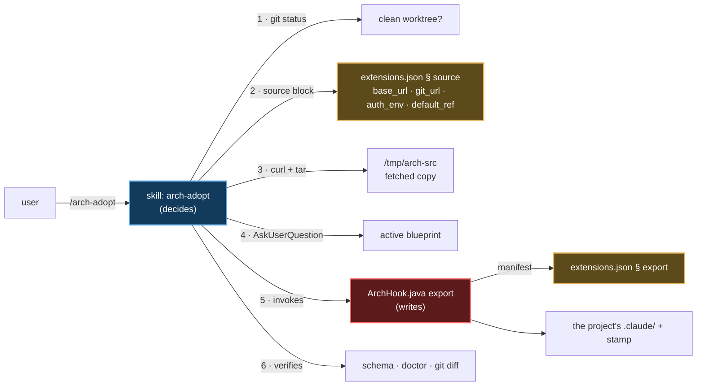

# `/arch-adopt` — installing and updating `.claude/` in an existing project

Primary source: `.claude/skills/arch-adopt/SKILL.md`, `.claude/hooks/ArchHook.java`
(`export` mode), the `source` and `export` blocks of `.claude/schemas/extensions.json`.
Record: `@.claude/decisions/0054-deterministic-export-provenance-plugin.md`.

## What it does

Pulls this architecture into the project the session is rooted at. One operation, two
starting states:

| Starting state | What happens | How the skill knows |
|---|---|---|
| Project never generated by `/init-project`, no `.claude/` of this shape | **Install** | no `.claude/.arch-provenance.json` |
| Project already has this `.claude/` and is behind | **Update** | the stamp exists and names an earlier ref |

Not two commands. The difference is the provenance stamp; the rest of the procedure is the
same.

It is the only creation skill that **travels** into the generated project.
`/init-project`, `project-bootstrap` and `/claude-code-architect-designer` stay out
(`export.skills.exclude`) because they only serve before the project exists. This one stays
because it is how a project updates itself afterwards — including when the plugin that
delivered it is no longer installed on the machine of whoever cloned it.

## The division of labour, and why it exists



**The skill writes one file by itself.** It answers three questions a deterministic mode
cannot — which source, which blueprint, and whether it is safe to write — and then gets
out of the way. Almost every byte is written by the `export` mode, from a manifest of
data; the exception is the project's bounded context (step 8): when the root `CLAUDE.md`
has no `Bounded context:` line, the skill asks once — the first segment of the existing
topics, or the build file's `artifactId` when there are none — and writes the line with the
text of the fetched `root.CLAUDE.md.example`. The skill's territory now includes that file.

**A convention change reaches existing code as a prompt, never as an edit.** When the
norms change in a way that leaves code generated before behind — use cases grouped by
aggregate, decision 0104 — the change ships as an entry in the `migrations` block of
`extensions.json`. On an update, step 9 shows every entry the project has not seen yet and
that applies to its blueprint: a note and a prompt to paste into Claude Code in the
project. The skill never runs it. The project's own copy of `extensions.json` is the
record of what it was shown, so a project generated after an entry never sees it.

That split replaced the previous model, where the copy tables lived as prose inside
`project-bootstrap/SKILL.md` §§ 6.6–6.8: a markdown table is copied by a model, row by
row, and the row it forgets breaks nothing at generation time — it breaks for whoever
clones the project later and follows a citation to a file that was never copied.

## The procedure's three guarantees

1. **Refuses a dirty worktree.** Not a git repository, or `git status --porcelain` came
   back non-empty → stop. An update overwrites: `git diff` is how the person reviews it and
   `git checkout` is how they undo it. Without a clean tree neither works. The skill says
   what to run and does **not** commit for them.
2. **None of the four `source` values written from memory.** `base_url`, `git_url`,
   `auth_env` and `default_ref` are data — that is the whole reason they sit in a block.
   Moving from GitHub to a licensing endpoint changes two fields, never the code path that
   consumes them. `auth_env` names an environment variable and never carries its value
   (invariant 11); the header is sent only when the variable is set, so a public repository
   needs no credential.
3. **Provenance is written, not promised.** The `.claude/.arch-provenance.json` stamp
   records ref, sha, blueprint, and the hash of every file written. `/arch-doctor`'s
   `Provenance` line compares those hashes against disk and **names the locally edited
   files before** the next update overwrites them. In a project that already has a stamp,
   run `/arch-doctor` first and put that list in front of the user.

## What travels, and what does not

All of it is the `export` block of `@.claude/schemas/extensions.json` — data, not prose:

| Group | Contents |
|---|---|
| `copy` | `ArchHook.java`, `extensions.json` |
| `binary_copy` | `ArchHook.jar` — what every hook launches, copied as bytes, never transformed |
| `overwrite` | the project's `settings.json`, from `project-bootstrap`'s template |
| `optional_copy` | `.mcp.json` and the MCP setup doc, when they exist |
| `rules` | every norm in `rules/`, with its `paths` globs rewritten for the active blueprint's packages (`derived_paths`) |
| `skills` | the 20 skills of `include`; the 4 of `exclude` stay out — the 2 creation skills (`init-project`, `project-bootstrap`) and the 2 that work on this repository itself (`claude-code-architect-designer`, `triage-issue`) |
| `agents` | `java-spring-boot-developer`, `archunit-installer`, `commons-logging-installer`, `compose-service-installer`; `project-initializer` and `issue-verifier` stay out |
| `blueprint_copy` | **only the active blueprint**, never the catalog |
| `ensure_dirs` | `.claude/audit-usage/` — creating the directory is what switches the trail on |
| `gitignore_lines` | `.claude/audit-usage/.state/` and `docs/lessons-learned/` |
| `body_transforms` | cuts citations to `.claude/decisions/` (which do not exist inside a project); blueprint citations are left as written — the active blueprint travels with the project (`blueprint_copy`) |
| `retired` | files this repository renamed or dropped (a rule, the old `java-patterns/` skill), deleted from the target when present — `export` only ever wrote, so without it an adopted project kept both copies. It also deletes the trail's `pricing.json`, which nothing reads since decision 0134 |

Two decisions in that manifest that look like inconsistencies and are not:

- **The active blueprint travels; the catalog does not.** Without it, the YAML defining the
  project's architecture would live only in the fetched temporary directory: the stamp
  records the id, the next update reads that id, the source does not have it, and the export
  fails at a point where nobody was ever told to keep a file.
- **`.claude/audit-usage/` is versioned; `docs/lessons-learned/` is not.** The reports
  belong to the commit of the run that produced them. Lessons-learned notes are local, and a
  run that recreates a deleted one writes different text nobody compares.

`ArchHook.java schema` checks that manifest against disk: every skill and every agent must
be in `include` **or** in `exclude` — not listing one is the bug, and the mode fails by
name. A norm with a package territory needs a `derived_paths` entry, or the glob copied
verbatim leaves the rule unloaded, silently.

## Invocation and output (fictional example)

```
/arch-adopt --ref latest-tag --blueprint hexagonal
```

```
✅ updated — blueprint hexagonal, ref v0.9.3 (a1b2c3d)

Source ....... codeload.github.com, fetched at 14:22
Files ........ 136 written · 118 unchanged · 4 overwritten
Warnings ..... none
Schema ....... exit 0
Provenance ... ⚠️ 2 files edited locally since the stamp:
               .claude/rules/persistence.md
               .claude/settings.json
Bounded ctx .. already declared
Migrations ... 1 below, to paste when you choose

Review: git diff · Undo: git checkout -- .claude
Next: /arch-doctor for the full diagnosis
```

Use cases are now grouped in one subpackage per aggregate: … (the entry's `note`)

```text
Move this project's use cases into one subpackage per aggregate, … (the entry's `prompt`)
```

`--source <local path>` bypasses the `source` block entirely and uses a tree on the
machine — that is how an unreleased change is tested.

## The `export` mode by hand

The mode is directly invocable, and it is what the skill calls:

```bash
java .claude/hooks/ArchHook.java export <dest> --blueprint <id> [--ref <label>] [--commit <sha>] [--dry-run]
```

`--dry-run` lists what it would write and writes nothing. `--commit` is the source commit the
stamp records — the skill resolves it with `git ls-remote`, peeling an annotated tag, since the
extracted tarball carries no repository. Without it the stamp takes the source's own HEAD, but
only when the source is the top of its own work tree, and `unknown` otherwise — never the HEAD
of a repository it happens to sit inside (decision 0141). `Overwrites` names a file only when
it already exists in the destination and changes. Running it twice into the same
destination produces byte-identical trees outside the stamp — determinism verified across
the 9 official blueprints on every change to the manifest.

## A project not generated here: what blocks and what does not

`arch-adopt` does not assess the project's code. It only decides whether it is safe to
write into `.claude/`. So there are two kinds of outcome, and they should not be confused:

- **`arch-adopt` stops** — nothing (or almost nothing) is written, and the person fixes
  it before trying again.
- **`arch-adopt` finishes, and `/arch-doctor` points it out** — what it finds becomes a
  report line, and only the lines of `doctor.gate.labels` fail CI (see
  [04-arch-doctor.md § What blocks CI](04-arch-doctor.md#what-blocks-ci-and-what-does-not)).

### What makes `arch-adopt` stop

| Situation | Step | Effect |
|---|---|---|
| Not a git repository, or `git status --porcelain` was not empty | 1 | stops; nothing written |
| Fetch without credentials, or an HTTP error | 3 | stops; `--fail` turns the 404 into an error rather than a broken tarball |
| Spring Boot **below** `doctor.platform.min_line` (today `4.0`) | 5 | `export` exits 2 before writing a byte; there is no `--force`. The way up is `/platform-upgrade` (below) |
| `schema` does not exit 0 after the export | 6 | the files are already written; the report shows the failure **first** and steps 7 to 9 do not run |

**The way up is `/platform-upgrade`.** Inside the same project, it takes the build to the line the
Initializr serves today — the version bump, the renamed starters and test slices, the renamed
configuration properties — through a recipe that `ArchHook.jar upgrade-recipe` writes from
`doctor.platform.upgrade` and from the jars' own metadata, run by the Apache-2.0 OpenRewrite core
through the project's Maven or Gradle wrapper. A guided pass then fixes what no rename covers until
the build is green. It refuses a dirty worktree, never commits, and ends by printing `/arch-adopt`.
The plugin delivers it next to `arch-adopt`; an adopted project keeps it for the next floor.

The version floor is only a floor: **there is no ceiling**. Spring Boot 5.x passes, and
the norms and exemplars written for the 4 line may diverge from it with no warning from
`arch-adopt`. A build that hides its version (corporate parent, external BOM) passes too,
because no `line_patterns` entry reads it.

### What does not make it stop

| Scenario | What `arch-adopt` does | `/arch-doctor` afterwards | Blocks CI? |
|---|---|---|---|
| Spring Boot 5.x | installs normally | `Platform` ✅ | no |
| Unreadable Boot version | installs normally | `Platform` ⚪ | no |
| Architecture outside every blueprint, no DDD | step 4: no blueprint matches, so it offers the existing ones and `custom.template.yaml`, stating the cost. Nearly matching is the dangerous case: it names the packages that differ before anything else. `src/` stays untouched | `Boundaries` ❌ until `boundary-map` runs; then `Boundary violations` ❌ listing `file → prefix` | **yes**, both |
| No tests at all | nothing: step 6 only runs `schema` and `doctor`. `test-architect` is not chained | no line looks at `src/test` | no |
| Already has its own `.claude/` | overwrites what has the **same path** as the manifest; what has another name survives. `settings.json` is overwritten **whole**, with no merge: the project's hooks and `permissions` disappear and show up in `git diff` | `Hooks` reflects only Nerviz's hooks. `Schema` ❌ if an own skill or agent has invalid frontmatter or no class in `skill_classes` / `agent_classes` | `Schema`, `Hooks` and `MCP`: **yes**. `Skill shadowing`: no |

Two details on the last case:

- `--dry-run` first. With files already at those paths, it is what shows the `Overwrites`
  list before any byte is written.
- With no `.arch-provenance.json` but a `.claude/rules/00-index.md`, the skill treats the
  project as "adopted before the stamp": it shows the blueprint `00-index.md` cites and
  asks for a single confirmation, instead of running the detection again.

### Validation script

Each fixture is a git repository with one commit. The base is a hexagonal project on Boot
4.0 with tests and a wrapper; adjust the package names to the real `packages.map`
(`ls .claude/blueprints/*/`).

```
f0-control/
├── pom.xml                      # spring-boot-starter-parent 4.0.x
├── mvnw, mvnw.cmd, .mvn/
├── CLAUDE.md                    # no "Bounded context" or "**Transport:"
└── src/
    ├── main/java/com/acme/orders/
    │   ├── domain/model/Order.java
    │   ├── application/port/in/CreateOrderUseCase.java
    │   ├── application/port/out/OrderRepository.java
    │   ├── application/service/CreateOrderService.java
    │   ├── adapter/in/web/OrderController.java
    │   └── adapter/out/persistence/OrderJpaAdapter.java
    └── test/java/com/acme/orders/CreateOrderServiceTest.java
```

| Fixture | Difference from the base | Expected result |
|---|---|---|
| F1a | parent `3.5.x`; F1d: `spring-boot = "3.5.1"` in `libs.versions.toml` | `export` exits 2, `git status --short` empty, no `.claude/` |
| F1b | parent `5.0.x` | installs; `Platform` ✅ |
| F1c | parent `com.acme:acme-parent` with no Boot version | installs; `Platform` ⚪ |
| F2 | packages `controller/ service/ repository/ model/ util/`, no `src/test/` | step 4 finds no blueprint; `src/` untouched |
| F2b | `application/usecase/` in place of `application/service/` | near-match warning naming both packages |
| F3 | no `src/test/` | same as the base |
| F4 | `.claude/settings.json` with its own hook, `rules/00-index.md`, a skill named like a Nerviz one, one with broken frontmatter, its own `.mcp.json` | `--dry-run` lists the `Overwrites`; `schema` fails on the broken skill; the own hook vanishes in `git diff` |
| F5a | no `git init` | step 1 stops |
| F5b | a modified, uncommitted file | step 1 stops |
| F5c | the base already adopted, run again | update: the blueprint comes from the stamp, without asking |
| F6 | F2 + F3 + F4 together | `Boundaries` ❌, `Schema` ❌, `Setup incomplete` footer, `src/` untouched |

For every fixture:

```bash
# in the project: /arch-adopt --source <path to nerviz>
java .claude/hooks/ArchHook.java schema </dev/null
java .claude/hooks/ArchHook.java doctor
java .claude/hooks/ArchHook.java doctor gate; echo "exit=$?"
git diff --stat -- src          # must stay empty
git log --oneline | head -1     # arch-adopt does not commit
```

Undo: `git checkout -- .claude && git clean -fd .claude`.

## What this command does not do

- **Doesn't generate a project.** With no `pom.xml`/`build.gradle`, `/init-project` is what
  you want.
- **Doesn't write business code**, and never touches `src/`.
- **Doesn't write outside `.claude/` itself — with one exception.** The bounded-context line
  of the root `CLAUDE.md`, in step 8. Beyond that, when the build file has no SonarQube
  scanner, step 7 chains `sonarqube-setup`, which writes the build file and the workflow
  under its own territory; when the root `CLAUDE.md` has no `**Transport:` paragraph,
  step 7.5 chains `transport-security-setup` the same way, under its own territory. On an
  install, run `/reload-skills` first for either — the skill's directory did not exist when
  the session started.
- **Doesn't commit.** It leaves the tree with the diff ready for review, and says how to
  undo it.
- **Doesn't ask for a blueprint when the stamp already records one** — on an update, the
  active blueprint is a fact of the project, not a fresh question.
