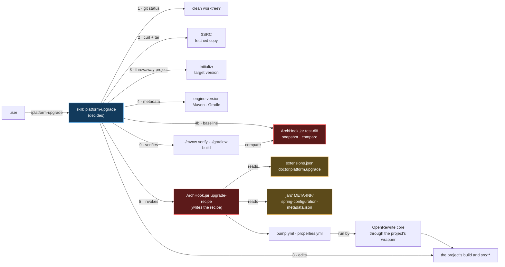

# `/platform-upgrade` — taking a project up to the Spring Boot floor

Primary source: `.claude/skills/platform-upgrade/SKILL.md`, `.claude/hooks/ArchHook.java`
(`upgrade-recipe` and `test-diff` modes), the `doctor.platform` block of `.claude/schemas/extensions.json`.
Records: `@.claude/decisions/0175-platform-upgrade-below-the-floor.md`,
`@.claude/decisions/0176-platform-upgrade-baseline-context-and-runtime-starters.md`.

## What it does

`export` refuses a project whose build declares a Spring Boot line below
`doctor.platform.min_line` (`@.claude/decisions/0161-spring-boot-3-5-line-for-adopted-projects.md`), and so does
`/arch-adopt`, which writes through it. Until this skill, nothing led a project from that line to
the floor: the refusal named the problem and stopped.

`/platform-upgrade` is the way up. Run from inside the project, it moves the build from the line it
declares to the one the Initializr serves today, and leaves the build green and the diff
**uncommitted**:

| It changes | Through |
|---|---|
| The Spring Boot version in the build | the recipe's pass 1 |
| Renamed starters and Testcontainers artifacts | pass 1, from `renames.dependencies` |
| Renamed types — test slices, `@MockBean` and `@SpyBean`, customizers | pass 1, from `renames.types` |
| A starter the sources now need — `@EnableCaching` needs `spring-boot-starter-cache` | pass 1, from `requires_starter`, added with no version |
| The version an old coordinate carried, left on its renamed or added successor | pass 1, removed: the Boot BOM manages them all |
| BOMs and libraries that carry their own version — a Spring Cloud train, Modulith, springdoc | pass 1, from the metadata the Initializr serves for the target |
| A Gradle wrapper older than the new Boot plugin accepts | step 5b, from the plugin's own refusal |
| Renamed configuration properties | pass 2, from the jars' own metadata |
| What no rename covers — a test starter, Jackson 3 code, an API that changed shape | the guided residue, by the model, one compile error at a time |

It ends by printing `/arch-adopt`, for the person to type once the diff is reviewed.

Manual only (`disable-model-invocation: true`): it rewrites a person's build and sources, so it
runs when they ask for it by name. It travels into a generated project (`export.skills.include`),
because a later floor raise sends an adopted project back here and the plugin that delivered the
skill may be gone by then. The plugin delivers it with `arch-adopt`, as `/nerviz:platform-upgrade`.

## Two engines, in this order



**What is mechanical is a recipe.** `ArchHook.jar upgrade-recipe` writes an OpenRewrite recipe from
data, and the same input gives the same recipe — that is why it is a mode of the hook (Form 7c) and
not prose a model re-derives each run. The OpenRewrite core runs it through the project's own
Maven or Gradle wrapper. The skill never assumes a Maven or a Gradle on `PATH`, and never adds a
wrapper.

**What is not mechanical is the guided residue.** The model reads the first compile errors, fixes
the cause against the norms and the vendor's migration guide, and compiles again. Two rules hold
with no exception: a test that fails is reported, never deleted, skipped or loosened; and the same
error three times in a row stops the loop and asks.

**What was red before is the baseline's to say.** Step 4b runs the tests on the tree as the person left
it; step 9 runs them again, and `ArchHook.jar test-diff` sorts every case — a regression, a test that
vanished, a failure the baseline never saw, a failure that was already there, a fix. Only the first
three exit 2. A red build that was red before is reported as that.

### The two passes

The recipe is written in two passes because the second one needs a classpath that only exists after
the first.

| Pass | Command | Writes | Why here |
|---|---|---|---|
| `bump` | `upgrade-recipe . --pass bump --target <x.y.z> --initializr <file> --out <file>` | the version bump; with the Initializr's metadata, a bump per BOM and per versioned library it lists; one coordinate rename per `renames.dependencies` entry; the starter of each `requires_starter` entry, added with no version where its type is used; one type rename per `renames.types` entry; last, the removal of the version a renamed or added coordinate carried | The recipe runs against the classpath the project **still has**. An old type stops resolving once the new BOM is in, so the type renames sit here, before it. The version removal is a text edit and goes last: a build file it changed is plain text to every step after it, which is how a Spring Cloud BOM once stayed on the old line |
| `properties` | `upgrade-recipe . --pass properties --classpath <file> --out <file>` | one rename per property a jar itself declares as `deprecation.level == "error"` with a `replacement` | The new jars carry their own renames as data, so no property table is kept by hand. Runs **without compiling**: after pass 1 the tests do not compile until their starter is added |

`upgrade-recipe` exits 2 and writes nothing for a malformed target, a target below the floor, a
project already at the floor (pass 1), a missing `recipes` block, or a data entry it cannot spell.
It exits 0 and writes nothing when no jar declares a property rename; the skill then skips the run.
`CLAUDE_PROJECT_DIR` names the source that holds the data, since a project below the floor has no
data of its own.

## What the skill does, step by step

| # | Step | What it guarantees |
|---|---|---|
| 1 | Refuse a dirty worktree; find the build tool and its wrapper | `git diff` is how the person reviews the upgrade and `git checkout -- .` how they undo it. No wrapper → stop |
| 2 | Fetch the source into `$SRC`, as `arch-adopt` § 2-3 does; `grep` the mode | A project below the floor has no `ArchHook.jar` of this shape. A ref that predates the skill has no mode, and an unknown mode exits 0 — it would read as success |
| 3 | Resolve the target from a throwaway project the Initializr generates, and download its `dependencies` metadata | Invariant 8: a version is never written from memory. No network → stop and ask. The metadata must be for the same Boot version, or `upgrade-recipe` refuses it |
| 4 | Resolve the engine's version from the repository that serves it | See the trap below. Every fetch follows redirects (`curl -sS --fail -L`) |
| 4b | The baseline: `clean verify` / `clean build --continue` on the untouched tree, then `test-diff snapshot` | Step 9 can tell what the upgrade broke from what was already broken. No report → no baseline, said in the report |
| 5 | Pass 1 | The bump, BOMs, coordinates, starters and types. `git diff --stat` must show the build file changed; a renamed or added coordinate carries no version; each BOM reads the Initializr's version |
| 5b | Gradle only: ask the build, `./gradlew -q help` | The new Boot plugin may refuse the wrapper's Gradle, and `./gradlew wrapper` is refused the same way. The lowest accepted major, its newest final release, in `gradle-wrapper.properties`; then `./gradlew wrapper` refreshes the scripts |
| 6 | List the new classpath | Maven `dependency:build-classpath`; Gradle an init script from `templates/` |
| 7 | Pass 2, without compiling | Only what a jar itself declares an error with a replacement |
| 8 | The guided residue | Compile, read, fix the cause, compile again |
| 8b | The context loads | The `@SpringBootTest` classes, first and on their own: a starter that moved out of the auto-configuration, or a property no jar reads any more, compile and fail only when the context is built. None → `Not verified: context load`; the skill writes no test |
| 9 | Verify | `clean verify` / `clean build`, then `test-diff compare`: green, no worse than the baseline, or the regressions are the report |
| 10 | Hand the diff over | `git status --short`, `git diff --stat`, no commit, print `/arch-adopt` |

Everything the procedure downloads or writes outside the project goes in one directory, `$WORK`.

### Where the data lives

The renames are data, owned by `doctor.platform.upgrade` in `@.claude/schemas/extensions.json`
(invariants 2 and 10). A rename missing from a project's upgrade is a missing entry there, never a
second list elsewhere.

| Key | Holds |
|---|---|
| `recipes` | the recipe names and what each kind of entry becomes — `{type, options}` templates with `${...}` placeholders. The engine is data |
| `renames.dependencies` | starter and artifact renames: `starter-web` → `starter-webmvc`, `starter-aop` → `starter-aspectj`, `flyway-core` and `liquibase-core` → their starters, the `org.testcontainers:*` artifacts |
| `renames.types` | type renames: the test slices and their auto-configure annotations, `@MockBean` → `@MockitoBean`, `@SpyBean` → `@MockitoSpyBean`, customizers, the Testcontainers module classes |
| `test_starters` | package → test-scope starter. A compile error that names a slice's package is cured by the starter its key maps to |
| `requires_starter` | type → starter. On the floor the auto-configuration that acts on a type moved into a module of its own, so a source that uses the type compiles and the context fails to start |
| `test_reports` | the globs `test-diff` reads JUnit XML from: Surefire, Failsafe, Gradle |
| `engine` | where the engine's versions are listed, the Initializr endpoints, where Gradle lists its releases, the migration guide, and how many Gradle plugin versions to try |

Every `to` of `renames` is a name an exemplar this repository compiles in CI already uses, or a
published artifact. Every `from` was found in the jar of the line it leaves. A wrong `from` renames
nothing; a wrong `to` breaks a build, so only the second is checked against a published artifact.

### The engine's public line, and a trap it set

The engine is the OpenRewrite core, Apache 2.0, run through the project's wrapper. The
`rewrite-spring` module is never used: it holds the ready-made Spring Boot recipes, but under a
source-available license that forbids a product whose value derives from it. The entries here were
written from Spring's migration guide and from the metadata Spring's own jars publish.

Maven Central serves the core's BOM only up to a version the newest Gradle plugin has already moved
past, so the newest plugin fails with `Could not find org.openrewrite:rewrite-bom`. Maven has no such
gap: its plugin lives on Central and its `<release>` is coherent with it. The skill therefore takes,
for Gradle, the newest plugin whose BOM Maven Central answers 200 for, among the last
`engine.gradle_candidates` entries. None → it stops, and `engine` is the block to edit when the
public line moves.

## What it does not do

- **Commit.** The diff is the person's to review.
- **Write `.claude/`.** That is `/arch-adopt`'s, which the skill hands over to.
- **Rename Jackson 3 code.** An annotation stayed, a package moved and an exception became
  unchecked: a decision per site, not a rename. It stays in the guided residue, against the
  Jackson section of the vendor's migration guide (`engine.migration_guide`). The architecture
  test's allowlist says which roots the domain may import, not how to migrate.
- **Reach a rename no exemplar names.** `renames` holds what this repository's exemplars use; a
  moved package none of them touches is the residue's.
- **Edit around a build that hides its version.** A Spring Boot version in a parent POM that is not
  the project's, or in a version catalog, is not read by the recipe: the skill names the file and
  asks the person to change that one line.
- **Run on a project already at or above the floor.** It says so and stops.

## Write territory

Class `build`, with an override in `skill_classes` of `extensions.json`: the root build file, the
wrapper files and `src/**`, at the project root and under any module. `ArchHook.java guard`
enforces it. `.claude/**` is outside it.

## What CI proves

| Job | What it proves |
|---|---|
| `validate › hooks-cross-platform › upgrade-recipe writes the bump and the property renames, and refuses what it cannot spell` | `UpgradeRecipeTest`: the bump carries the target and one step per rename of the production data; each refusal exits 2 with nothing written; the property pass over fixture jars skips a warning, an entry with no replacement and a jar with no metadata |
| `validate › hooks-cross-platform › test-diff separates what the upgrade broke from what was already broken` | `TestDiffTest`: a regression, a vanished test and a new failure each exit 2 alone; a failure already there, a fix and a skip exit 0; no report, a foreign baseline, a report that is not XML or carries a DOCTYPE exit 2 |
| `templates › platform-upgrade` | `PlatformUpgradeTest`, with network: on Maven and on Gradle, a fixture on the newest GA line below the floor goes through the skill's procedure and builds green on the Initializr's line — the context loads with the cache and Flyway starters, a Spring Cloud BOM moves, a pinned starter loses its pin, an old Gradle wrapper is fixed, and no test is worse than before |
| `validate › design › schema` | the skill's class, sections, territory and `export` entry |
| `validate › export-determinism` | the skill and the mode travel the same on every OS |

Not proven, on purpose: a scheduled run of the engine job, so a drift in the engine's public line
shows at the next PR that touches its paths; the Gradle Kotlin DSL and multi-module Gradle builds;
and how often a rename is missing from the data. The record's *CI coverage* section lists them.

## Run it

```text
/platform-upgrade [--ref <tag|sha|main>] [--source <local path>]
```

A clean worktree, a JDK the build accepts, a wrapper at the project root and network access to the
Initializr and the engine's repositories. It ends with the report:

```text
✅ upgraded — <from line> → <target>, <Maven | Gradle>

Source ....... <host>, ref <ref>
Engine ....... <engine artifact> <version>
Baseline ..... <n> test cases, <n> failing before | none — the tree ran no tests
Pass 1 ....... <n> files changed (<n> sources, <n> build)
BOMs ......... <n> moved by the recipe, <n> by hand | not moved — no Initializr metadata
Wrapper ...... <unchanged | Gradle <from> → <to>> (Gradle only)
Pass 2 ....... <n> property renames applied | none declared by the jars
Residue ...... <n> edits by hand — <one line each>
Context ...... <n> @SpringBootTest classes green | Not verified: context load
Verify ....... <green | no worse than the baseline: <n> pre-existing | the regressions, verbatim first line>
Not verified . <what no step above ran — one line each | none>

Review: git diff · Undo: git checkout -- .
Next: /arch-adopt
```

Then `/arch-adopt` installs this `.claude/` into the upgraded project; see
[10-arch-adopt.md](10-arch-adopt.md).
