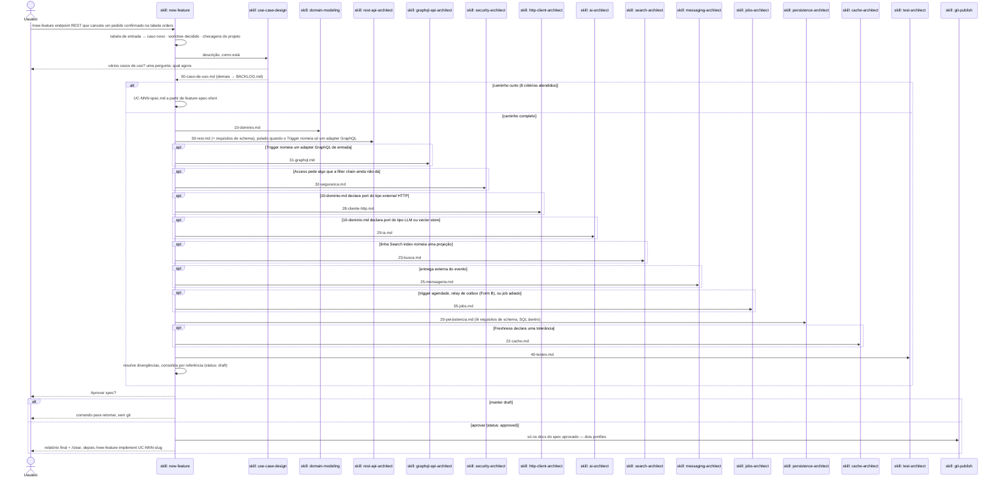
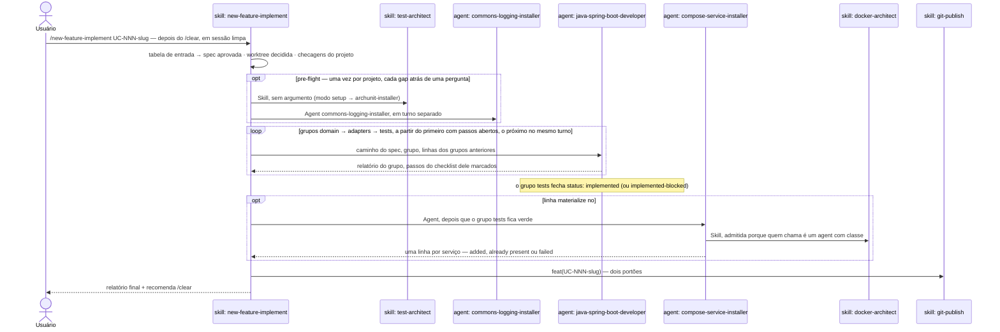

# `/new-feature` — desenhar uma spec, depois implementá-la

Fonte primária: `.claude/skills/new-feature/SKILL.md`,
`.claude/agents/java-spring-boot-developer.md`, as skills de design (`use-case-design`,
`domain-modeling`, `rest-api-architect`, `graphql-api-architect`, `security-architect`, `http-client-architect`,
`messaging-architect`, `jobs-architect`, `persistence-architect`, `cache-architect`,
`ai-architect`, `search-architect`, `test-architect`) e o modo
`guard` de `.claude/hooks/ArchHook.java`.

## O que faz

Desenha **um caso de uso por execução** e o consolida num único `UC-NNN-spec.md` —
pronto para o agent executor implementar depois que o usuário aprovar. **Este comando só
existe dentro de um projeto já gerado** por `/init-project`: lê `pom.xml`,
`.claude/forbidden-imports.txt` e descobre o package de domínio no projeto real.

**Dois fluxos, um comando — o argumento decide qual, e os dois nunca dividem uma sessão.**

| Fluxo | Comando | Termina com |
|---|---|---|
| 1 · Criar a spec | `/new-feature <descrição>` (ou `UC-NNN-slug` de um draft para retomar) | a spec aprovada e commitada pelo `git-publish`, e os dois comandos a digitar em seguida: `/clear` · `/new-feature-implement UC-NNN-slug` |
| 2 · Implementar a spec | `/new-feature-implement UC-NNN-slug` sobre uma spec `approved`, depois do `/clear` | o pre-flight, depois o `java-spring-boot-developer` em três grupos encadeados — `domain` (blocos 1–2) → `adapters` (H, 3, S, M, J) → `tests` (bloco 4) —, `status: implemented` e o commit da feature |

O design deixa a thread principal com 250–370k tokens de contexto; implementar em cima dele
pagaria isso a cada hand-back e no `git-publish`. Cada grupo do executor recomeça da spec e do
disco em vez de carregar os blocos anteriores
(`.claude/decisions/0130-executor-split-by-block-group-implement-in-clean-session.md`).
Desde a decisão 0135, o fluxo de implementação é uma skill própria, a `new-feature-implement`:
roda em `sonnet`, não escreve nada por conta própria e nunca carrega o procedimento de design
(`.claude/decisions/0135-new-feature-split-spec-and-implement.md`).

Estas fronteiras valem em toda execução, e nenhuma delas é prosa — o hook `guard`
bloqueia com `exit 2`, `permissions.ask` pergunta, ou a consolidação para:

- **Um run escreve só em `docs/`.** Território é allowlist, deny por default: cada skill
  do pipeline só escreve o `write_allow` da classe dela (`skill_classes` em
  `.claude/schemas/extensions.json`). O SQL da migration fica dentro de
  `20-persistencia.md`; todo arquivo em `src/` vem do executor.
- **Um run de design não materializa arquivo nenhum fora de `docs/`.** O `guard` recusa a
  própria *chamada* a uma skill de classe `build` — `docker-architect` incluída — enquanto
  o run está aberto. Serviço de compose que falta é **registrado** na parcial, com o
  comando que o cria.
- **Git só via `git-publish`**, atrás das duas confirmações — em todo fim de fluxo,
  inclusive o sem executor. `git push` é sempre `ask`.
- **Spec aprovado é imutável.** Um caso posterior registra a mudança necessária na
  própria seção `## Impact on approved use cases`, e uma linha no `CHANGELOG.md` da pasta
  de cada caso alterado. O `guard` congela os arquivos — e libera exatamente esse
  `CHANGELOG.md`, então o log que a pasta congelada deve receber é a única escrita que ela
  ainda aceita (`guard.frozen_exempt_basenames`), além do fechamento do `status:` da própria
  spec e dos toggles do checklist.
- **Uma impact row que adiciona precondição nomeia quem a satisfaz.** Coluna
  `Satisfied by`: um `UC-NNN` aprovado, o próprio caso, ou um caso do backlog **nomeado** —
  e nesse último caso a spec e o relatório final dizem que o caso anterior fica inalcançável
  ponta a ponta até o outro entrar. Sem satisfator, a consolidação para. Fixture que fabrica
  o estado não conta como satisfator.
- **O relatório final carrega quatro achados que ninguém deve ter de reconstruir:** caso
  aprovado que este run deixou inalcançável, todo item que uma parcial adiou com o dono a quem
  o deixou, garantia de dedupe delegada a consumidor externo sem contrato, e dado pessoal que
  cruza fronteira em claro com seu destinatário.
- **Design patterns são decididos no desenho, não pelo executor.** Toda parcial de design
  carrega uma seção `## Design patterns` — `none` quando nada se aplica, e a ausência para a
  consolidação — nomeando a linha da spec ou o `file:line` que força cada padrão e as classes
  que ele cria.

## Por que é uma skill manual, não um agent

`new-feature/SKILL.md` documenta a própria decisão: eixo 2 (disparo manual) + eixo 5
(procedural) + eixo 8 (ambos). A forma "agent" foi rejeitada — nenhum dos três motivos
válidos se aplica (contexto, tools, model). `disable-model-invocation: true` impede o
modelo de chamá-la: o usuário digita o comando.

## Entrada — tabela fechada

O argumento é classificado por comando (`grep -E`, `test -d`, `grep '^status:'`), nunca
interpretado. Vale a primeira linha que casar; qualquer outra coisa é erro.

| Entrada | Resultado |
|---|---|
| vazia | lista os casos de uso com o `status` de cada um |
| `UC-NNN-slug`, pasta existe, spec `draft` ou ausente | retoma: só os partials que faltam, depois consolidação |
| `UC-NNN-slug`, spec `approved` | ❌ aprovada — imprime `/clear` + `/new-feature-implement UC-NNN-slug` |
| `UC-NNN-slug`, spec `implemented` ou `implemented-blocked` | ❌ já implementado — descreva a mudança como feature nova |
| pasta não existe, mas o `UC-NNN` do argumento tem exatamente uma pasta no disco | ❌ informa o slug real e o status, mais o comando exato — o caso existe, o argumento nomeou errado |
| `UC-NNN-slug`, pasta não existe, número casando com zero ou várias | ❌ não encontrado — descreva a feature para criar |
| contém `UC-` + dígito mas não é exato | ❌ argumento ambíguo |
| texto livre, algum caso ainda aberto | ❌ retome ou aprove antes |
| texto livre, nenhum caso aberto | caso novo — o texto vai como está para `use-case-design` |

Erro imprime o motivo e o uso, e encerra: nenhum efeito colateral depois dele — nenhuma
chamada de skill, escrita ou pergunta. Leitura continua permitida, e é o que deixa um
quase-acerto responder com o slug real em vez de "não encontrado".

## Diagrama de sequência

Os dois fluxos abaixo são duas execuções, com `/clear` entre elas.

### Fluxo 1 — criar a spec: `/new-feature <descrição>`

### Fluxo 2 — implementar a spec: `/new-feature-implement UC-NNN-slug` sobre uma spec aprovada

## Peças e o que cada uma escreve

| Ordem | Skill/Agent | Depende de | Arquivo que produz |
|---|---|---|---|
| 1 | `use-case-design` | — | `00-caso-de-uso.md`, entradas em `BACKLOG.md` — dona de número e slug. A linha `Storage` registra, por agregado, `relational` ou `document (MongoDB)`, e a linha `Search index` nomeia uma projeção de busca ou `none`; as duas vêm do pedido, ou de uma única pergunta factual ("SQL ou NoSQL?") — nunca são ponderadas, essa decisão é de uma skill de solution-design planejada |
| 2 | `domain-modeling` | 1 | `10-dominio.md` — dona dos nomes de exceção |
| 3 | `rest-api-architect` | 1, 2 | `30-rest.md` — inclusive os requisitos de schema que o transporte cria; pulado quando o `Trigger` nomeia só um adapter GraphQL de entrada |
| opcional | `graphql-api-architect` | 1, 2, e 3 quando existe, quando a linha `Trigger` de `00-caso-de-uso.md` termina em `inbound GraphQL adapter` ou `inbound REST and GraphQL adapters` (o passo 3 é pulado quando ela nomeia só o adapter GraphQL) | `31-graphql.md` — root fields e o input port que cada um chama, tipos e nullability, inputs e payloads de mutation com `userErrors`, connections com teto de página, campos filhos com `@BatchMapping` e os ports de batch que eles pedem, o mapa de erros, acesso por campo, dado pessoal por campo de saída e, no primeiro caso GraphQL do projeto, os limites de demanda e o setup. O bloco da spec é `## 4.1 GraphQL`, implementado pelo Block G (G1-G3) do executor, logo depois do Block 3 e antes do Block S. O protocolo em si é escolhido por `use-case-design` com os critérios de `.claude/rules/api-graphql.md` § Choosing the inbound protocol |
| opcional | `security-architect` | 1, 2, 3, e a linha `Access` de `00-caso-de-uso.md` | `32-seguranca.md` — mecanismo, acesso por endpoint, lista de `permitAll`, ownership, 401/403, exposição de CORS/Actuator/OpenAPI |
| opcional | `http-client-architect` | 2, quando `10-dominio.md` declara um port do tipo `external HTTP` | `28-cliente-http.md` — client e engine, timeouts, camada de retry e resiliência, autenticação de saída, a tabela de falhas de integração por operação, dependências declaradas e os casos de teste com WireMock |
| opcional | `ai-architect` | 2, quando `10-dominio.md` declara um port do tipo `LLM` ou `vector store` | `29-ia.md` — provedor e modelo por port, os prompts como resources em `classpath:/prompts/`, o tipo da resposta com campos fechados e no que vira uma resposta inutilizável, quais campos vão ao provedor, o vector store e quem o reindexa, timeout e a única camada de retry, a tabela de falhas, métricas, a variante de imagem `pgvector` da linha `postgres` do compose. O bloco da spec é `## 3.7 AI`, implementado pelo Block A do executor, logo depois do Block H |
| opcional | `search-architect` | 1, 2, quando a linha `Search index` de `00-caso-de-uso.md` nomeia uma projeção | `23-busca.md` — o documento de busca e seu mapping estrito, o índice versionado atrás de um alias, a consulta e seu cursor, as regras de escrita do indexer com a versão da fonte, o rebuild com a troca do alias, o lag que ela consome de `Freshness`, a tabela de falhas e a linha de compose do engine. O bloco da spec é `## 3.8 Search`, implementado pelo Block I do executor, logo depois do Block A. A versão da fonte e o evento de outbox são de `20-persistencia.md`, o consumer do indexer é de `25-mensageria.md`, o job de rebuild é de `35-jobs.md`; normas em `.claude/rules/search.md` |
| opcional | `messaging-architect` | 2, se houver entrega externa | `25-mensageria.md` |
| opcional | `jobs-architect` | 1 (trigger agendado), Form B da mensageria, uma reconciliação que `28-cliente-http.md` § 10 pede, ou um job adiado | `35-jobs.md` — tecnologia, trigger/cadência, coordenação entre instâncias, overlap/misfire, propriedade de liga-desliga, métricas de job; dona do schedule do relay de outbox e do job de prune |
| 4 | `persistence-architect` | 1, 2, 3, segurança, http-client e mensageria/jobs quando rodaram | `20-persistencia.md` — na família que a linha `Storage` registra (a skill para sem ela): SQL da migration dentro para relacional, ou coleções, índices e validators garantidos no startup, `@Version` e transações em replica set para documento (MongoDB); stamps ou histórico Envers quando a linha `Audit` pede (só stamps no MongoDB); lê `32-seguranca.md` § 7 (tabela de credenciais ou de API key) quando security-architect rodou, `28-cliente-http.md` § 10 (chave de idempotência armazenada ou coluna de resultado desconhecido) quando http-client-architect rodou, e as tabelas de ferramenta de `35-jobs.md` (`shedlock`, `QRTZ_*`, `BATCH_*`) como requisito de schema e a contagem de réplicas para a estratégia de claim do outbox, quando jobs-architect rodou |
| opcional | `cache-architect` | 1, 2, 4, quando a linha `Freshness` de `00-caso-de-uso.md` declara uma tolerância | `22-cache.md` — quais leituras vão para o cache e a chave de cada uma, Caffeine ou Redis, expiração e tamanho por cache ao lado da tolerância, todo escritor que precisa invalidar, falha e carga sem o cache, serialização, métricas, a linha `redis` do compose |
| 5 | `test-architect` | 1–4, e cache, GraphQL, IA e busca quando rodaram | `40-testes.md` — três casos por leitura em cache quando `22-cache.md` existe; o teste de slice do controller, o IT por HTTP e o teste de snapshot do schema quando `31-graphql.md` existe; o teste de contrato do adapter, o IT do provedor e, com um store, o IT do vector store quando `29-ia.md` existe; o IT de MongoDB em replica set para um agregado de documento e o IT do índice de busca quando `23-busca.md` existe |
| — | `new-feature` (consolidação) | todas acima | `UC-NNN-spec.md` |
| 6 | `java-spring-boot-developer` (agent) | spec `approved` | código e migrations em `src/**` |
| 7 | `compose-service-installer` (agent) | código `implemented` e uma linha `materialize` no `## Infrastructure` | o bloco do serviço no `docker-compose.yml`, escrito pelo `docker-architect` |
| — | `git-publish` | fim do fluxo | commit + push, atrás de dois portões |

**Diagramas no spec.** `00-caso-de-uso.md` traz dois. Um `sequenceDiagram` em `## Flow` mostra
quem chama quem no caminho que dá certo, com uma mensagem por passo da lista numerada. Um
`flowchart TD` abaixo da tabela **Out** mostra cada checagem do fluxo e onde ela termina, com um
nó final por situação da tabela. `10-dominio.md` traz um `classDiagram` do agregado e dos
value objects e, quando um campo de estado tem mais de um valor, um `stateDiagram-v2` da
tabela *State reachability*. São blocos Mermaid dentro do markdown, que o GitHub renderiza no
PR. Não existe arquivo `.drawio` nem `.excalidraw`, e nada é instalado. O diagrama só usa nomes
que o texto do mesmo arquivo já define e não acrescenta fato. Quando os dois discordam, vale o
texto (`.claude/rules/spec-diagrams.md`, decisão 0143). O `UC-NNN-spec.md` consolida por
referência e não copia diagrama. Sintaxe e variantes de exemplo ficam em cada skill:
`use-case-design/references/mermaid-use-case-diagrams.md` com `templates/use-case-diagram-variants.md.example`
(port `external HTTP` com seus desfechos, evento, agendamento), e `domain-modeling/references/mermaid-class-and-state.md`
com `templates/domain-diagram-variants.md.example` (entidade filha com multiplicidade, tipo selado,
estados finais).

**Por que REST antes de persistência.** REST gera requisito de schema
(`Idempotency-Key` precisa da tabela compartilhada de chaves); persistência não gera
requisito de REST. Na ordem antiga a tabela era descoberta depois do partial de
persistência escrito, e persistência rodava duas vezes.

`docker-architect` **não** é encadeada pelo run de design, que é docs-only: o modo `guard` do
`ArchHook.java` recusa a chamada enquanto a fase de design está aberta —
`.claude/decisions/0058-skill-classes-territory-schema.md`. O que o run de design faz é perguntar.
Quando `persistence-architect` ou `messaging-architect` detecta que o serviço dele falta no
`docker-compose.yml`, o passo 9 pergunta se adiciona, se roda em outro lugar ou se o usuário
adiciona, e registra a resposta (`materialize`, `external` ou `pending`) no `## Compose services`
da parcial. A consolidação copia essas linhas para o `## Infrastructure` da spec; a ausência
interrompe a consolidação. O `/new-feature-implement` então dispara o `compose-service-installer`
para cada linha `materialize`, depois que o grupo `tests` termina verde e antes do `git-publish`.
O agent roda o `docker-architect` via `Skill` — o guard admite porque a chamada de um agent com
classe é ignorada, enquanto a chamada da própria thread do implement continua recusada — e o
`git-publish` commita a mudança do compose junto com o código. O relatório final lista cada linha
do `## Infrastructure` com o que o run fez com ela
(`.claude/decisions/0137-pending-compose-service-decided-at-design-materialized-at-implement.md`).

**Os design patterns também são decididos nessa fase.** `domain-modeling`,
`persistence-architect`, `rest-api-architect`, `graphql-api-architect`, `security-architect`, `http-client-architect`,
`messaging-architect`, `jobs-architect`, `cache-architect`, `ai-architect` e `search-architect`
leem `gof-design-patterns` § Design-time use — lida, nunca invocada: é uma skill `build` — e
escrevem uma seção `## Design patterns` na própria parcial: a linha da spec ou o `file:line`
que força o padrão, o padrão, as classes e interfaces que ele cria, o "When not" conferido. A
consolidação junta todas as linhas na `## Design patterns` da spec, então as classes que um
padrão cria estão no que o usuário aprova. O executor implementa essas linhas, e adota um
padrão por conta própria só para um sintoma já em disco; o catálogo chega a ele no
`SubagentStart` (`.claude/decisions/0089-design-patterns-decided-at-design-time.md`).

## Pre-flight — infraestrutura instalada uma vez, na primeira execução de implementação

Antes de delegar ao executor, `new-feature-implement` detecta (por comando, não por suposição)
dois gaps que só importam quando o primeiro `.java` vai ser escrito em `src/`:

| Gap | Como detecta | Instala via |
|---|---|---|
| ArchUnit ausente | `grep -rl "ArchRule\|ArchTest" src/test/` vazio | `Skill(test-architect)` sem argumento — modo setup, que delega a `archunit-installer` (ArchUnit + portão JaCoCo) |
| Classes de logging/máscara ausentes | pasta `commons` inexistente ou só com `package-info.java` | `Agent(commons-logging-installer)` — treze exemplares de `new-feature-implement/templates/commons/` traduzidos para o package real, mais `AutoConfiguration.imports` e as dependências AOP |

Cada gap encontrado vira um `AskUserQuestion` (**Install now** / **Skip for this run**);
nenhum gap, nenhuma pergunta. Os dois podem disparar no mesmo turno — e não podiam antes:
`Skill(test-architect)` abria uma fase de design no hook `guard` e
`Agent(commons-logging-installer)` fechava uma, sem ordem garantida entre os dois
`PreToolUse`, e o perdedor bloqueava toda escrita em `src/` do outro agent (aconteceu: 138k
tokens, zero arquivos escritos). `agent_classes` encerrou o problema: a escrita de um
subagent é julgada pelo `agent_type` dela, então nenhuma fase a alcança e nada mais fecha
fase numa chamada `Agent`.

## Ciclo de vida do spec

| `status:` | Escrito por | Quando |
|---|---|---|
| `draft` | `new-feature` | na consolidação |
| `approved` | `new-feature` | só com aprovação explícita do usuário |
| `implemented` | `java-spring-boot-developer` | com `./mvnw verify` verde |
| `implemented-blocked` | `java-spring-boot-developer` | com build verde, quando o run deixou um caso aprovado inalcançável ponta a ponta — o `Satisfied by` que a spec nomeou ainda não existe |

Qualquer dos dois estados fechados pode voltar a `approved` — a saída de que precisa um run
que fechou por engano (`.claude/decisions/0066-spec-state-machine.md`).

Defeito de spec encontrado pelo executor num spec aprovado: o usuário muda `status:
draft` à mão, e `/new-feature UC-NNN-slug` retoma e reaprova.

**Um spec aprovado nunca é editado para registrar que outro caso mudou o comportamento
dele.** O caso que altera casos já aprovados — inclusive o que não cria classe de use case
nenhuma, e ainda assim ganha seu próprio `UC-NNN` — escreve uma linha no `CHANGELOG.md`
**da pasta de cada caso alterado**: data, o `UC-NNN` que alterou, e o que mudou. Sem isso, a
imutabilidade protege o texto e perde a história: quem abre `UC-001-register-customer/` não
tem como saber que o comportamento dela mudou em outro lugar. O `guard` congela a pasta; o
changelog é o arquivo separado que registra a mudança sem violar o congelamento.

## Caminho curto

Quando o caso reusa um agregado aprovado, não precisa de tabela, coluna ou migration
nova, nem de exceção nova, nem de pergunta ao usuário, `new-feature` pula os partials e
escreve um spec único em que cada linha cita a fonte — um spec aprovado ou uma regra.

## Regra de precedência na consolidação

| Fato | Quem vence |
|---|---|
| Path, verbo, status HTTP, formato do corpo | `30-rest.md` |
| Client, engine e pool, timeouts, camada de retry, breaker e bulkhead, autenticação de saída | `28-cliente-http.md` |
| Root fields GraphQL e o port que cada um chama, tipos, nullability, inputs, payloads e `userErrors`, connections e tetos, batch loads, o mapa de erros GraphQL, os limites GraphQL do projeto | `31-graphql.md` — exceto quem pode ler cada campo (de `32-seguranca.md`). Um port de batch que ele pediu vira o port de `10-dominio.md` na consolidação; o statement de batch e o índice que a ordem de uma connection precisa são de `20-persistencia.md` |
| Tabela, coluna, chave, índice, migration | `20-persistencia.md` |
| Tópico, serialização, garantia de entrega, retry/DLQ do consumidor | `25-mensageria.md` |
| Tabela outbox, suas colunas, query de claim, teto de tentativas/backoff e janela de retenção | `20-persistencia.md` — a mensageria **declara** que o caso precisa de outbox e qual garantia o relay tem de honrar, e nunca um nome de coluna. Uma linha de § 6 nomeando colunas é divergência, e uma decisão de coluna que derrubaria a garantia declarada **para** o pipeline em vez de ser resolvida por precedência |
| Tecnologia de scheduling, trigger e cadência, coordenação entre instâncias, tratamento de overlap/misfire, métricas de job, job de prune | `35-jobs.md` — inclusive o poll interval e a coordenação do próprio relay de outbox, que não moram mais em `20-persistencia.md` |
| Quais leituras vão para o cache, a chave de cada uma, Caffeine ou Redis, expiração e tamanho por cache, os escritores que precisam invalidar, serialização e métricas do cache | `22-cache.md` — a tolerância a dado velho continua sendo de `00-caso-de-uso.md`, e uma expiração maior que ela **para** o pipeline em vez de ser resolvida por precedência |
| Provedor, modelo, resources de prompt, tipo da resposta e seus campos fechados, quais campos chegam ao provedor, timeout e a camada de retry | `29-ia.md` — o port, o valor "não consegui decidir" e o estado de revisão continuam sendo de `10-dominio.md`; a migration do vector store é de `20-persistencia.md` (`29-ia.md` § 9 só pede); um gatilho de reindexação ou um job de ingestão é de `25-mensageria.md` ou `35-jobs.md` |
| O documento de busca, seu mapping e alias, a consulta e o cursor, as regras de escrita do indexer, o rebuild e o lag | `23-busca.md` — o lag é no máximo `Freshness`, e um maior é divergência. A versão da fonte e o evento de mudança são de `20-persistencia.md`; o consumer do indexer é de `25-mensageria.md` e o job de rebuild de `35-jobs.md` |
| Nome do agregado, value object, port, evento | `10-dominio.md` |
| Classe de exceção e `errorCode` | `10-dominio.md` |
| Fronteira do caso de uso, invariantes, situações de erro | `00-caso-de-uso.md` |
| Nome e nível de cada teste | `40-testes.md` |
| Um design pattern e as classes que ele cria | A parcial da camada onde essas classes vivem — duas parciais adotando padrões diferentes para a mesma classe **param** o pipeline |

O spec é consolidado **por referência**: cada bloco traz as decisões finais e o caminho
do partial, nunca a cópia das tabelas. Valores descartados vão para
`## Resolved divergences`. `## Impact on approved use cases` e `## Design patterns` juntam
todas as linhas da mesma seção de cada parcial.

## Disciplina de custo

Numa execução real para um agregado de dois campos, o executor levou 203 turnos e releu
58,8M tokens de cache: a alavanca é turnos × tamanho do contexto. Por isso: sem mensagens de progresso entre
passos, escritas independentes no mesmo turno, versões lidas do `pom.xml`, um caso de
uso por execução e `/clear` entre execuções. Uma execução de design termina na aprovação,
então a de implementação começa em sessão limpa, e o executor roda em três grupos
encadeados — `domain`, `adapters`, `tests` —, cada um recomeçando da spec e do disco em vez
de carregar o contexto dos blocos anteriores
(`.claude/decisions/0130-executor-split-by-block-group-implement-in-clean-session.md`).

## Nota operacional — trabalho longo em background

Um executor em background **não sobrevive à máquina dormir**. Antes de delegar em
background, `new-feature-implement/SKILL.md` manda oferecer manter a máquina acordada
(`caffeinate -i` no macOS) ou rodar na thread principal, que é retomável.

## Entrada em projetos gerados

`/new-feature` viaja para todo projeto gerado por `/init-project` (passo 6.6 do
`project-bootstrap`, que escreve skills, agents e hooks via `ArchHook.java export`), com o
hook `guard` ligado. Com `pedidos-api` existindo,
`/new-feature <descrição>` roda **dentro** dele, sem Nerviz na
máquina.

Toda execução deixa um relatório em `.claude/audit-usage/` — duração ativa, espera pelo
usuário, tokens por skill encadeada e pelo executor, arquivos tocados, falhas. É assim
que a disciplina de custo acima deixa de ser estimativa: `/audit-usage` mostra qual
peça está comendo o orçamento. Ver [08-audit-usage.md](08-audit-usage.md).
