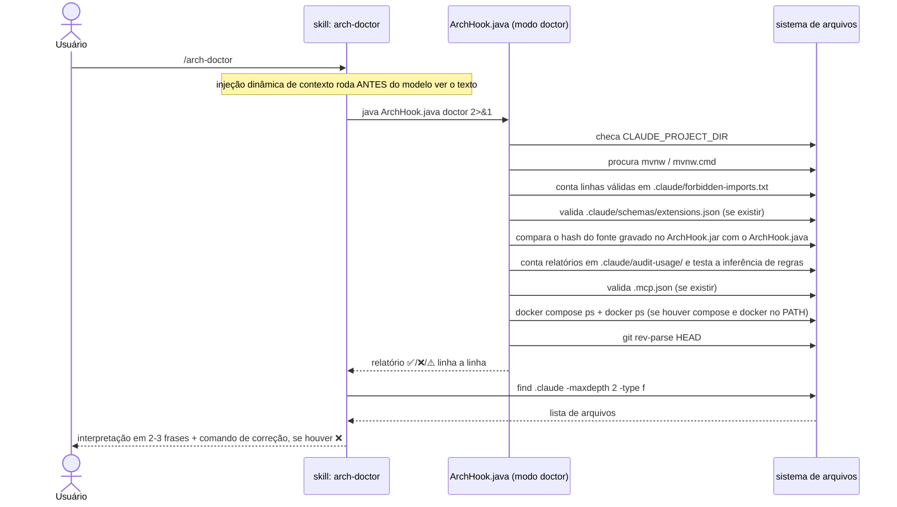

# `/arch-doctor` — diagnóstico do setup

Fonte primária: `.claude/skills/arch-doctor/SKILL.md`,
`.claude/hooks/ArchHook.java` (método `doctor()`).

## O que faz

Diagnostica se o enforcement de arquitetura está realmente funcionando na máquina
atual: hooks ativos, boundaries carregadas, wrapper do Maven, `java` no PATH, schema de
frontmatter válido, trilha de auditoria, servidores MCP declarados, e se todo serviço
do `docker-compose.yml` está de fato `running` sem um container de outro projeto nas
mesmas portas — e se cada porta publicada no host é alcançável de lá. Não corrige nada por conta própria — só relata, e sugere o comando
exato para corrigir cada item marcado com ❌.

## Por que é a skill mais simples das três

`arch-doctor/SKILL.md` não delega para nenhum agent — não há saída volumosa a esconder
nem tools sensíveis a restringir (`CLAUDE.md` § Invariant 5, nenhum dos três motivos se
aplica). O corpo da skill só embute, via injeção dinâmica de contexto (`` !`comando` ``,
ver [01-tipos-de-arquivo.md § Skill](01-tipos-de-arquivo.md#skill)), a saída real de
dois comandos:

```markdown
## Diagnosis
!`java "${CLAUDE_PROJECT_DIR:-.}/.claude/hooks/ArchHook.java" doctor 2>&1`

## AI files
!`find "${CLAUDE_PROJECT_DIR:-.}/.claude" -maxdepth 2 -type f | sort`
```

O modelo então lê o resultado já pronto e o interpreta em 2-3 frases — não roda nada
por decisão própria durante a invocação, os comandos já rodaram antes de o modelo ver
o texto.

## Diagrama de sequência



## O que cada linha do diagnóstico verifica

| Linha | Condição de ✅ | Condição de ❌/⚠️ |
|---|---|---|
| `OS` | — informativo | No Windows, nota que roda em exec form (sem shell) |
| `Java` | — informativo | versão da JVM em uso |
| `Project root` | — informativo | resolvido de `CLAUDE_PROJECT_DIR` ou diretório atual |
| `CLAUDE_PROJECT_DIR` | variável setada | ❌ não setada — hooks usam o diretório atual |
| `Build wrapper` | `mvnw`/`mvnw.cmd` ou `gradlew`/`gradlew.bat` encontrado (`build_tools` do `extensions.json`), com a ferramenta entre parênteses | ❌ ausente — rodar `/init-project` (o `starter.tgz` já traz o wrapper) |
| `Boundaries` | ≥ 1 regra válida em `.claude/forbidden-imports.txt` | ❌ 0 regras — enforcement OFF, gerado por `/init-project` |
| `Boundary violations` | nenhum arquivo-fonte importa o que o `forbidden-imports.txt` proíbe ao seu módulo — a mesma regra do `check`, sobre tudo que o git versiona ou versionaria (sem git, o disco menos `target/`, `build/` e afins) | ❌ conta os arquivos e lista até 8 no formato `arquivo → prefixo (módulo)`. Entra no `doctor gate`: o job `architectural boundaries` do projeto gerado reprova um import proibido escrito por qualquer agente. Sem regras, ✅ "nothing to sweep" (decisão 0140) |
| `Schema` | todos os arquivos de extensão passam | ❌ N arquivos com frontmatter inválido, ou ⚠️ sem `extensions.json` — validação OFF |
| `Hook jar` | `.claude/hooks/ArchHook.jar` carrega o hash do `ArchHook.java` atual | ❌ ausente, ilegível ou desatualizado — construído de outra versão do fonte, então todo hook roda o código antigo; `java .claude/hooks/ArchHook.java build` o reconstrói |
| `Audit` | N execuções registradas em `.claude/audit-usage/` | ⚪ sem o diretório — trilha OFF (opcional; é o caso deste meta-repo) |
| `Audit rule inference` | a inferência de regras renderiza sem erro para um `.java` sintético | ❌ `auditRules()` lança — todo relatório congelaria assim que uma execução tocasse `src/**` |
| `MCP` | N servidores declarados em `.mcp.json`, todos válidos | ❌ N problemas — rodar `java ArchHook.java schema`; ou "no .mcp.json" (opcional) |
| `Hooks` | N registros válidos em M eventos | ❌ evento desconhecido, `matcher` em evento que não lê um, ou string de shell no `command` — os quatro modos de falhar silenciosamente de um hook. Também quando `enabledPlugins` não traz `"<id>": false` para um plugin de `settings.blocked_plugins` (decisão 0138) |
| `Skill shadowing` | nenhuma pasta do diretório pessoal de skills (`$CLAUDE_CONFIG_DIR/skills`, ou `~/.claude/skills`) tem o nome de uma skill de `.claude/skills/` | ❌ lista as skills pessoais que substituem as do projeto — o Claude Code resolve um nome como enterprise > pessoal > projeto, então a pessoal roda no lugar, sem aviso. Renomear ou remover a pessoal. ⚪ sem o diretório. Estado da máquina: nunca entra no `doctor gate` (decisão 0138) |
| `Agent instructions` | o `AGENTS.md` raiz, o `.github/copilot-instructions.md`, e para cada módulo do blueprint ativo com `forbidden_imports` um `AGENTS.md` listando todo prefixo, ao lado de um `CLAUDE.md` com `@AGENTS.md`; todo caminho citado entre crases existe | ⚠️ nomeia o arquivo que falta, o prefixo não listado, o `CLAUDE.md` que não importa — sem ele o Claude Code pula o `AGENTS.md` do módulo — e o caminho morto. Calada sem stamp de proveniência. Só reporta, nunca entra no `doctor gate`: quem recusa um import proibido é o build (decisão 0139) |
| `Provenance` | nenhum arquivo do `.claude/` editado depois do stamp `.claude/.arch-provenance.json` | ❌ lista os arquivos editados localmente — um `arch-adopt` sobrescreveria cada um; ⚠️ sem stamp — este `.claude/` não foi escrito por `export`. No repositório de origem: `⚪ origin repository — writes stamps, carries none` |
| `Compose` | todo serviço do compose `running`, nenhuma porta declarada ocupada por container alheio, nenhuma tag de `image:` divergindo da que `src/test` fixa em `DockerImageName.parse`, e toda porta publicada no host anunciada em um endereço que o host resolve, e todo `${VAR:default}` que aponta para um serviço do compose valendo no host e no container `app` | ❌ serviço em `created`/`exited`, porta publicada por outro projeto quando já existe container deste projeto (antes disso, um aviso ⚠️), tag divergente, ou serviço que publica porta anunciando só o hostname da rede do compose, ou placeholder cujo default o host não alcança ou que o `app` não sobrescreve — detalhe linha a linha. A comparação de tags, a checagem de endereço anunciado e a de placeholders não precisam de Docker: leem os arquivos |
| `git HEAD` | existe pelo menos 1 commit | ❌ sem commits — o hook `tests` não roda (`git diff HEAD` falha) |
| `UC references` | toda pasta `docs/use-cases/UC-NNN-slug/` citada por um arquivo versionado existe no disco | ❌ citação órfã, com arquivo e linha — apagar ou renomear um caso de uso deixa as citações para trás, e cada uma estava correta no commit que a escreveu. Sem `docs/use-cases/`, "nothing to check (optional)" — é o caso deste meta-repo |
| `BL references` | todo `BL-NN` que uma spec cita existe em `docs/use-cases/BACKLOG.md`, na tabela ativa ou na de aposentados | ❌ N citações nomeiam uma linha de backlog que o arquivo não tem, listadas uma por linha. Mesmo bloco de dados (`doctor.bl_references`); sem `docs/use-cases/`, "nothing to check (optional)" |

A linha final resume: `✅ Setup operational.` só aparece quando **ao mesmo tempo**
`Boundaries` tem regras > 0 **e** o wrapper do build (Maven ou Gradle) foi encontrado. Qualquer outra
combinação vira `⚠️ Setup incomplete — see marked lines above.`

## O que bloqueia o CI e o que não bloqueia

O `doctor` tem duas formas, e só uma delas bloqueia alguma coisa:

| Forma | Exit | Onde roda |
|---|---|---|
| `java .claude/hooks/ArchHook.java doctor` (é o que o `/arch-doctor` injeta) | sempre 0 — só imprime | na máquina de quem pediu |
| `java .claude/hooks/ArchHook.java doctor gate` | 1 quando uma linha de `doctor.gate.labels` imprimiu ❌ | no job `architectural boundaries` do CI do projeto gerado |

O `doctor` não participa do build Maven ou Gradle: quem recusa compilar é o próprio build
(Checkstyle, ArchUnit, JaCoCo). O que o `doctor gate` bloqueia é o job de CI. O rodapé
`Setup incomplete` também não bloqueia nada — o veredito do gate vem das linhas listadas
abaixo, não do rodapé.

A regra de corte (decisão 0128): entra no gate o check de um **arquivo versionado que um
push pode quebrar**. Fica de fora o que é estado do runner ou da máquina, e o que é só
defeito de documentação. A lista é dado — `doctor.gate.labels` em
`.claude/schemas/extensions.json` — e cada label bate com o primeiro argumento de
`report(...)` em `ArchHook.java`.

### Bloqueiam o CI

| Linha | Por que bloqueia |
|---|---|
| `Boundaries` | `forbidden-imports.txt` é versionado; sem regra, a fronteira não é aplicada em ninguém |
| `Boundary violations` | um import proibido commitado quebra quem clonar; é a única linha que lê código-fonte (decisão 0140) |
| `Schema` | frontmatter inválido é um arquivo versionado quebrado |
| `Hook jar` | com um jar defasado todo hook sai com 1, o que não bloqueia: a proteção some em silêncio |
| `Hooks` | o runtime ignora, sem erro, um evento desconhecido ou um `matcher` que o evento não lê |
| `MCP` | inclui a varredura de segredo literal no `.mcp.json` (invariante 11) |
| `Audit overrides` | os overrides moram em arquivo versionado |
| `Compose overrides` | `.claude/compose-gate.json` é arquivo versionado; um malformado não ligaria nada, em silêncio (decisão 0186) |

### Não bloqueiam o CI

| Linha | Por que não bloqueia |
|---|---|
| `CLAUDE_PROJECT_DIR` | estado do runner — o CI nunca define a variável |
| `Compose` | estado do runner — o CI não sobe os serviços |
| `Build wrapper` | o job de build já falha sem ele |
| `Audit` | só mede gasto; não gateia nada |
| `git HEAD` | num checkout de CI é sempre verdadeiro |
| `UC references`, `BL references` | defeito de documentação |
| `Mods` | estado da máquina — depende de qual `claude` está no PATH; calada onde não há pasta de mods, como num projeto gerado |
| `Skill shadowing` | o runner de CI não tem skills pessoais |
| `Agent instructions` | gatear deixaria vermelho todo projeto adotado sem esses arquivos (decisão 0139) |
| `Platform`, `Virtual threads` | imprimem ⚠️ ou ⚪, nunca ❌ — não há como falhar o gate |
| `Provenance`, `Plan limits`, `Audit rule inference` | fora de `doctor.gate.labels` |

Quatro detalhes que mudam o resultado:

- **O gate só enxerga ❌ impresso por `report(...)`.** Uma linha ⚠️ ou ⚪ não bloqueia nem
  se alguém a listar em `gate.labels`: o código da linha teria de mudar também.
- **Linha que não é impressa passa.** Sem `.mcp.json`, sem `.claude/audit-usage/`, sem
  pasta de mods, a linha nem aparece e o gate segue.
- **Lista vazia ou ausente falha fechada**, com exit 1. Um `/arch-adopt` em modo update
  reescreve a lista.
- **Um ❌ fora do gate continua sendo um ❌.** Ele não derruba o CI, mas é o que o
  `/arch-doctor` aponta — e o rodapé `Setup incomplete` só considera `Boundaries` e o wrapper.

### Projeto adotado com `/arch-adopt`

O `export` não escreve `.claude/forbidden-imports.txt`. Quem o escreve é o `boundary-map`,
que `project-bootstrap` § 5 roda na geração. Num projeto adotado, o `doctor` mostra:

```
  Boundaries          ❌ 0 rules — ENFORCEMENT OFF. Generated by /init-project
  Boundary violations ✅ nothing to sweep — no boundary rule
  ...
⚠️  Setup incomplete — see marked lines above.
```

`Boundaries` está no gate. Se o projeto tem um job de CI que roda `doctor gate`, ele falha
nessa linha até o arquivo existir — e o `arch-adopt` só escreve em `.claude/`, então esse
job também precisa existir por outra via. Para gerar o arquivo:

```bash
java .claude/hooks/ArchHook.java boundary-map . --blueprint <id> --package <base.package>
```

Com o arquivo no lugar, `Boundary violations` passa a varrer o código existente. Um
projeto cuja arquitetura foge do blueprint falha o gate listando até 8 linhas
`arquivo → prefixo`. Isso é o gate funcionando, não um defeito da adoção.

## Exemplo de invocação e saída (fictício, projeto `pedidos-api`)

```
/arch-doctor
```

```
ArchHook doctor
  OS ................ Mac OS X
  Java .............. 21.0.4
  Project root ...... /Users/dev/projetos/pedidos-api
  CLAUDE_PROJECT_DIR  ✅ set
  Build wrapper       ✅ ./mvnw  (maven)
  Boundaries          ✅ 9 active rules
  Schema              ✅ all extension files pass
  Hook jar .......... ✅ built from the current .claude/hooks/ArchHook.java
  Audit ............. ✅ 3 execution(s) recorded
  Audit rule inference ✅ renders without error on a touched .java file
  MCP ................ no .mcp.json — nothing declared (optional)
  Compose ........... ✅ 3/3 services running · no foreign container on declared ports
  git HEAD            ✅ exists

✅ Setup operational.

AI files
.claude/audit-usage/GENESIS.md
.claude/forbidden-imports.txt
.claude/hooks/ArchHook.java
.claude/schemas/extensions.json
.claude/settings.json
```

Interpretação que o modelo devolve ao usuário (2-3 frases, conforme instruído no corpo
da skill):

> Setup operacional — wrapper do Maven presente, 9 regras de boundary ativas, schema de
> frontmatter validando sem erros, três serviços do compose de pé. A trilha de auditoria
> tem 3 execuções.

## Exemplo de saída com problema

Se o projeto ainda não tivesse passado por `/init-project` (ou o arquivo de boundaries
tivesse sido apagado por engano):

```
ArchHook doctor
  OS ................ Mac OS X
  Java .............. 21.0.4
  Project root ...... /Users/dev/projetos/pedidos-api
  CLAUDE_PROJECT_DIR  ✅ set
  Build wrapper       ✅ ./mvnw  (maven)
  Boundaries          ❌ 0 rules — ENFORCEMENT OFF. Generated by /init-project
  Schema              ✅ all extension files pass
  git HEAD            ✅ exists

⚠️  Setup incomplete — see marked lines above.
```

Resposta esperada do modelo — nomeando o comando concreto, não descrevendo o problema
em termos gerais (regra explícita do corpo da skill):

> Boundaries desligadas — `.claude/forbidden-imports.txt` está vazio ou ausente. Rode
> `/init-project` novamente sobre este projeto para regenerá-lo, ou restaure o arquivo
> a partir do blueprint original se foi apagado por engano.

`arch-doctor` **não corrige nada sem o usuário pedir** — essa é a última linha do
corpo da skill, e vale tanto para o arquivo de boundaries quanto para qualquer outro
item marcado com ❌.
