# `validate.yml` — CI dos invariantes

Fonte primária: `.github/workflows/validate.yml`, `.claude/hooks/ArchHook.java`
(método `schema()`), `CLAUDE.md` § Invariantes.

## Por que existe

Os invariantes de `CLAUDE.md` e as normas em `rules/` são prosa, não código — nada
impede que uma edição viole um deles em silêncio. `ArchHook.java check` só guarda a
fronteira Java de um projeto **gerado**; nunca roda contra o próprio grafo de prompts
deste repositório. `validate.yml` é o que transforma cada invariante numa verificação
determinística e cobrindo o repositório inteiro, a cada `push` e `pull_request`, em vez
de uma alegação que só se sustenta enquanto quem escreve a próxima skill lembra dela.

## Diagrama dos jobs

```mermaid
flowchart TD
    T[push / pull_request / workflow_dispatch] --> J1
    T --> J2
    T --> J3
    T --> J4

    subgraph J1["hooks-cross-platform (matrix: ubuntu · macos · windows)"]
        H1[ArchHook.java doctor]
        H0[build --verify — ArchHook.jar commitado = o que o source compila]
        H2[BoundaryTest.java — import proibido → exit 2, pelo payload e por `check <path>`]
        H2b[BuildToolTest.java — check compila com mvnw ou gradlew; doctor nomeia a ferramenta]
        H3[InjectionPathTest.java — injection relativa ao cwd → exit 2]
        H4[ComposeTagTest.java — tag de image divergente de src/test → reportada]
        H5[SkillTerritoryTest.java — escrita fora do write_allow da classe → exit 2]
        H6[AgentTerritoryTest.java — agent_type fora do write_allow da classe → exit 2]
        H7[BashGuardTest.java — force push / escrita de shell fora da fase → exit 2]
        H8[SweepTest.java — escrita do turno fora do território → exit 2 no Stop]
        H9[ComposeGateTest.java — porta publicada anunciada só na rede interna, ou placeholder que o host ou o app não alcança → exit 2]
        H10[SubagentContextTest.java — catálogo só para agents pattern_catalog]
        H11[AuditRenderTest.java — onde a execução gastou, erros redigidos, classes observer puladas]
        H12[MigrationsSchemaTest.java — entrada de migrations que nenhum projeto veria → exit 2]
        H13[ModuleMapTest.java — arquivo editado → o módulo Maven que format, check e tests passam no -pl]
        H14[TestsDeferTest.java — subagent escritor da sessão rodando → tests adiado, Maven não chamado]
        H15[GenesisTest.java — números do GENESIS vindos das transcrições, preenchidos uma vez]
        H16[DoctorGateTest.java — linha gated do doctor vermelha → exit 1; estado do runner nunca bloqueia]
        H17[GuardStatusTest.java — guard status imprime a fase aberta, a classe e o território]
        H18[ModsSchemaTest.java — mod que carregaria pela metade → exit 2]
        H19[PluginBlockTest.java — settings sem o false de um plugin bloqueado → exit 2]
        H20[SkillShadowTest.java — skill pessoal com nome de skill do projeto → nomeada; nunca bloqueia]
        H21[VirtualThreadsDoctorTest.java — build JDK 21+ sem virtual threads → aviso; nunca bloqueia]
        H22[PlatformLineTest.java — export sobre uma linha do Spring Boot abaixo do piso → exit 2, nada escrito; doctor reporta]
        H23[BoundaryMapTest.java — todo blueprint deriva um mapa de boundaries, e o check o aplica]
        H24[FrontmatterYamlTest.java — frontmatter que um parser YAML estrito recusa → exit 2, por arquivo e linha]
        H25[UpgradeRecipeTest.java — upgrade-recipe escreve o bump e os renames de propriedade a partir de dados; recusa um alvo abaixo do piso]
        H26[TestDiffTest.java — test-diff sai com 2 numa regressão, num teste que sumiu ou numa falha nova; nunca com 0 num build que não rodou testes]
    end

    subgraph J2["design (ubuntu-latest)"]
        D1[schema — frontmatter, shadow de comando nativo, manifesto de export vs disco]
        D4[blueprint não toca prompts]
        D5[rules é folha]
        D6[norma sem boilerplate de código]
        D7[sem commands/]
        D8[sufixo .example]
        D10[XmlTemplatesTest.java — todo *.xml.example faz parse]
        D17[SpecDiagramTemplateTest.java — diagrama dos templates de spec só com nomes e desfechos do texto]
        D18[CacheTemplateTest.java — exemplares de cache decidem todo default da biblioteca, e só eles cacheiam]
        D19[AiTemplateTest.java — exemplares de IA decidem todo default da biblioteca, e só eles chegam até ela]
        D20[GraphQlTemplateTest.java — exemplares GraphQL decidem todo limite e agrupam em batch toda lista de filhos]
        D21[PersistenceTemplateTest.java — exemplares da família documento nomeiam coleção, alias e versão, e rodam em replica set]
        D22[SearchTemplateTest.java — exemplares de busca mantêm o índice como projeção estrita e versionada]
        D23[AuditTemplateTest.java — exemplares de auditoria mantêm o histórico inteiro, o ator nomeado e a poda segura]
        D24[ApiVersionTemplateTest.java — exemplares REST versionam todo handler a partir de uma configuração]
        D25[AdmissionTemplateTest.java — exemplares de admissão mantêm um limiter limitado por chamador e o cap inbound antes da idempotência]
        D26[MessagingRetryTemplateTest.java — exemplares de consumer Kafka deixam retry e commit com o container e retentam a corrida perdida]
        D27[AsyncApiTemplateTest.java — exemplares AsyncAPI anotam os dois lados explicitamente e fazem do documento servido um gate contra um snapshot]
        D28[BlueprintSkeletonTest.java selftest — o workflow blueprints gera só o que a mudança impacta]
        D16[corpo de exemplar sem comentário além de Javadoc]
        D9[templates do blueprint existem]
        D10[dono único da norma]
        D15[templates de serviço do compose mesclam e parseiam]
        D11[sem dependência fora do ecossistema Java]
        D12[decisions/ isolado]
        D13[sem versão hardcoded]
        D14[paths bate com blueprint]
    end

    subgraph J3["exemplar-imports (ubuntu-latest)"]
        E1[baixa starter.tgz real do Initializr]
        E2[cada import de .java.example resolve no classpath]
        E3[nenhum símbolo denylisted como deprecado]
    end

    subgraph J4["export-determinism (ubuntu-latest)"]
        X1[export duas vezes por blueprint → árvores idênticas]
        X2[árvore exportada leva ArchHook.jar idêntico byte a byte, e só o que um projeto precisa]
        X3[jar exportado roda schema + doctor na própria árvore]
        X4[re-export apaga todo caminho de export.retired]
    end
```



## O que cada verificação cobre

| Job / passo | Verifica | Contra o quê |
|---|---|---|
| `hooks-cross-platform` | `ArchHook.java doctor`, `build --verify` e depois dezessete testes nas três OSes, todos disparando `java -jar .claude/hooks/ArchHook.jar` — o mesmo comando que os registros rodam | Decisão D8 — "cross-platform" como fato, não alegação — e decisão 0084: testar o source não prova nada sobre o jar que os hooks lançam |
| `committed ArchHook.jar is what the source compiles to` | `build --verify` recompila sob o `hook_build.javac_feature` fixado e compara byte a byte | Decisão 0075 — editar `ArchHook.java` sem rebuild não muda nada que um hook executa. Roda antes dos testes, para que exercitem bytes revisados |
| `hook blocks forbidden import, from the payload and from argv` | `BoundaryTest.java`, projeto descartável com um `forbidden-imports.txt`: o payload no stdin e o `check <path>` saem com exit 2 num import proibido, a forma com argv com o stdin aberto; arquivo limpo sai com 0, arquivo inexistente com 1 | Decisão 0123 — `check <path>` lia o stdin primeiro, travava até o timeout da tool e depois passava em silêncio; o probe de fronteira do bootstrap reportou um ✓ que nenhum hook produziu (lessons-learned-020 § 3) |
| `check compiles with the project's Maven or Gradle wrapper` | `BuildToolTest.java`, projetos descartáveis com o `extensions.json` real e um wrapper falso que grava seus argumentos e sai com 1: Gradle multi-módulo recebe `-q --offline :domain:compileTestJava`, Gradle single-module `-q --offline compileTestJava`, Maven `-q -o -pl domain -am test-compile`, todos reprovando o `check` com exit 2; o `doctor` mostra `Build wrapper` verde com `(gradle)` | Issue #167, decisão 0180 — `wrapper()` só achava `mvnw`, então um projeto Gradle ficava sem compilação incremental e com `Maven wrapper` vermelho em toda execução |
| `format, check and tests hand Maven the module the edited file belongs to` | `ModuleMapTest.java`, projetos descartáveis com um `mvnw` stub que registra seus argumentos: um arquivo sob o `src/main` ou `src/test` da raiz de um projeto single-module chega a `format`, `check` e `tests` como `-pl .`, um arquivo multi-module como `-pl <módulo>`; um `.java` sob `.claude/` e um projeto sem `pom.xml` nunca chamam o Maven; depois do `-am`, o `tests` passa ao Maven os goals de `tests.stop_maven_args` do `extensions.json` do próprio projeto, e bloqueia sem chamar o Maven quando a chave some | Decisão 0107, issue #60 — `moduleOf` nunca olhava o POM da raiz, então esses três hooks retornavam antes de chamar o Maven em todo projeto single-module desde o primeiro commit, e um hook que não faz nada parece um hook que passou. Decisão 0142, issue #126 — o gate parava em `test` enquanto `spotless:check` e `checkstyle-test` ficam em `verify`, e imprimia verde numa árvore que o CI rejeitava |
| `tests defers while a writer subagent of the session runs, and only then` | `TestsDeferTest.java`, projetos descartáveis com um `mvnw` stub e uma cópia do `extensions.json` real: depois de `tests agent-start` de um agente cuja classe tem `executor: true`, o `Stop` não chama o Maven e imprime `Tests deferred` — também quando um primeiro escritor parou e um segundo já começou, os grupos encadeados do executor da 0130; um agente só de leitura, um agente sem classe, um escritor que já parou, o escritor de outra sessão e um marcador além de `tests.writer_agent_max_minutes` chamam o Maven como antes, assim como três grupos que já pararam | Decisões 0116 e 0130, issue #76 — um `Stop` da thread principal durante um executor em background rodava o Maven sobre a árvore pela metade e bloqueava uma thread que não pode escrever `src/`. Um marcador nunca escrito traz isso de volta, um nunca apagado desliga o gate — os dois em silêncio |
| `guard bash refuses force pushes and holds shell writes to the phase` | `BashGuardTest.java`, 29 casos: toda grafia de force push de `guard.force_push` (`-f`, `-uf`, `--force-with-lease`, `+ref`, `git -C`, `sh -c "…"`) recusada, redirect / `sed -i` fora do território de uma fase de design recusados, `sed` simples, alvo `$OUT` irresolvível e `ls` liberados; na fase do `sonar-lessons`, `./mvnw -q` e `gh issue create` liberados e o scan redirecionado para `target/` recusado; para o `java-spring-boot-developer`, a rodada de teste documentada com log em `$TMPDIR` e um caminho absoluto fora do projeto liberados, um log em `target/` recusado; `sed -i ''`, `-i '' -e`, dois scripts `-e` e `--expression=` sobre um arquivo do território do executor liberados, as mesmas grafias sobre um arquivo fora dele recusadas | Decisões 0076, 0117 e 0118. O modo roda antes de todo comando de shell em toda sessão: falha caro nas duas direções, e o parser é dado que uma edição de JSON muda |
| `guard status prints the open phase the cockpit draws` | `GuardStatusTest.java`: sem fase, imprime `phase` vazio e classe `null`, e chamar `status` não abre nada; `/claude-code-architect-designer` abre uma fase que imprime a skill, a classe `meta` e `.claude/**`; um `Skill` da mesma classe mantém a classe; `deny_markers` sai igual a `mods.deny_markers`; o próximo prompt esvazia a fase | Decisão 0131 — a faixa do `nerviz-cockpit` desenha a partir dessa única linha de JSON, e os testes do próprio mod só conseguem fazer stub dela: uma chave renomeada esvaziaria a faixa sem nada falhar |
| `schema blocks a mod that would load half-way` | `ModsSchemaTest.java`, numa cópia descartável de `.claude/`: os mods entregues passam; evento desconhecido, hook de gating sem `.catch`, um `$.http.fetch`, um `$.process.run` de `sh`, um mod que o marketplace não lista, um mod que `enabledPlugins` deixa desligado, um mod sem testes e uma entrada de `deny_markers` que não está mais no `ArchHook.java` saem com 2 nomeando o defeito; comentário dentro de um hook não é defeito; árvore sem `.claude/mods/` fica calada | Decisão 0131 — todos esses defeitos são silenciosos em runtime (hook pulado é uma linha de debug log), e `claude plugin validate` só roda onde o CLI está, o workflow `mods` abaixo |
| `guard sweep reports this turn's writes, never pre-existing dirt` | `SweepTest.java` num repo git descartável: arquivo sujo antes do prompt nunca é nomeado, escrita fora do território no turno sai 2, `stop_hook_active` não bloqueia duas vezes, escrita dentro do território fica calada, a trilha do `audit` gravada no turno não é reportada enquanto um `Write` nela continua recusado, uma cadeia `/new-feature` → skill de design → `git-publish` cujos spec, parciais e escrita do executor em `src/` foram admitidos em tool-time fica calada com a pasta aprovada depois, e um arquivo que nenhum guard de tool-time viu no mesmo turno continua nomeado | Decisões 0065, 0105 e 0114 — o sweep vale o que vale a baseline do `guard prompt`, e uma baseline quebrada falha calada nos dois sentidos |
| `compose gate blocks a published service no host client can reach` | `ComposeGateTest.java`: `9092:9092` + `PLAINTEXT://kafka:9092` sai 2 nomeando a linha de endereço anunciado, `stop_hook_active` sai 0, um listener `localhost` limpa a linha, sem compose fica calado; collector sem porta publicada e `app` sem `OTLP_METRICS_ENDPOINT` saem 2 pela pergunta 5, e as variantes corrigidas, `SPRING_DATASOURCE_URL` sobrescrevendo `${DB_URL:…}` e o default host-first do Kafka (com portas de host fixas e variáveis) ficam calados; na forma de relatório, um datasource cujo banco ou usuário diverge do serviço `postgres`, ou que não tem senha onde o serviço exige uma, é aviso, nunca linha do gate, e o literal da senha nunca aparece na saída; o mesmo para uma URI do MongoDB contra um serviço `mongo` — usuário e senha lidos da URI, o placeholder de senha sem default contado como definido | Decisões 0064, 0110, 0124 e 0147. Não precisa de Docker — as checagens de endereço anunciado e de placeholders leem os arquivos |
| `doctor gate fails on every gated line and only on those` | `DoctorGateTest.java` num projeto descartável com cópias do `extensions.json`, `ArchHook.java` e `ArchHook.jar` reais, `CLAUDE_PROJECT_DIR` ausente: o saudável sai 0 mesmo com `CLAUDE_PROJECT_DIR`, `Build wrapper`, `Compose` e `git HEAD` vermelhos; quebrar `Boundaries`, `Boundary violations`, `Schema`, `Hook jar`, `Hooks`, `MCP` ou `Audit overrides` sai 1 nomeando a linha; todo rótulo de `doctor.gate.labels` tem de aparecer na saída saudável; o `doctor` puro sai 0 com `ENFORCEMENT OFF`; lista vazia falha fechada | Decisão 0128 (issue #104). O job `architectural boundaries` do projeto gerado é `doctor gate`; o `doctor` puro só imprime, então esse job ficava verde com `ENFORCEMENT OFF`. O rótulo casa por texto, então um rename o tiraria do gate em silêncio |
| `config writes only valid project settings, and guard leaves it the only writer` | `ProjectConfigTest.java` num projeto git descartável com cópia do `extensions.json` real, rodando o `ArchHook.jar`: `config list` nomeia todo arquivo de `project_config` e expande seus padrões de chave; `set` grava um valor válido e recusa (exit 2, arquivo intacto) chave desconhecida, valor fora do conjunto, skill sem arquivo, `skills.arch-adopt` e configuração de uma trilha de auditoria desligada; `unset` da última chave apaga o arquivo; `guard write` e `guard bash` recusam escrita direta em cada caminho registrado nomeando `config set`; `guard sweep` deixa passar a escrita que o `config` fez numa fase `/project-config` e ainda pega um arquivo avulso (decisão 0187) |
| `schema blocks a settings file that re-enables a colliding plugin` | `PluginBlockTest.java`, numa cópia descartável de `.claude/`: os dois arquivos entregues passam; tirar ou trocar para `true` o `false` de um plugin de `settings.blocked_plugins` no `.claude/settings.json` ou no `settings.json.example` sai com 2 nomeando o arquivo e o id; um id novo na lista passa a ser exigido nos dois; lista vazia não exige nada | Decisão 0138 — um plugin ligado no nível de usuário volta a carregar em silêncio quando o `false` do projeto some, e a mesma lista em dois arquivos diverge na primeira edição de um só |
| `doctor names a personal skill that shadows a project skill, and never gates` | `SkillShadowTest.java` com `CLAUDE_CONFIG_DIR` num diretório descartável: uma skill pessoal com o nome de uma do projeto aparece na linha `Skill shadowing ... ❌`; uma de nome distinto e uma pasta sem `SKILL.md` não; sem colisão ✅; sem o diretório ⚪; o `doctor gate` nunca nomeia a linha | Decisão 0138 — o Claude Code resolve um nome como pessoal > projeto, sem aviso; nada no projeto recusa o diretório pessoal, e o estado da máquina de um dev não pode bloquear o CI |
| `doctor checks the agent instruction files against the blueprint, and never gates` | `AgentInstructionsTest.java` num projeto descartável com o blueprint `hexagonal` e um stamp: tudo presente ✅ e módulos sem diretório pulados; prefixo não listado, `CLAUDE.md` de módulo ausente ou sem `@AGENTS.md`, caminho citado morto e ponteiros raiz ausentes nomeados; sem stamp, calada; a lista inline de `forbidden_imports` lida; o `doctor gate` nunca nomeia a linha | Decisão 0139 — um `AGENTS.md` de módulo sozinho é pulado pelo Claude Code enquanto a raiz tem `CLAUDE.md`, em silêncio; os arquivos são renderizados pelo modelo, então um módulo esquecido só aparece aqui |
| `doctor warns when a JDK 21+ build lacks virtual threads, and never gates` | `VirtualThreadsDoctorTest.java` em projetos descartáveis: Maven 21 com `spring.threads.virtual.enabled` e `spring.main.keep-alive` no `application.yml` ✅, e o `application.yml.example` do bootstrap também; sem as duas, ⚠️ nomeando cada uma; um profile com `false` nomeado; `.properties` lido com `=` e `:`; Gradle `sourceCompatibility` e toolchain lidos, e o `application.yml` de um módulo achado; Maven 17, build sem versão e sem build ⚪; o `doctor gate` nunca nomeia a linha | Decisão 0155 — a norma foi definida de antemão, sem falha observada, e um profile pode desligar com motivo; a versão-alvo é a do build, nunca a do JVM que roda o doctor |
| `export refuses a Spring Boot line below the floor, and doctor reports it` | `PlatformLineTest.java`, `export --dry-run` em destinos descartáveis: um starter parent, um BOM do Boot importado, a propriedade `spring-boot.version`, o plugin Gradle em Groovy e em Kotlin e um version catalog, todos abaixo de `doctor.platform.min_line` → exit 2, com a linha, o piso e a saída nomeados, e sem `--dry-run` nenhum `.claude/` escrito; o próprio piso, linhas posteriores, uma versão que nenhum padrão lê, um build que não diz nada e nenhum build → exit 0. `doctor` em projetos descartáveis: ⚠️ abaixo do piso, ✅ nele, ⚪ sem nada detectado; o `doctor gate` nunca nomeia a linha | Decisão 0161 — o `arch-adopt` instalava este `.claude/` num projeto Boot 3 sem aviso, e recusar exige evidência: uma linha que nenhum padrão lê nunca é recusada |
| `upgrade-recipe writes the bump and the property renames, and refuses what it cannot spell` | `UpgradeRecipeTest.java`, `upgrade-recipe` contra uma fonte descartável com o `extensions.json` deste repositório: `--pass bump` carrega o alvo como versão do parent, um rename de coordenada por entrada de `renames.dependencies` e um rename de tipo por entrada de `renames.types`, byte a byte igual numa segunda execução; um alvo abaixo do piso, um malformado, um projeto que já está no piso, uma fonte sem o bloco `recipes` e um placeholder de opção que nenhum valor preenche → exit 2, nada escrito. `--pass properties` sobre jars montados no teste: um erro com replacement vira um rename para `.properties` e outro para YAML, em ordem de chave, e o primeiro jar vence uma chave; um warning, um erro sem replacement e um jar sem metadata são pulados; um classpath unido por quebras de linha e um unido pelo separador de path do SO leem igual; nenhum rename declarado → exit 0, nada escrito A decisão 0176 acrescenta ao bump: um par de `AddDependency` (Maven, Gradle) por entrada de `requires_starter`, com o tipo que o pede; um par de `FindAndReplace` por coordenada renomeada ou adicionada, que tira a versão que ela carregava, e as edições de texto por último — um arquivo de build que uma delas mudou deixa de ser um modelo para os passos seguintes; com `--initializr`, um par de bumps de versão por BOM e por dependência com versão do arquivo, em ordem de chave, recusado quando o arquivo é de outra versão do Boot, ilegível, ou os dados não têm template para ele | Decisões 0175 e 0176 — um modo Form 7c que lança exceção sai com 0 pelo `catch` do `main`; o motor que lê a receita é provado pelo `templates.yml`, então aqui ficam toda recusa e todo formato de metadata. A ordem dos passos apareceu primeiro como um BOM do Spring Cloud esquecido na linha antiga por uma execução real |
| `test-diff separates what the upgrade broke from what was already broken` | `TestDiffTest.java`, `test-diff` contra projetos descartáveis com o XML JUnit do Surefire, do Failsafe e do Gradle, na raiz e num módulo: `snapshot` grava pass, fail (um `failure` ou um `error`) e skip; `compare` sai com 0 nos mesmos relatórios, numa falha que já existia e num teste corrigido, e sai com 2 numa regressão, num teste que sumiu e numa falha que o baseline nunca viu — cada uma sozinha, depois juntas; sai com 2 também num projeto sem relatório, num baseline que não é um snapshot, num relatório que não é XML, num com DOCTYPE e numa fonte sem `test_reports` | Decisão 0176 — um build vermelho depois de um upgrade não diz nada sem a execução anterior; e o `catch` de topo do modo sai com 0, o que aqui leria como "nada pior" |
| `doctor sweeps every source file for forbidden imports, with check's own match` | `BoundarySweepTest.java` num projeto descartável: árvore limpa ✅ com a contagem; import proibido, simples ou `static`, nomeado com prefixo e módulo; nome qualificado sem import — uma anotação, uma chamada depois de um char literal `'"'` — nomeado como `qualified name`, e comentário, link de Javadoc, string, text block e nome mais longo não; teste sob o módulo varrido; arquivo fora de todo módulo não; prefixo de package do single-module casa; com git, arquivo não versionado varrido e `target/` ignorado; sem git, `build/` pulado em qualquer profundidade; sem mapa ✅ "nothing to sweep"; o `check <path>` bloqueia exatamente o arquivo que a varredura nomeia. O `DoctorGateTest` ganha o caso que reprova o gate pelo label | Decisão 0140 — a linha é gated e é a única coisa no CI que recusa import proibido antes do ArchUnit, que sob outro agente pode nunca existir; uma varredura que não casa nada pareceria projeto limpo |
| `boundary-map derives every blueprint's rules, and check enforces them` | `BoundaryMapTest.java`: `ArchHook.jar boundary-map` sobre todo `<id>/<id>.yaml` — exit 0, o cabeçalho, linhas `<path>\|<prefixo>`, sem duplicata e sem `..` do ArchUnit sobrando; o mapa single-module começa cada linha em `src/main/java/<caminho do package>/` e nunca proíbe um package de importar a si mesmo; um nome de `dependency_rules` sem entrada em `packages.map` é reportado, e o conjunto não resolvido tem de ser exatamente o que o teste lista (`features` no `vertical-slice`). Casos nomeados: o `hexagonal` copia `domain\|org.springframework.`; o `clean-architecture-single-module` dá ao `domain` as quatro raízes de framework e à `application` nenhuma; o `hexagonal-single-module` proíbe cache → persistence e deixa GraphQL → REST aberto. Depois o `check` bloqueia um arquivo plantado sob um mapa single-module e um multi-module e passa o mesmo arquivo sem o import; `--package` malformado, blueprint desconhecido e opção ausente saem com 2 e não escrevem nada | Decisão 0166 — o § 5 de `project-files.md` era prosa que um agente seguia; um blueprint cujas regras derivavam para nada gerava um projeto com cara de protegido que não bloqueava nada |
| `schema refuses frontmatter a strict YAML parser refuses` | `FrontmatterYamlTest.java`, `schema` sobre um arquivo de um projeto descartável: `: ` sem aspas recusado pela linha numa rule, num agent e numa skill; a linha de continuação, valor terminado em `:`, valor começando com crase, `@`, `*` ou `- `, aspas não fechadas, texto depois delas, escape desconhecido, cabeçalho de bloco inválido, lista flow não fechada, tab, chave em coluna sem mapping aberto e chave duplicada recusados; `: ` entre aspas, blocos `>` e `>-`, lista `paths:`, bloco de hooks de skill, URL e comentário `#` lidos | Decisão 0174 — o Claude Code perdoa `: ` sem aspas, o GitHub Copilot descarta o arquivo (lessons-learned-022 § 9); o scanner não tem biblioteca YAML, então cada forma é um caso |
| `export notes only real overwrites, and never guesses the stamp's commit` | `ExportProvenanceTest.java` exportando o `hexagonal`: árvore nova e arquivo igual sem `Overwrites`; `settings.json` editado no destino nomeado; `--commit` gravado como dado; sem a flag, a fonte no topo da própria work tree grava o HEAD dela, e uma cópia do `.claude/` aninhada em outro repositório grava `unknown`, não o HEAD de fora; `--commit` malformado sai com 2; numa árvore baixada (sem repositório), o marker de `source.fetch_marker` dá ref e commit, cada flag vence o campo dela, um marker sem sha ou sem JSON sai com 2, e o mesmo marker numa fonte que é a própria work tree é ignorado | Decisão 0141 (issue #123) — o stamp do `arch-adopt` dizia `unknown`, e o `report-issue` compara esse campo quando o ref não é tag; o aviso mandava a pessoa a um `git diff` vazio. Decisão 0163 — um projeto gerado da árvore que o `new-project` baixa sairia `working-tree`/`unknown` |
| `context subagent hands the catalog to pattern_catalog agents only` | `SubagentContextTest.java`: `java-spring-boot-developer` recebe um `## Catalog` dentro de `subagent_context.max_chars`; installers e `general-purpose` não recebem nada | Decisão 0077. `SubagentStart` não bloqueia, então catálogo que para de chegar — ou chega em todo lugar — é silencioso |
| `audit renders where the run spent, redacts tool errors, skips what class or project turns off` | `AuditRenderTest.java` num projeto descartável com cópia do `extensions.json` real: chamadas de tool por peça (incluindo o transcript próprio de um subagent), os turnos mais caros, o pico de contexto, a primeira linha de cada erro de tool redigida, os campos de ledger que `audit summary` agrega, nenhum relatório para peça cuja classe declara `audited: false`, e o `audited.json` do projeto ligando ou desligando uma peça por cima da classe — exceto `arch-adopt`, desligado fixo pelo próprio override — com o `doctor` apontando cada entrada inválida, e um prompt que o harness injeta (hand-back `<agent-message>`, `<task-notification>`) deixando o run aberto até o próximo prompt do usuário; cache read e write de cada peça e a description da chamada do agent na tabela e no `nodes.jsonl`, e as chamadas de tool cujo resultado os requests seguintes mais releram, ranqueadas, com a releitura parando numa compactação e a primeira linha de um comando redigida; nenhum custo em parte alguma — nenhuma célula `💰`, nenhum campo `cost` nos dois ledgers, o `doctor` calado sobre um `pricing.json` que sobrou — e o modelo nomeado por peça; execuções por janela de plano a partir dos tokens billable do run e do `plan-limits.json` do projeto — Max como múltiplo do Pro, semanal de Max não publicada, as horas da janela limitando pelo tempo — no relatório e no `audit summary`, e o `doctor` apontando cada entrada inválida do orçamento, uma chave `*_usd` inclusive | Decisões 0041, 0085, 0086, 0111, 0119, 0132, 0133, 0134. Todo número é extraído de um layout de transcript não documentado e um render que lança exceção sai com 0 — o relatório só para de atualizar; a linha de erro cai num arquivo versionado, então um token ecoado vazaria (invariante 11) |
| `audit genesis fills GENESIS from the transcripts, once` | `GenesisTest.java`, um `CLAUDE_CONFIG_DIR` descartável com transcrição principal e de subagent, e um projeto com um `pricing.json` que sobrou e GENESIS com placeholders: Started é a mensagem do `/init-project`, ou o prompt por trás de um tool result do Skill tool quando não foi digitado, e vale o mais recente dos dois; turnos anteriores, um tool result que cita a tag ou o campo e um resultado de Skill de outra skill não contam, tokens exatos, nenhum custo escrito; registro já preenchido e sessão desconhecida são recusados | Decisões 0123, 0134 e 0164 (issue #146) — o GENESIS registrou início depois do fim, escrito pelo modelo a partir da data de criação de um diretório (lessons-learned-020 §§ 4–5) |
| `guard keeps each skill inside its class's territory` | `SkillTerritoryTest.java` roda o modo `guard` sobre o `extensions.json` real em 59 casos: sem fase aberta nada restringe, dentro e fora do `write_allow`, o `agent_type` prevalecendo sobre a fase aberta — na escrita e na chamada `Skill` de um agent com classe, que nem é recusada nem troca a fase de quem chamou (decisão 0126) —, a recusa de `Skill(<build>)` com fase de design aberta, o território mais estreito do callee numa chamada entre classes, a fase sobrevivendo a uma chamada `Agent` até o próximo prompt, um encadeamento da mesma classe (`arch-adopt` → `sonarqube-setup` → `docker-architect`) somando territórios — ainda negação por padrão fora da união —, a classe `report` (`sonar-lessons`) presa a `docs/lessons-learned/` e recusada no meio de um design, e o território por arquivo do `transport-security-setup`: `application.yml`, a única classe `HstsHeaderFilter` e o IT de transporte liberados, qualquer outra classe principal e um arquivo de chave sob `resources` recusados, e o `Dockerfile` e `docker/caddy/**` recusados até o `docker-architect` entrar na fase, e a fase de implement: a chamada `Skill(docker-architect)` do `compose-service-installer` passa enquanto a da thread principal é recusada | O território ser allowlist é o tipo de alegação que apodrece em silêncio: vale até alguém alargar uma entrada de `write_allow` sem perceber. O caso que motivou tudo — um run de design escrevendo `docker-compose.yml`, arquivo que nenhuma denylist nomeava — é um dos 59, e também o `sonarqube-setup` encadeado que tinha o `pom.xml` recusado antes da decisão 0092 |
| `guard keeps each agent inside its class's territory` | `AgentTerritoryTest.java` roda o mesmo modo sobre `agent_classes` em 37 casos: cada installer dentro e fora da sua lista estreita, as grafias single- e multi-module do mesmo caminho, o executor alcançando a única linha de spec que ele fecha, o driver escrevendo qualquer coisa, o `issue-verifier` (classe `verifier`) recusado em toda escrita no repo — por `Write`, por heredoc, e com a fase `.claude/**` do designer aberta — enquanto o scratch fora do repo passa, um agent sem classe caindo na fase do chamador, e o `compose-service-installer` escrevendo cada path que o `docker-architect` escreve — `docker-compose*.yml`, `docker/**`, `Dockerfile`, `.env`, `.env.example`, `.gitignore`, `.dockerignore` — e recusado em config de aplicação, no POM e na spec, com a escrita no compose valendo sob a fase de implement aberta | Cada agent prometia o próprio território em prosa (`**Does not write:** docker-compose.yml`) enquanto o guard dava bypass irrestrito aos quatro. A promessa agora é dado, e os dois bloqueios que mais importam — `archunit-installer` recusado no `docker-compose.yml`, e recusado no source principal — são casos deste arquivo |
| `hook reports a compose image tag that disagrees with src/test` | `ComposeTagTest.java` monta um projeto descartável com `docker-compose.yml` e um `DockerImageName.parse(...)` em `src/test`, e exige que `ArchHook.java compose` reporte a divergência, expanda `${VAR:-default}` e fique calado quando as tags batem | A suíte passar contra uma versão de engine que ninguém roda. Roda nas três OSes porque a pergunta 3 do modo `compose` compara dois arquivos e não precisa de Docker — o que também prova que o casamento de `src/test/` sobrevive ao separador do Windows |
| `frontmatter schema` | `java .claude/hooks/ArchHook.java schema` | Invariante 10 — `extensions.json` é o dono único do frontmatter reconhecido; campo inventado ou `metadata:` falha alto em vez de ser ignorado em silêncio pelo runtime. O mesmo modo exige que toda injection `` !`command` `` resolva caminho a partir de `${CLAUDE_PROJECT_DIR}` — uma relativa reporta arquivo ausente sempre que o cwd do shell derivou —, reprova pasta de skill com nome de slash command nativo (`types.skill.native_commands`; até a 0084 um passo só no YAML que projeto gerado nunca rodava) e reprova rule sem `paths` (`types.rule.required`; decisão 0082 — rule sem ele carrega no launch, toda sessão), e reprova entrada de `migrations` que o `arch-adopt` nunca mostraria — blueprint id inexistente, campo faltando, id repetido (decisão 0104, `MigrationsSchemaTest.java`) |
| `new blueprint doesn't touch prompts` | adicionar um blueprint deixa `.claude/skills` e `.claude/agents` intactos | Invariante 7 — arquiteturas são dados |
| `rules is a leaf of the graph` | nenhuma rule menciona "skill", "agent", "subagent" | Invariante 1 |
| `norm contains no code boilerplate` | nenhuma declaração de `class`/`record`/`interface`/`enum` dentro de `rules/` | Invariante 3 |
| `no new commands/` | `.claude/commands/` não existe | Invariante 4 |
| `exemplar imports have the .example suffix at the end` | todo arquivo sob `skills/*/templates/` | Globs de precondição que dependem do sufixo |
| `exemplar bodies carry no comment but Javadoc` | `TemplateCommentsTest.java`: nenhum `*.java.example` (fora de `claude-code-architect-designer/`) tem `//` ou `/* */` no corpo — depois do cabeçalho `EXEMPLAR` e fora dos marcadores `// --- ` na coluna 0 — que o `checkstyle.xml.example` rejeitaria. Lê as regex dos módulos `LineComment`, `BlockComment` e `TrailingComment` do próprio template, então os dois não divergem | Decisão 0108 — o executor copia a forma do exemplar, comentários inclusive, e 60 templates carregavam 508 comentários no corpo. Com o Checkstyle do projeto gerado rejeitando-os, um comentário que volta a um template vira hook `check` vermelho em todo projeto que o copiar |
| `exemplars log no DEBUG/TRACE and rejections at WARN without the exception` | `TemplateLogLevelTest.java`: nenhum `*.java.example` (fora de `claude-code-architect-designer/`) chama `.debug(`, `.trace(`, `isDebugEnabled` ou `isTraceEnabled` fora de comentário; todo `@ExceptionHandler` de requisição recusada antes do caso de uso (400, 401, 403, 429) tem um `log.warn` e não passa `e` nem a mensagem dela | Decisão 0157 — cada `DEBUG` do `bank-app` veio de um template ou de uma regra: uma rejeição que produção não vê, e a exceção do parser que pode repetir o corpo. Um template nunca é um caso que pediu `DEBUG` |
| `exemplars let Lombok write the logger, the plain constructor and the field modifiers` | `TemplateLombokTest.java`: nenhum exemplar de produção (fora de `claude-code-architect-designer/`, `test-architect/` e dos `*Test`/`*IT`) chama `LoggerFactory.getLogger`; nenhuma classe tem um único construtor que só atribui seus campos `final` a partir de parâmetros sem anotação e de tipos distintos; toda classe cujos campos de instância são todos `private` tem `@FieldDefaults`, sem modificador de acesso escrito num campo de instância, e nenhuma sem campo de instância o tem. Em `gof-design-patterns/` e `domain-modeling/` o construtor fica escrito, e só uma classe `@Service` usa `@RequiredArgsConstructor`. Exemplar de teste não importa Lombok | Decisão 0158 — a `lombok.md` só permitia `@RequiredArgsConstructor` e não citava `@Slf4j`, e os templates escreviam à mão o logger e 75 construtores; 73 arquivos não tinham o `@FieldDefaults` que a norma já exigia. O executor copia o formato do exemplar |
| `Gradle and Maven run the same test classes, and every test exemplar is named for both` | `TestNameFilterTest.java`: a task `test` de `build.gradle.parent.example` inclui exatamente os quatro padrões default do Surefire (`Test*`, `*Test`, `*Tests`, `*TestCase`) e exclui `*IT`; `pom.parent.xml.example` não configura o plugin do Surefire; todo exemplar Java que declara um método `@Test` declara uma classe que um desses padrões ou `*IT` alcança | Decisão 0179 — o filtro do Gradle incluía só `*Test`, então `ModularityTests` e os `*ApplicationTests` do Initializr nunca rodavam num projeto Gradle com `./gradlew build` verde. Nenhum outro job lia os arquivos de build dos próprios templates |
| `exemplars keep the adapters of hexagonal-single-module apart, and its matrix is complete` | `HexagonalSingleModuleTemplateTest.java`: toda chave `adapter.*` do `packages.map` do `hexagonal-single-module` tem uma entrada em `dependency_rules` que lista todos os outros pacotes de adapter (salvo a única aresta aberta, `adapter.in.graphql` → `adapter.in.rest`), e nenhum `.java.example` declara um pacote dentro de um adapter e importa um tipo de outro. Fixtures que devem falhar rodam antes | Decisão 0165 — um pacote não tem o curinga `adapters/*`, então a matriz é uma lista 10 × 9 escrita à mão, e o teste descobriu na primeira execução que os exemplares de GraphQL importam os subpacotes `security` e `admission` do adapter REST |
| `the blueprints workflow generates only what a change impacts` | `BlueprintSkeletonTest.java selftest`, sem git e sem rede: uma mudança em `.claude/blueprints/<id>/` seleciona esse id (as `references/` dele também); a pasta `references/` compartilhada e uma pasta que não é blueprint não selecionam nada; a skill de bootstrap, o hook, o `extensions.json` ou qualquer outro path junto selecionam todos os blueprints; a matriz é cada id em Maven e em Gradle | Decisão 0166 — o `blueprints.yml` gasta até 18 builds, e a regra que os escolhe é o que impede um typo de rodar nove ou um blueprint quebrado de ser pulado |
| `MapStruct mapper exemplars hold mapping.md § Forbidden and pair every manual one` | `MapperTemplateTest.java`: todo `*/templates/*MapStructMapper.java.example`, com os comentários apagados, não tem nada de `mapping.md` § Forbidden (`expression =`, `defaultExpression`, `Mappers.getMapper`, campo `INSTANCE`, `@Context`, `@Before`/`@AfterMapping`, `NullValuePropertyMappingStrategy`, `unmappedTargetPolicy`, `defaultValue`, `java.util.Date`), nem `componentModel`/`injectionStrategy`, que são das opções do processor no build; tem uma interface `@Mapper` e nenhuma `public`. E toda skill cujo exemplar tem um `*Mapper` manual tem o `*MapStructMapper.java.example` ao lado | Decisão 0160 — o MapStruct virou escolha por projeto; o executor copia o exemplar e o installer converte os mappers existentes para ele, então uma construção proibida no exemplar vai para todo projeto que escolheu MapStruct |
| `XML exemplars are well-formed` | `XmlTemplatesTest.java`: todo `*.xml.example` sob `.claude/skills/` faz parse com o parser DOM do JDK; fragmento sem declaração sob uma raiz sintética | Decisão 0123 — o `logback-spring.xml.example` tinha a declaração abaixo do comentário EXEMPLAR, e todo teste com contexto Spring do projeto gerado ficou vermelho (lessons-learned-020 § 1) |
| `spec template diagrams name only what their text defines` | `SpecDiagramTemplateTest.java`: todo bloco `mermaid` de um `*.md.example` sob `.claude/skills/` abre com `sequenceDiagram`, `flowchart TD`, `classDiagram` ou `stateDiagram-v2`; todo nome do bloco — token com maiúscula, id e alias de participante, campo de um corpo `class { }`, primeira palavra do rótulo de uma transição — aparece no mesmo arquivo fora dos blocos; um `sequenceDiagram` tem uma mensagem por passo da lista numerada acima dele, e um `flowchart TD` tem um nó final `([…])` por linha da tabela **Out** acima dele; os templates do caso de uso (base e variantes) têm `sequenceDiagram` e `flowchart TD`, e os do domínio (base e variantes) têm `classDiagram` e `stateDiagram-v2` | Decisão 0143 — o template é a única fonte do formato do spec (0115), então um diagrama que diverge do próprio texto ali entra em todo spec gerado dele. Prova os templates, nunca um spec gerado: nada de `.claude/.ci/` viaja, e lá `rules/spec-diagrams.md` continua norma |
| `cache exemplars decide every library default, and only they cache` | `CacheTemplateTest.java`: todo exemplar que declara `@EnableCaching` registra um `CacheErrorHandler`, e nenhum fica ao lado de `@SpringBootApplication`; o manager do Caffeine monta cada cache com `expireAfterWrite`, `maximumSize` e `recordStats`, em modo estático, recusando null, ciente de transação; o manager do Redis define `entryTtl`, um `JacksonJsonRedisSerializer` tipado por cache, `disableCachingNullValues`, prefixo versionado, limpeza por `SCAN`, `transactionAware`, estatísticas e nenhum cache criado sob demanda; todo `@Cacheable` nomeia sua `key` e nenhum junta `sync = true` com `unless`; um exemplar de cache não importa pacote de outro adapter; todo nome de cache declarado tem `ttl` e `maximum-size` em `application-cache.yml.example`, cuja senha do Redis não tem default; nenhum exemplar fora de `cache-architect/templates/` carrega anotação de cache, e nenhum cita o serializer JDK ou um serializer Jackson 2 do Redis | Decisão 0144 — todo default de uma biblioteca de cache é uma escolha silenciosa, e o executor copia a forma do exemplar. Prova os exemplares, nunca o código de um projeto gerado: lá, a checagem é `rules/caching.md` § How to verify |
| `AI exemplars decide every library default, and only they reach the library` | `AiTemplateTest.java`: nenhum exemplar de IA monta um `ChatClient` fora do builder autoconfigurado, nem define options sem modelo e sem timeout; todo prompt é um resource em `classpath:/prompts/`, nunca uma string literal; toda busca define um `similarityThreshold`; o log de conteúdo fica desligado; o `max-retries` do SDK é a única camada de retry e `spring.ai.retry` não aparece; nenhum nome de API 1.x sobrevive; a API key é `${…}` sem default; nenhum exemplar fora dos de IA do `ai-architect` e do `test-architect` importa a biblioteca de IA; todo blueprint tem uma chave `.ai` e proíbe `org.springframework.ai..` no módulo `application` | Decisão 0145 — todo default do Spring AI é uma escolha silenciosa (um modelo sem fixar, um timeout por request que sobrescreve o configurado, um threshold que aceita todo item), e o executor copia a forma do exemplar. Prova os exemplares e os dados dos blueprints, nunca o código de um projeto gerado: lá, a checagem é `rules/ai.md` § How to verify |
| `GraphQL exemplars decide every limit and batch every child list` | `GraphQlTemplateTest.java`: o exemplar de config declara as instrumentations de profundidade e complexidade, o interceptor de timeout e o tamanho do batch, multiplica a complexidade só num campo que declara `first` e faz o relatório de inspeção do schema derrubar o startup; o exemplar de controller não tem transação nem repository, tem ao menos um `@BatchMapping`, nenhum `@SchemaMapping` que devolve lista, um teto de página e uma mutation que devolve um `...Payload`; o exception resolver devolve `null` para o que não é dele; introspection e GraphiQL ficam desligados no yml base e ligados só num profile `dev`, o CORS permite `POST` e nenhuma origem `*`; o schema não tem lista na raiz sem connection, nem `Float`, e tem um `input` e um `...Payload` por mutation; os casos de acesso rodam sobre um servidor real, nunca no slice, e o snapshot do schema fica fora do classpath de teste; nenhum exemplar fora dos GraphQL importa `graphql.` ou `org.springframework.graphql.`; todo blueprint tem uma chave `.graphql` e proíbe as duas bibliotecas no módulo `application` | Decisão 0146 — Spring for GraphQL e graphql-java não ligam nenhum limite por padrão (sem profundidade, sem complexidade, sem timeout, batch sem teto, introspection ligada), e um resolver que carrega um filho por pai passa em todo teste funcional; o executor copia a forma do exemplar. Prova os exemplares e os dados dos blueprints, nunca o código de um projeto gerado: lá, a checagem é `rules/api-graphql.md` § How to verify |
| `document-family exemplars name collection, alias and version, and run a replica set` | `PersistenceTemplateTest.java`: todo exemplar de documento MongoDB nomeia sua coleção, seu type alias e um `@Version`; nenhum usa `@DBRef`, `@Indexed`, método derivado com `Containing` ou `IgnoreCase`, `Page` num repository MongoDB, nem bean `MongoClientSettings` ou `MongoCustomConversions`; o yml usa `spring.mongodb.uri` (nunca `spring.data.mongodb.uri`), UUID `standard`, `decimal128`, criação de índice desligada, todo timeout do client e nenhuma senha default; `DocumentTransactions` não importa nada do MongoDB; o IT de MongoDB sobe `.withReplicaSet()` via `DockerImageName.parse`; o serviço de compose roda `--replSet` com keyfile e exige a senha sem default; nenhum exemplar fora dos de documento e do IT importa o driver; todo blueprint proíbe os prefixos do MongoDB no módulo `application` e os do driver em `domain` | Decisão 0147 — todo default do MongoDB é uma escolha silenciosa (`save` sem `@Version` é um upsert do documento inteiro, um container standalone recusa toda transação), e o executor copia a forma do exemplar. Prova os exemplares e os dados dos blueprints, nunca o código de um projeto gerado: lá, a checagem é `rules/persistence.md` § How to verify |
| `search exemplars keep the index a strict, versioned projection` | `SearchTemplateTest.java`: todo documento de busca define `createIndex = false`, versionamento externo, sem type hint, e mantém id e versão fora do `_source`; todo `@Field` é tipado, nunca `FieldType.Auto`; nenhum exemplar de busca usa `ElasticsearchRepository`, `NativeQuery`, política de refresh, cast de `getSortValues()` nem `IndexQueryBuilder` sem `withVersion`; o arquivo de mapping é estrito e deixa a contagem de réplicas para o ambiente; o yml não tem senha default e define os dois timeouts; o IT fixa a imagem via `DockerImageName.parse` e espera um health autenticado na 9200; os serviços de compose exigem a senha com `:?`, rodam single node e não usam variante `_FILE`; nenhum exemplar fora dos de busca e do IT importa um client de busca; todo blueprint tem uma chave `.search` e proíbe os prefixos de busca no módulo `application` | Decisão 0147 — o Spring Data Elasticsearch cria o índice no startup, infere tipos de campo e escreve um type hint que um mapping estrito recusa, e um bulk sem a versão da fonte sobrescreve uma cópia mais nova; o executor copia a forma do exemplar. Prova os exemplares e os dados dos blueprints, nunca o código de um projeto gerado: lá, a checagem é `rules/search.md` § How to verify |
| `auditing exemplars keep the history whole, its actor named and its prune safe` | `AuditTemplateTest.java`: toda coleção `List` de uma entidade `@Audited` tem order column; o embeddable de stamps mantém as duas colunas `created` não atualizáveis e não tem setter, e o `AssignedIdEntity` não carrega stamp; o número da revisão é `Long`, o timestamp é `long`, e o `allocationSize` é igual ao `INCREMENT BY` da migration; o resolver do ator lança exceção sem autenticação e nenhum auditor devolve `Optional.empty()`; nenhum exemplar liga auditing na classe da aplicação, usa o `@Audited` próprio do Hibernate ou audita o outbox ou o idempotency store; o yml do Envers escolhe a validity strategy com o timestamp de fim de revisão e nunca guarda dados no delete; a migration cria `revinfo`, e toda tabela `_aud` tem colunas não-chave anuláveis, `revend`, `revend_tstmp` e um índice em cada; a poda apaga por `revend_tstmp`; o IT de auditoria comita e fixa a imagem via `DockerImageName.parse`; nenhum exemplar fora dos de auditoria importa Envers ou o history do Spring Data; todo blueprint proíbe `org.hibernate..` em `domain` e o Envers, o history do Spring Data e as anotações de auditing em `application` | Decisão 0149 — cada item foi reproduzido contra um Postgres real: um bag grava uma duplicata uma vez só no histórico, uma coluna `NOT NULL` no `_aud` quebra o primeiro delete, um timestamp de revisão `Instant` quebra o commit de todo update, uma poda pelo timestamp da própria revisão apaga a versão vigente, um teste com rollback não vê histórico. Prova os exemplares e os dados dos blueprints, nunca o código de um projeto gerado: lá, a checagem é `rules/persistence.md` § How to verify |
| `REST exemplars version every handler from one configuration` | `ApiVersionTemplateTest.java`: nenhum exemplar mapeia um path, escreve uma regra de request ou declara um `BASE_PATH` com `/api/v<N>`; todo mapping de handler de um exemplar `@RestController` declara `version`; o exemplar de config adiciona o prefixo `/api/v{version}` restrito ao próprio pacote, lê a versão pelo `usePathSegment` de dois argumentos, a exige, não detecta versão suportada pelos mappings, não define default e nunca chama `setSunsetLink`; nenhum exemplar yml ou properties define `spring.mvc.apiversion.*`; o `ApiExceptionHandler` responde `InvalidApiVersionException` com `violations` em `version` e sem `errorCode`; a observation convention lê o `ApiVersionHolder`, nunca o path cru; o controller monta o `Location` do path da própria requisição; o interceptor do `Idempotency-Key` acha as rotas protegidas por `@Idempotent`, sem conjunto de paths; o teste de controller chama uma URI pública literal e prova o caso de versão não suportada | Decisão 0150 — o prefixo e o escopo dele estavam errados na primeira execução contra Boot 4.1.1, Framework 7.0.9 e springdoc 3.1.1: `/api/{version}` sai documentado como `/api/1/users`, e um prefixo restrito só por anotação alcança o controller do próprio springdoc e transforma o `/v3/api-docs` em 404. Prova os exemplares, nunca o código de um projeto gerado: lá a verificação é o § How to verify de `rules/api-rest.md` e de `rules/authorization.md` |
| `admission exemplars keep one bounded limiter per caller and an inbound cap ahead of idempotency` | `AdmissionTemplateTest.java`: nenhum exemplar usa `RateLimiterRegistry`; o exemplar de admissão guarda um `RateLimiter.of` por chamador num cache Caffeine com tamanho máximo e expiração após acesso, não espera (`timeoutDuration` zero), divide a cota declarada pelas réplicas, usa o principal (anônimo excluído) ou o endereço do cliente como chave e nunca um header cru, e não conta nada por conta própria; todo `@Bulkhead` dos exemplares REST, GraphQL e de teste se chama `inbound-…`, e toda instância inbound do yml espera zero; nenhum yml define `bulkhead-aspect-order` e o `IdempotencyAspect` não declara `@Order`; o `ApiExceptionHandler` responde 429 `RATE_LIMITED` e 503 `SERVICE_BUSY` com `traceId`, ambos com `Retry-After`; o `GraphQlExceptionResolver` mapeia o cap cheio para `SERVICE_BUSY` `retryable` com a espera; o `AdmissionIT` roda num servidor real, nunca num slice | Uma armadilha de admissão copiada para todo projeto gerado — nenhuma delas dá erro (0151) |
| `Kafka consumer exemplars leave retry and commit to the container and retry a lost race` | `MessagingRetryTemplateTest.java`: nenhum exemplar com `@KafkaListener` recebe `Acknowledgment`, chama `acknowledge`, `Thread.sleep` ou faz `while (true)`, e nenhum yml define `ack-mode: manual`; um exemplar de listener que escreve `@LogExecution` declara no cabeçalho EXEMPLAR que ele só vale se as classes de commons logging estiverem instaladas; o exemplar bloqueante marca `DomainException` como não retentável e `ConcurrentUpdateException` como retentável uma vez só, aplica isso ao `DefaultErrorHandler`, nunca por uma função de backoff, e manda para `<topic>.dlq` com o header `errorCode` e `MALFORMED` para a `ConversionException` do Spring Kafka; o exemplar não-bloqueante não define `include`/`exclude` no `@RetryableTopic`, aplica a mesma classificação ao resolver de destino, usa o sufixo `.dlq` e tópicos de retry por índice, nunca inicia o consumer de DLQ do framework, roda num `RetryTopicSchedulerWrapper` e não usa `@EnableKafkaRetryTopic`; `ConcurrentUpdateException` estende `ConflictException` sem estado, e toda tradução de optimistic lock dos exemplares de persistência lança essa exceção | Uma armadilha de consumer copiada para todo projeto gerado — nenhuma delas dá erro (0159) |
| `AsyncAPI exemplars annotate both sides explicitly and gate the served document against a snapshot` | `AsyncApiTemplateTest.java`: o exemplar de consumer leva `@AsyncListener` e `@KafkaAsyncOperationBinding` ao lado de `@KafkaListener`, lendo uma constante `TOPIC` em `topics` e em `channelName`; cada exemplar de producer (o publisher da Forma A, o outbox writer da Forma B) leva exatamente um `@AsyncPublisher` com `payloadType`, `channelName = TOPIC`, uma `message` e `headers`, num `@Component`, e o `KafkaOutboxEventSender` do relay não leva nenhum; o exemplar yml desliga o scanner de `@KafkaListener` do Springwolf e a publicação pela UI, define `base-package` e `use-fqn: false`, e não declara `servers` nem `info.version`, e nenhum exemplar yml liga a publicação; nenhum exemplar que importa Springwolf importa Jackson 2; o IT do contrato lê `/springwolf/docs`, compara árvores com `src/test/asyncapi/asyncapi.snapshot.json` fora do classpath de teste e não sobe container de listener; o exemplar de segurança lista `/springwolf/docs/**`; o template do partial tem as quatro linhas de contrato e uma linha de dependência Springwolf não gerenciada e sem versão; o exemplar ZenWave não fixa versão; a norma diz os critérios do spec-first nos dois sentidos; a migração e o executor citam o mesmo caminho de snapshot | Uma armadilha de contrato copiada para todo projeto gerado — cada uma produz um documento que parece certo e nenhuma levanta erro (0162) |
| `blueprint-declared templates exist on disk` | todo `templates.<role>` de um blueprint resolve a um arquivo real | Blueprint apontando para template renomeado ou apagado |
| `issue forms cited by skills exist` | todo `.github/ISSUE_TEMPLATE/*.yml` citado em `.claude/skills` existe | Form renomeado ou apagado: projetos já exportados o buscam do `HEAD` deste repo, e o passo de formulário do `report-issue` — o de publicação do `sonar-lessons`, nos projetos exportados antes da decisão 0103 — para em todos eles (decisões 0100, 0103) |
| `compose service templates merge and parse` | todo `docker-architect/templates/*-service.yml.example` mesclado de uma vez no compose base do `project-bootstrap`, depois `docker compose config -q` | Nada mais lê esses templates antes do `docker compose up` de um projeto gerado: uma indentação errada, ou um volume nomeado que o template usa sem declarar (os templates de Kafka e da stack Grafana tinham as duas formas disso), só aparecia lá. Os templates de banco leem `${DB_PASSWORD:?…}` sem default (0124), então o step exporta senhas descartáveis e preenche `{{DB_NAME}}` como o step 4.5 do `docker-architect` faz |
| `each norm has a single owner` | lista fixa de termos conhecidos aparece em no máximo um arquivo sob `rules/` | Invariante 2 — estreito por construção, ver nota abaixo. A lista ganhou três termos quando `secrets.md` e `transport-security.md` assumiram a redação que quatro outras normas reescreviam: `forward-headers-strategy`, `reload-on-update` e `A placeholder for a secret has no default` (decisão 0122) |
| `no dependencies outside the Java ecosystem` | nenhum `pip install`, `npm install`, `node `, `python` solto em `.claude/` | Decisão D7 |
| `every norm paths matches some blueprint` | o glob `paths` de uma rule nomeia um pacote que algum blueprint declara | Gap 8 de `decisions/0024-lessons-learned-001-remediation.md` — rule que nunca carrega sozinha, em silêncio. Os globs isentos dessa checagem são lidos um por linha de `export.derived_paths.derived_paths_exempt_globs` em `extensions.json` — a mesma lista que o `schema` lê, então as duas checagens não podem divergir, e um glob é comparado inteiro e literalmente, hífens inclusive |
| o manifesto de export bate com o disco (dentro de `frontmatter schema`) | toda skill e agent em disco está no `include` ou `exclude` do bloco `export`; toda rule cujo `paths` nomeia um pacote tem entrada em `export.derived_paths` | Invariante 9 — esse manifesto **é** a lista de cópia que torna o projeto gerado self-contained. As duas checagens faziam grep nas tabelas de cópia em prosa de `project-bootstrap` §§ 6.6–6.8; as tabelas sumiram (D54) e o `schema` é dono da checagem, então ela também dispara localmente a cada edição em `.claude/`. Uma norma nova ausente do manifesto não quebra nada na geração: quebra para quem clona o projeto depois e segue uma citação para um arquivo que nunca foi copiado |
| `decisions/ doesn't grow paths or enter 00-index.md` | nenhum arquivo em `decisions/` declara `paths:`; nenhum está listado em `rules/00-index.md` | `decisions/` é histórico, não é rule — ver [11-pitfalls.md](11-pitfalls.md) |
| `no hardcoded Spring/Java version outside decisions/` | nenhum `Spring Boot X.Y` / `Java NN` escrito como fato em `rules/`, `skills/`, `blueprints/`, `CLAUDE.md` | Invariante 8 — versão é resolvida via Spring Initializr, nunca escrita de memória. Exclui a linha de requisito mínimo `JDK 21+` e notas datadas de "Tested to compile" em exemplares, que registram uma verificação passada, não uma versão a usar |
| `export-determinism` (job inteiro) | dois exports por blueprint geram árvores idênticas; a árvore leva `ArchHook.jar` idêntico ao verificado e nada que só este repo precisa; o **jar exportado** roda `schema` e `doctor` na própria árvore; semear cada caminho de `export.retired` e re-exportar apaga cada um | Invariante 9 e decisão D54. O passo de retired é o rename da decisão 0082: sem o delete, projeto atualizado fica com norma sem dono. O id do blueprint é lido do stamp com `sed`, não `python3` — D7 |
| `exemplar-imports` (job inteiro) | todo `import` de um `.java.example` resolve contra JARs de uma request real ao `start.spring.io`, e nenhum `.java.example` ou `.yml.example` usa nome na denylist de deprecados | Gaps 4, 5, 9 de `decisions/0024-lessons-learned-001-remediation.md`; a varredura de `.yml.example` e as entradas dos serializers Kafka, `decisions/0106-kafka-string-wire-contract.md`; a entrada mais nova da denylist, `requiresChannel(` — deprecado na geração do Spring Security que o Boot 4 gerencia, substituído por `redirectToHttps()` (decisão 0122) — exemplar que "compila na cabeça de quem escreveu"; a request também pede `spring-ai-openai` e `spring-ai-vectordb-pgvector`, porque os exemplares de IA e os três testes de IA importam Spring AI, o SDK da OpenAI e Jackson 3 (decisão 0145); e por `graphql`, porque os exemplares GraphQL e os três testes GraphQL importam Spring for GraphQL, graphql-java e o suporte de teste do GraphQL — os prefixos `graphql` e `org.dataloader` são as raízes do graphql-java e do java-dataloader (decisão 0146); e por `data-mongodb` e `data-elasticsearch`, porque os exemplares de documento e de busca e os dois ITs importam Spring Data MongoDB e Elasticsearch, o driver do MongoDB, BSON e o client do Elasticsearch — os prefixos `com.mongodb`, `org.bson` e `co.elastic` são as raízes deles (decisão 0147); e o prefixo `io.github.springwolf`, com o `springwolf-kafka` `2.x` mais recente lido do `maven-metadata.xml` a cada execução porque o BOM do Boot não o gerencia, já que os exemplares AsyncAPI e o teste de contrato o importam (decisão 0162) |

Nota sobre "each norm has a single owner": o teste checa uma lista fixa de frases
literais (`Constructor injection`, `Zero framework`, `RuntimeException`,
`forward-headers-strategy`, `reload-on-update`, `A placeholder for a secret has no
default`), não um detector geral de duplicação. Pega regressão de termos que já se sabe
terem divergido uma vez; uma rule nova sem frase nova adicionada a essa lista não é
coberta.

## Postura do workflow

Quatro decisões que não verificam invariante nenhum — são o custo e a superfície do
próprio CI:

- **`permissions: contents: read`** no topo. Nenhum job escreve: todos leem o checkout e
  rodam `java`. Sem isso o `GITHUB_TOKEN` herda o default do repositório, que é write.
- **`concurrency` com `cancel-in-progress`**. `push: [main]` e `pull_request` disparam no
  mesmo head quando se empurra um branch de PR; o run superado é cancelado em vez de
  disputar a mesma conclusão.
- **`timeout-minutes` em todo job** — 15 nos dois de hook e prompt, 30 no
  `exemplar-imports`, que depende de rede. O default é 6h.
- **Actions fixadas por commit SHA**, com a tag como comentário ao lado. `@v7` é um ref
  móvel que o dono da action pode reapontar — uma tag torna irreproduzível o que o CI
  rodou. Subir os dois juntos. Ambas estão no major atual (`checkout` v7.0.1,
  `setup-java` v6.0.1): v1–v4 de `setup-java` estão deprecadas, e os majors intermediários
  só apertam o que este workflow não usa — node24 (exige runner ≥ v2.327.1, que os
  runners hospedados no GitHub são), o bloqueio de checkout de PR de fork, que vale para
  `pull_request_target`/`workflow_run` e não para o gatilho `pull_request` daqui, e a
  remoção das distribuições `adopt` legadas no `setup-java` v6, sendo `temurin` a usada.

Os jobs `design` e `exemplar-imports` declaram `defaults.run.shell: bash` para ganhar
`pipefail`, que o shell default (`bash -e {0}`) não tem. Por job, nunca no nível do
workflow: a matriz `hooks-cross-platform` tem uma perna `windows-latest` cujo shell
default é pwsh.

## O workflow vizinho: `release.yml`

Fonte primária: `.github/workflows/release.yml`, `.github/PULL_REQUEST_TEMPLATE.md`
§ Release bump.

`validate.yml` prova que o que entrou em `main` está correto. `release.yml` responde a
outra pergunta: **com que nome esse estado passa a ser citável**. Todo merge em `main`
ganha uma tag anotada, porque quem adota a arquitetura fixa um ref — o
`.plugin-source.json` do marketplace e o selo de procedência de cada projeto gerado
guardam exatamente isso. Um merge sem tag é um estado que ninguém consegue apontar.

| Job | Quando roda | O que faz |
|---|---|---|
| `bump-declared` | todo evento de PR (`opened`, `edited`, `synchronize`, …) | Lê § Release bump do corpo do PR e exige **exatamente um** nível marcado: `major`, `minor` ou `patch`. Publica o nível como output |
| `tag` | uma vez, no `closed` de um PR **merged** com base `main` | Roda `schema` e `doctor` no commit de merge, calcula o próximo semver a partir da última tag e cria e empurra a tag anotada |

Quatro decisões que não são óbvias no arquivo:

- **O nível vive no corpo do PR, não numa label nem num commit.** O campo é obrigatório
  no template e o job `bump-declared` falha enquanto o PR está aberto — a decisão
  acontece na revisão, não depois do merge, quando já não há onde registrá-la.
- **Um parser, um arquivo.** A checagem de PR e a criação da tag leem o mesmo corpo; duas
  regex em dois workflows divergem silenciosamente. Por isso são dois jobs do mesmo
  `release.yml`, e o segundo consome o output do primeiro.
- **A tag nasce do `merge_commit_sha`, não de `main`.** `main` pode já carregar o merge
  seguinte quando o job roda. E o job revalida esse commit: `validate.yml` passou na head
  do PR, que é outra árvore sempre que `main` andou por baixo — um conflito semântico em
  `extensions.json` falha ali em vez de virar um ref que o marketplace pode fixar.
- **O marketplace é avisado, não escrito.** O último step manda um `repository_dispatch`
  (`source-released`, payload `{ref}`) para `nerviz-ai/marketplace`, cujo
  `sync.yml` roda `./sync.sh vX.Y.Z`, ajusta a versão do plugin, chama o próprio
  `validate.yml` na branch e abre um PR. O `GITHUB_TOKEN` não alcança outro repositório, então
  o step lê o secret `MARKETPLACE_DISPATCH_TOKEN` (PAT fine-grained, só aquele repositório,
  Contents: read and write). Sem ele, o step avisa em vez de falhar: a tag já foi enviada.

O GitHub Release não é deste workflow. `release-notes.yml` roda toda sexta-feira, e à mão
(`workflow_dispatch`) quando um lote deve sair antes: junta todas as tags desde o último
Release publicado, agrupa por nível de bump (Breaking, New, Fixes and docs) com a § What
changes de cada PR, lista as entradas de `migrations` novas no intervalo e publica um Release
só, na tag mais nova. Com `dry_run`, só mostra as notas no resumo da execução.

Uma coisa continua manual, de propósito: o merge do PR no marketplace — publicar é uma
decisão, não consequência de um merge.

**O que torna o campo obrigatório não está no arquivo:** é `bump-declared` como *required
status check* na branch protection de `main`. Sem isso, o job falha e o merge acontece
de todo jeito.

## O workflow vizinho: `templates.yml`

Filtrado por paths: roda só quando um PR mexe nos arquivos que ele testa, porque todos os jobs
baixam do Maven Central, do GitHub ou do `start.spring.io`. Não é required check — um required
check num workflow filtrado por paths fica pendente em todo PR que ele pula. Design:
`.claude/decisions/0099-ci-tests-for-verbatim-templates.md`.

| Job | Verifica | Contra o quê |
|---|---|---|
| `checkstyle-configs` | `CheckstyleConfigTest.java`: `checkstyle.xml.example` e `checkstyle-test.xml.example` rodando no Checkstyle **mais recente** (resolvido no Maven Central, jar `-all` da release no GitHub) sobre três fixtures — arquivo limpo passa nos dois, `record` e `permits` como nome falham nos dois com `IllegalIdentifierName`. Mais seis fixtures de comentário só no `checkstyle.xml`: `//` em linha própria, `//` no fim da linha, `/* */`, `/** */` dentro de corpo e `TODO` em Javadoc falham, cada um pelo seu módulo; um arquivo com as duas exceções (corpo vazio, diretiva de ferramenta) e strings `"http://…"` e `"/api/*"` passa; o `checkstyle-test.xml` deixa o comentário passar. Mais onze fixtures de assertion de exceção, só no `checkstyle-test.xml`: dez lambdas com mais de uma chamada — uma por nome de assertion que `testing.md` § Names and shape lista, um argumento `new`, um `orElseThrow()` encadeado, um bloco de dois statements, um `Assertions.` qualificado — falham com `OneCallInThrowLambda`; um arquivo de formas com uma chamada (construtor sob teste, method reference, bloco de um statement, lambda de `forEach` com duas chamadas) passa. Mais duas fixtures de literal repetido: um literal de 5 caracteres três vezes falha no `checkstyle.xml` com `MultipleStringLiterals` e passa no `checkstyle-test.xml`; um arquivo com o mesmo literal duas vezes, um literal de 4 caracteres três vezes e um literal três vezes dentro de anotação passa no `checkstyle.xml`. Mais três fixtures de `catch`: um `catch` só com comentário e um vazio falham no `checkstyle.xml` com `EmptyCatchBlock`; um arquivo que devolve `Optional.empty()`, loga e restaura o interrupt passa; o `checkstyle-test.xml` deixa o `catch` comentado passar | Decisão 0097 — o `format` default do Checkstyle 14 só rejeita `var`; uma config que dependia dele passou quatro variáveis `record` com 0 violações, e a config nunca roda neste repositório. Decisão 0108 — Javadoc é o único comentário em `src/main`. Decisão 0113 — a regra de uma chamada na lambda de assertion de exceção era só uma linha de norma, e a forma voltou em formatos de teste que nenhum template cobria. Decisão 0120 — "nada de string mágica" era só norma; os números são os do S1192 do Sonar, que pula arquivos de teste. Decisão 0153 — `code-quality.md` § Comments liberava um `//` em corpo vazio, `catch` incluído, e um projeto gerado saiu com `catch` que só tinha o comentário |
| `java-templates` | `JavaTemplatesTest.java`: todo arquivo de `new-feature-implement/templates/commons/` mais os blocos `// --- ` de `JpaEntity.java.example` (`AssignedIdEntity` incluído), e os blocos de auditoria de `AuditedEntity`, `AuditRevision`, `AuditingConfig` e `SystemActor` com `spring-data-envers` e `spring-security-core` adicionados (0149), num projeto novo do `start.spring.io`, depois `./mvnw test` sobre os três templates `*Test` | Decisões 0096 e 0098 — esses templates são copiados como arquivo, não lidos como forma: um que para de compilar quebra o `commons-logging-installer` em todo projeto. `exemplar-imports` prova que cada import existe; este prova que os arquivos compilam juntos e que os testes enviados passam |
| `mapstruct-wiring` | `MapStructWiringTest.java`: um projeto novo do `start.spring.io` por build tool (Lombok + configuration processor), com o fragmento de `new-feature-implement/templates/mapstruct/` aplicado como o cabeçalho manda — no Maven, dentro da execução `default-compile` que o Initializr já declara, e falha se o fragmento derrubar um processor que ela lista — e as versões resolvidas no Maven Central (a última estável, nunca o `<release>`). Compila todo `*MapStructMapper.java.example` com stubs dos tipos que ele cita; confere que o Lombok ainda roda antes do MapStruct, que o metadata do configuration processor ainda é escrito, e que o mapper gerado é `@Component` com injeção por construtor. Depois, de propósito, um mapper com um alvo não mapeado tem que falhar o compile com `Unmapped target property` | Decisão 0160 — declarar `annotationProcessorPaths` desliga a descoberta pelo classpath, e um processor fora da lista para sem erro; e o `<release>` do metadata do MapStruct era um beta (`1.7.0.Beta2`) |
| `ci-it-check` | `CiItCheckTest.java`: lê o step `integration tests actually ran` de `ci.yml.example` e de `ci-gradle.yml.example` e o roda com `bash -eo pipefail` sobre um projeto novo do `start.spring.io` por build tool, ligado pelo bloco de IT de `pom.parent.xml.example` ou `build.gradle.parent.example`. Só com `ForwardedHeadersIT` (todos os testes em `@Nested`) o step tem que passar; com um `GuardedIT` desligado pelo guard `@EnabledIf` do Docker, tem que falhar citando a classe | Decisão 0127 — o step reprovava todo build cujo IT usava `@Nested` (o failsafe escreve `Tests run: 0` no `.txt` da classe externa; o Gradle nomeia o relatório `<Outer>$<Nested>`) e nunca pegou o skip do guard, que sai como `Skipped: N`, não como zero testes. Esse step só roda dentro do projeto gerado, então nada aqui o via |
| `platform-upgrade` | `PlatformUpgradeTest.java`: por build tool, um fixture na linha GA mais nova abaixo do piso (lida do metadata do Maven Central para `spring-boot-starter-parent`), o alvo lido de um projeto que o Initializr gera, a versão do motor resolvida como a skill faz (`doctor.platform.upgrade.engine`: o `<release>` no Maven; no Gradle, o plugin mais novo cujo `rewrite-bom` o Maven Central serve). `upgrade-recipe --pass bump` rodado pelo motor, o classpath resolvido, `--pass properties` rodado por ele sem compilar, depois o starter de teste que `test_starters` mapeia a partir do pacote do erro de compilação, depois o build. Verifica que o build declara o alvo, que o starter e os tipos foram renomeados, que `spring.data.mongodb.*` virou `spring.mongodb.*` pelo metadata do próprio jar, e que o teste rodou. A decisão 0176 acrescenta ao fixture, nas duas ferramentas: um baseline (`test-diff snapshot` antes do bump, `compare` depois — os mesmos três casos, nenhum pior); `@EnableCaching` e uma migration do Flyway, de modo que o contexto só sobe com os starters de cache e de Flyway que a receita adiciona e renomeia, rodado à parte como o passo 8b da skill faz; um BOM do Spring Cloud no train anterior, movido para o do Initializr; um `spring-boot-starter-aop` fixado numa versão antiga, cujo pin não pode sobreviver ao rename; e, no Gradle, um wrapper mais velho do que o plugin do Boot aceita, recusado pelo plugin novo e consertado como o passo 5b faz — a menor major aceita, seu release final mais novo. Decisão 0177: o teste de contexto é uma base `@SpringBootTest` abstrata e uma subclasse concreta; o passo 8b resolve a subclasse, e o teste falha pelo nome quando só a base é selecionada e nada rodou | Decisões 0175, 0176 e 0177 — o arquivo de receita só vale o que o OpenRewrite faz com ele; defeitos só apareceram numa execução real: o plugin do rewrite compila antes de rodar, o plugin Gradle mais novo importa um BOM que o Maven Central não serve, e uma edição de texto transforma o arquivo de build em texto puro para as receitas seguintes |
| `dockerfile-jar` | `DockerfileJarTest.java`: por build tool, um projeto novo do `start.spring.io` (single-module) e um `docker build` de verdade. Primeiro o controle — o exemplar do Dockerfile preenchido com o caminho de jar versionado que o `project-bootstrap` escrevia builda, e falha depois que a versão do projeto sobe, com o build do próprio projeto verde. Depois a correção aplicada como `build-maven.md` e `build-gradle.md` dizem (o `<finalName>` de `pom.main-build.xml.example`, o bloco `bootJar` de `build.gradle.main-boot.example`), o exemplar preenchido com o caminho do `scaffold.md`: builda, e builda de novo depois de mais dois bumps. Lê também o § 4.10 do `scaffold.md` atrás de `target/app.jar` e `build/libs/app.jar` e falha diante de qualquer jar nomeado por artifactId e versão | Decisão 0183, issue #149 — nada do que é gerado builda a imagem, então um bump quebrava o `docker build` sem aviso. Multi-module não é buildado aqui: o fragmento é o mesmo, a posição dele é prosa, e o `blueprints.yml` builda esse layout com POMs próprios |

## O workflow vizinho: `blueprints.yml`

Gera o esqueleto de todo blueprint que uma mudança pode afetar, em Maven e em Gradle. Filtrado por
path duas vezes: o workflow só dispara em `.claude/blueprints/*/**`, `.claude/skills/project-bootstrap/**`,
`ArchHook.java`, `ArchHook.jar`, `extensions.json`, no teste e nele mesmo; depois o job `plan`
estreita — mudança em `.claude/blueprints/<id>/` gera só `<id>`, qualquer outro path acima gera os
nove, e um dispatch manual ou o primeiro push gera os nove. Não é check obrigatório — um check
obrigatório num workflow filtrado por path fica pendente em todo PR que ele pula. Desenho:
`.claude/decisions/0166-blueprint-skeleton-generated-in-ci.md`.

| Job | Verifica | Contra o quê |
|---|---|---|
| `plan` | `BlueprintSkeletonTest.java plan <base> <head>` imprime a matriz (`id` × `maven\|gradle`) e se ela é vazia; o `selftest` segura a regra no `validate` | `git diff --name-only` entre a base do PR e o checkout |
| `skeleton` (`<id> · <tool>`, `fail-fast: false`) | `BlueprintSkeletonTest.java run <id> <tool>`: o starter do Initializr, moldado pelo blueprint — um reator montado de `modules[]` e `depends_on` quando é multi-module (ciclo ou módulo desconhecido quebra o build), um `package-info.java` por papel do `packages.map` no módulo que o possui; depois `boundary-map` e `export`; depois `./mvnw verify` ou `./gradlew build`, com a classe da aplicação compilada; `doctor gate` verde no projeto; depois uma classe por regra de fronteira importando o que ela proíbe — o `doctor gate` fica vermelho nomeando todos os arquivos, o `check` bloqueia um com exit 2, e removê-los volta o gate para verde | Um projeto novo do `start.spring.io` por execução, Maven Central ou Gradle, o `ArchHook.jar` do próprio repositório |

O que não prova: os arquivos de build que o `project-bootstrap` adapta de `templates/pom.*.xml.example`,
as dependências das features e a prosa do agente — o teste escreve arquivos de build mínimos próprios.

## O workflow vizinho: `mods.yml`

Filtrado por paths em `.claude/mods/**`, `extensions.json` e nele mesmo; não é check
obrigatório. O único lugar do CI deste repositório que instala algo fora de
`java`/`git`/`curl`: o CLI do Claude Code, via npm, em `mods.ci_version` — fixado, então uma
release que muda a API de mods quebra o PR que sobe a versão. Nada que uma pessoa ou um
projeto gerado roda precisa dele (mods ficam neste repositório). Design:
`.claude/decisions/0131-mods-in-architect-designer.md`.

| Passo | Verifica | Contra o quê |
|---|---|---|
| `claude plugin validate` | O marketplace e cada mod, lidos como o engine lê; falha em qualquer linha `gating hook without .catch` | O que o `ModsSchemaTest` checa como dado, provado contra o parser do próprio engine |
| `claude plugin test` | Os `tests/*.test.ts` de cada mod contra o `$` do próprio engine — sem sessão, login nem rede | O TypeScript em si: a faixa, o spinner deixado intocado, o diálogo do guard, `/nerviz-doctor` onde nada desenha |

## O que ainda não está aqui

- Invariante 9 (o projeto gerado é self-contained) está coberto **pela metade**: o passo
  `schema` prova que o manifesto de `export` cobre o disco, e `export-determinism` prova
  que a árvore exportada é estável e passa no próprio `schema` e `doctor` — as partes cujo
  modo de falha era silencioso.
  Que o projeto gerado *de fato* compile e não tenha caminho morto continua verificado à
  mão, pelo bloco de comandos em `project-bootstrap/SKILL.md` § 8 ("Verify"): exige gerar
  um projeto de verdade contra o Initializr, e esse custo não foi automatizado. Uma fatia
  foi: o workflow vizinho `templates.yml` (abaixo) compila, num projeto novo do Initializr,
  os templates que o projeto recebe **como arquivo**, e roda os testes que vêm com eles.
- `claude plugin validate .claude/skills` — o CLI não está instalado no runner do
  GitHub Actions, e instalá-lo puxaria uma dependência fora de `java`/`git`/`curl`
  (ver `CLAUDE.md` § Dependencies). Rode à mão antes de abrir um PR; é uma checagem
  barata e complementar ao passo `schema` acima, pega YAML malformado. (O `mods.yml` instala
  o CLI, mas só pra testar `.claude/mods/`.)

## Como rodar localmente

```bash
# Os mesmos comandos que o job `design` roda, um a um:
java .claude/hooks/ArchHook.java schema
claude plugin validate .claude/skills   # não roda em CI — CLI ausente no runner
java .claude/hooks/ArchHook.java doctor
java .claude/.ci/BoundaryTest.java
java .claude/.ci/BuildToolTest.java
java .claude/.ci/ModuleMapTest.java
java .claude/.ci/TestsDeferTest.java
java .claude/.ci/InjectionPathTest.java
java .claude/.ci/FrontmatterYamlTest.java
java .claude/.ci/MigrationsSchemaTest.java
java .claude/.ci/ComposeTagTest.java
java .claude/.ci/SkillTerritoryTest.java
java .claude/.ci/AgentTerritoryTest.java
java .claude/.ci/GenesisTest.java
java .claude/.ci/XmlTemplatesTest.java
java .claude/.ci/SpecDiagramTemplateTest.java
java .claude/.ci/CacheTemplateTest.java
java .claude/.ci/AiTemplateTest.java
java .claude/.ci/GraphQlTemplateTest.java
java .claude/.ci/PersistenceTemplateTest.java
java .claude/.ci/SearchTemplateTest.java
java .claude/.ci/AuditTemplateTest.java
java .claude/.ci/ApiVersionTemplateTest.java
java .claude/.ci/AdmissionTemplateTest.java
java .claude/.ci/MessagingRetryTemplateTest.java
java .claude/.ci/AsyncApiTemplateTest.java
java .claude/.ci/GuardStatusTest.java
java .claude/.ci/ModsSchemaTest.java
java .claude/.ci/PluginBlockTest.java
java .claude/.ci/SkillShadowTest.java
java .claude/.ci/VirtualThreadsDoctorTest.java
java .claude/.ci/PlatformLineTest.java
java .claude/.ci/UpgradeRecipeTest.java
java .claude/.ci/TestDiffTest.java
java .claude/.ci/BoundaryMapTest.java
java .claude/.ci/BlueprintSkeletonTest.java selftest
# mods.yml — um CLI do Claude Code em mods.ci_version ou mais novo:
claude plugin validate .claude/mods && claude plugin test .claude/mods/nerviz-cockpit && claude plugin test .claude/mods/nerviz-config
# templates.yml — rede, ~1 min com cache Maven quente:
java .claude/.ci/CheckstyleConfigTest.java
java .claude/.ci/JavaTemplatesTest.java
java .claude/.ci/CiItCheckTest.java
java .claude/.ci/MapStructWiringTest.java
java .claude/.ci/PlatformUpgradeTest.java
# blueprints.yml — rede, um blueprint e uma ferramenta de build por execução:
java .claude/.ci/BlueprintSkeletonTest.java run hexagonal-single-module maven
```

Um `git push` sem rodar isso antes ainda passa pelo hook local (`settings.json`), mas
só o CI roda os passos do job `design` e `exemplar-imports` — esses dois não têm hook
equivalente local.
