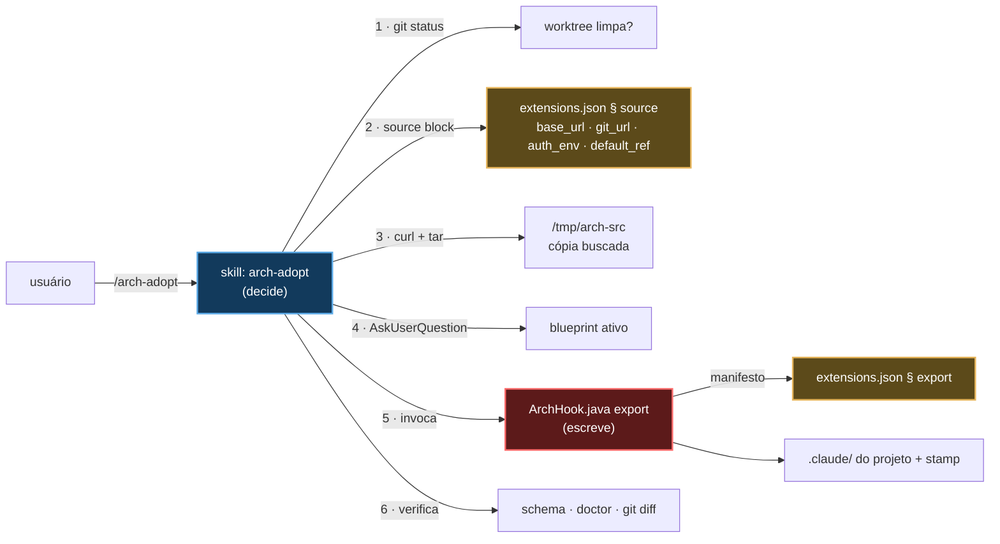

# `/arch-adopt` — instalar e atualizar o `.claude/` em um projeto existente

Fonte primária: `.claude/skills/arch-adopt/SKILL.md`, `.claude/hooks/ArchHook.java`
(modo `export`), blocos `source` e `export` de `.claude/schemas/extensions.json`.
Decisão: `@.claude/decisions/0054-deterministic-export-provenance-plugin.md`.

## O que faz

Traz esta arquitetura para dentro do projeto em que a sessão está aberta. Uma operação,
dois estados de partida:

| Estado de partida | O que acontece | Como a skill sabe |
|---|---|---|
| Projeto nunca gerado por `/init-project`, sem `.claude/` desta forma | **Instala** | não existe `.claude/.arch-provenance.json` |
| Projeto já tem o `.claude/` e está atrasado | **Atualiza** | o stamp existe e aponta para um ref anterior |

Não são dois comandos. A diferença é o stamp de proveniência, e o resto do procedimento é
o mesmo.

É a única skill de criação que **viaja** para dentro do projeto gerado. `/init-project`,
`project-bootstrap` e `/claude-code-architect-designer` ficam fora
(`export.skills.exclude`) porque só servem antes do projeto existir. Esta fica porque é
como um projeto se atualiza depois — inclusive quando o plugin que o entregou não está
mais instalado na máquina de quem clonou.

## A divisão de trabalho, e por que ela existe



**A skill escreve um arquivo por conta própria.** Ela responde três perguntas que um modo
determinístico não consegue responder — qual fonte, qual blueprint, e se é seguro
escrever — e sai da frente. Quase todo byte é escrito pelo modo `export`, a partir de um
manifesto de dados; a exceção é o bounded context do projeto (step 8): quando o `CLAUDE.md`
raiz não tem uma linha `Bounded context:`, a skill pergunta uma vez — o primeiro segmento
dos tópicos já existentes, senão o `artifactId` do build file — e escreve a linha com o
texto do `root.CLAUDE.md.example` buscado. O território da skill passa a incluir esse
arquivo.

**Mudança de convenção chega ao código existente como prompt, nunca como edição.** Quando
as normas mudam de um jeito que deixa para trás o código gerado antes — use cases
agrupados por aggregate, decisão 0104 —, a mudança vai como uma entrada no bloco
`migrations` do `extensions.json`. Num update, o step 9 mostra cada entrada que o projeto
ainda não viu e que vale para o blueprint dele: uma nota e um prompt para colar no Claude
Code dentro do projeto. A skill nunca roda o prompt. A cópia do `extensions.json` do
próprio projeto é o registro do que ele já viu, então um projeto gerado depois de uma
entrada nunca a vê.

Essa separação é o que substituiu o modelo anterior, em que as tabelas de cópia viviam em
prosa dentro de `project-bootstrap/SKILL.md` §§ 6.6–6.8: uma tabela em markdown é copiada
por um modelo, linha a linha, e a linha que ele esquece não quebra a geração — quebra para
quem clona o projeto depois e segue uma citação para um arquivo que nunca foi copiado.

## As três garantias do procedimento

1. **Recusa worktree suja.** Não é repositório git, ou `git status --porcelain` não veio
   vazio → para. Uma atualização sobrescreve: `git diff` é como a pessoa revisa e
   `git checkout` é como desfaz. Sem árvore limpa, nenhum dos dois funciona. A skill diz o
   que rodar e **não** comita por conta própria.
2. **Nenhum dos quatro valores de `source` escrito de memória.** `base_url`, `git_url`,
   `auth_env` e `default_ref` são dados — é por isso que existem num bloco. Trocar o
   GitHub por um endpoint de licenciamento muda dois campos, nunca o caminho de código
   que os consome. `auth_env` nomeia uma variável de ambiente e nunca carrega o valor
   (invariante 11); o header só é enviado quando a variável está setada, então repositório
   público não precisa de credencial.
3. **A proveniência é escrita, não prometida.** O stamp `.claude/.arch-provenance.json`
   registra ref, sha, blueprint e o hash de cada arquivo escrito. A linha `Provenance` do
   `/arch-doctor` compara esses hashes com o disco e **nomeia os arquivos editados
   localmente antes** de a próxima atualização sobrescrevê-los. Em um projeto com stamp,
   rode `/arch-doctor` primeiro e ponha essa lista na frente do usuário.

## O que viaja, e o que não viaja

Tudo isto é o bloco `export` de `@.claude/schemas/extensions.json` — dado, não prosa:

| Grupo | Conteúdo |
|---|---|
| `copy` | `ArchHook.java`, `extensions.json` |
| `binary_copy` | `ArchHook.jar` — o que todo hook dispara, copiado como bytes, nunca transformado |
| `overwrite` | o `settings.json` do projeto, do template de `project-bootstrap` |
| `optional_copy` | `.mcp.json` e o doc de setup de MCP, quando existem |
| `rules` | todas as normas de `rules/`, com os globs de `paths` reescritos para os pacotes do blueprint ativo (`derived_paths`) |
| `skills` | as 20 skills de `include`; as 4 de `exclude` ficam fora — as 2 de criação (`init-project`, `project-bootstrap`) e as 2 que trabalham sobre este próprio repositório (`claude-code-architect-designer`, `triage-issue`) |
| `agents` | `java-spring-boot-developer`, `archunit-installer`, `commons-logging-installer`, `compose-service-installer`; `project-initializer` e `issue-verifier` ficam fora |
| `blueprint_copy` | **só o blueprint ativo**, nunca o catálogo |
| `ensure_dirs` | `.claude/audit-usage/` — criar o diretório é o que liga a trilha |
| `gitignore_lines` | `.claude/audit-usage/.state/` e `docs/lessons-learned/` |
| `body_transforms` | corta citações a `.claude/decisions/` (que não existem dentro do projeto); citações ao blueprint ficam como estão escritas — o blueprint ativo viaja com o projeto (`blueprint_copy`) |
| `retired` | arquivos que este repositório renomeou ou removeu (uma rule, a antiga skill `java-patterns/`), apagados do alvo quando presentes — o `export` só escrevia, então sem isso um projeto adotado ficava com as duas cópias. Apaga também o `pricing.json` da trilha, que nada lê desde a decisão 0134 |

Duas decisões desse manifesto que parecem inconsistências e não são:

- **O blueprint ativo viaja; o catálogo não.** Sem isso, o YAML que define a arquitetura
  do projeto só existiria no diretório temporário buscado: o stamp grava o id, a próxima
  atualização lê esse id, a fonte não o tem, e o export falha num ponto em que ninguém
  foi avisado de guardar arquivo nenhum.
- **`.claude/audit-usage/` é versionado; `docs/lessons-learned/` não é.** Os relatórios
  pertencem ao commit da execução que os produziu. As notas de execução são locais, e um
  run que recria uma nota apagada escreve texto diferente que ninguém compara.

`ArchHook.java schema` verifica esse manifesto contra o disco: toda skill e todo agent
precisa estar em `include` **ou** em `exclude` — não listar é o bug, e o modo falha pelo
nome. Uma norma com território de pacote precisa de entrada em `derived_paths`, ou o glob
copiado literalmente deixa a rule sem carregar, em silêncio.

## Invocação e saída (exemplo fictício)

```
/arch-adopt --ref latest-tag --blueprint hexagonal
```

```
✅ updated — blueprint hexagonal, ref v0.9.3 (a1b2c3d)

Source ....... codeload.github.com, fetched at 14:22
Files ........ 136 written · 118 unchanged · 4 overwritten
Warnings ..... none
Schema ....... exit 0
Provenance ... ⚠️ 2 files edited locally since the stamp:
               .claude/rules/persistence.md
               .claude/settings.json
Bounded ctx .. already declared
Migrations ... 1 below, to paste when you choose

Review: git diff · Undo: git checkout -- .claude
Next: /arch-doctor for the full diagnosis
```

Use cases are now grouped in one subpackage per aggregate: … (the entry's `note`)

```text
Move this project's use cases into one subpackage per aggregate, … (the entry's `prompt`)
```

`--source <caminho local>` ignora o bloco `source` inteiro e usa uma árvore da máquina —
é assim que se testa uma mudança ainda não publicada.

## Modo `export` à mão

O modo é invocável direto, e é o que a skill chama:

```bash
java .claude/hooks/ArchHook.java export <dest> --blueprint <id> [--ref <label>] [--commit <sha>] [--dry-run]
```

`--dry-run` lista o que escreveria e não escreve nada. `--commit` é o commit da fonte que o
stamp registra — a skill o resolve com `git ls-remote`, descascando a tag anotada, porque o
tarball extraído não traz repositório. Sem ele, o stamp usa o HEAD da própria fonte, mas só
quando a fonte é o topo da própria work tree, e `unknown` caso contrário — nunca o HEAD de um
repositório onde ela por acaso esteja (decisão 0141). `Overwrites` só nomeia um arquivo que já
existe no destino e muda. Rodar duas vezes no mesmo destino
produz árvores byte-identical fora do stamp — determinismo verificado nos 9 blueprints
oficiais a cada mudança do manifesto.

## Projeto que não foi gerado aqui: o que bloqueia e o que não bloqueia

O `arch-adopt` não avalia o código do projeto. Ele só decide se é seguro escrever em
`.claude/`. Por isso há dois tipos de resultado, e convém não confundi-los:

- **O `arch-adopt` para** — nada (ou quase nada) é escrito, e a pessoa corrige antes de
  tentar de novo.
- **O `arch-adopt` termina, e o `/arch-doctor` aponta** — o que ele encontra vira linha
  do relatório, e só as linhas de `doctor.gate.labels` derrubam o CI (veja
  [04-arch-doctor.md § O que bloqueia o CI](04-arch-doctor.md#o-que-bloqueia-o-ci-e-o-que-não-bloqueia)).

### O que faz o `arch-adopt` parar

| Situação | Passo | Efeito |
|---|---|---|
| Não é repositório git, ou `git status --porcelain` não veio vazio | 1 | para; nada escrito |
| Fetch sem credencial, ou erro HTTP | 3 | para; `--fail` transforma o 404 em erro, não em tarball quebrado |
| Spring Boot **abaixo** de `doctor.platform.min_line` (hoje `4.0`) | 5 | `export` sai com 2 antes de escrever um byte; não existe `--force`. O caminho para cima é o `/platform-upgrade` (abaixo) |
| `schema` não sai com 0 depois do export | 6 | os arquivos já foram escritos; o relatório mostra a falha **antes** de tudo e os passos 7 a 9 não rodam |

**O caminho para cima é o `/platform-upgrade`.** No mesmo projeto, ele leva o build até a linha que
o Initializr serve hoje — o bump de versão, os starters e slices de teste renomeados, as propriedades
de configuração renomeadas — por uma receita que o `ArchHook.jar upgrade-recipe` escreve a partir de
`doctor.platform.upgrade` e dos metadados dos próprios jars, e que o núcleo OpenRewrite (Apache 2.0)
roda pelo wrapper Maven ou Gradle do projeto. Uma passada guiada corrige o que nenhum rename cobre,
até o build ficar verde. Ele recusa worktree suja, nunca faz commit e termina imprimindo
`/arch-adopt`. O plugin o entrega ao lado do `arch-adopt`; um projeto adotado o mantém para o
próximo piso.

O piso de versão é só um piso: **não existe teto**. Um Spring Boot 5.x passa, e as normas e
exemplares escritos para a linha 4 podem divergir dele sem nenhum aviso do `arch-adopt`.
Um build que esconde a versão (parent corporativo, BOM externo) também passa, porque
nenhum padrão de `line_patterns` o lê.

### O que não faz parar

| Cenário | O que o `arch-adopt` faz | `/arch-doctor` depois | Bloqueia o CI? |
|---|---|---|---|
| Spring Boot 5.x | instala normalmente | `Platform` ✅ | não |
| Versão do Boot ilegível | instala normalmente | `Platform` ⚪ | não |
| Arquitetura fora de qualquer blueprint, sem DDD | passo 4: nenhum blueprint casa, então oferece os existentes e o `custom.template.yaml`, dizendo o custo. Quase casar é o caso perigoso: avisa quais pacotes diferem antes de qualquer coisa. `src/` fica intocado | `Boundaries` ❌ até o `boundary-map` rodar; depois, `Boundary violations` ❌ listando `arquivo → prefixo` | **sim**, nas duas |
| Sem nenhum teste | nada: o passo 6 só roda `schema` e `doctor`. O `test-architect` não é encadeado | nenhuma linha olha `src/test` | não |
| Já tem `.claude/` próprio | sobrescreve o que tem o **mesmo caminho** que o manifesto; o que tem outro nome sobrevive. `settings.json` é sobrescrito **inteiro**, sem merge: hooks e `permissions` do projeto somem e aparecem no `git diff` | `Hooks` reflete só os hooks do Nerviz. `Schema` ❌ se uma skill ou agent próprio tiver frontmatter inválido ou nenhuma classe em `skill_classes` / `agent_classes` | `Schema`, `Hooks` e `MCP`: **sim**. `Skill shadowing`: não |

Dois detalhes do último caso:

- `--dry-run` primeiro. Com arquivos já presentes nesses caminhos, é ele que mostra a lista
  de `Overwrites` antes de qualquer byte.
- Sem `.arch-provenance.json`, mas com `.claude/rules/00-index.md`, a skill trata o projeto
  como "adotado antes do stamp": mostra o blueprint que o `00-index.md` cita e pede uma só
  confirmação, em vez de repetir a detecção.

### Roteiro de validação

Cada fixture é um repositório git com um commit. A base é um projeto hexagonal em Boot 4.0
com testes e wrapper; ajuste os nomes de pacote aos `packages.map` reais
(`ls .claude/blueprints/*/`).

```
f0-control/
├── pom.xml                      # spring-boot-starter-parent 4.0.x
├── mvnw, mvnw.cmd, .mvn/
├── CLAUDE.md                    # sem "Bounded context" nem "**Transport:"
└── src/
    ├── main/java/com/acme/orders/
    │   ├── domain/model/Order.java
    │   ├── application/port/in/CreateOrderUseCase.java
    │   ├── application/port/out/OrderRepository.java
    │   ├── application/service/CreateOrderService.java
    │   ├── adapter/in/web/OrderController.java
    │   └── adapter/out/persistence/OrderJpaAdapter.java
    └── test/java/com/acme/orders/CreateOrderServiceTest.java
```

| Fixture | Diferença para a base | Resultado esperado |
|---|---|---|
| F1a | parent `3.5.x`; F1d: `spring-boot = "3.5.1"` em `libs.versions.toml` | `export` sai com 2, `git status --short` vazio, sem `.claude/` |
| F1b | parent `5.0.x` | instala; `Platform` ✅ |
| F1c | parent `com.acme:acme-parent` sem versão do Boot | instala; `Platform` ⚪ |
| F2 | pacotes `controller/ service/ repository/ model/ util/`, sem `src/test/` | passo 4 sem blueprint; `src/` intocado |
| F2b | `application/usecase/` no lugar de `application/service/` | aviso de near-match nomeando os dois pacotes |
| F3 | sem `src/test/` | igual à base |
| F4 | `.claude/settings.json` com hook próprio, `rules/00-index.md`, uma skill com o nome de uma do Nerviz, uma com frontmatter quebrado, `.mcp.json` próprio | `--dry-run` lista os `Overwrites`; `schema` falha pela skill quebrada; hook próprio some no `git diff` |
| F5a | sem `git init` | passo 1 para |
| F5b | arquivo modificado e não commitado | passo 1 para |
| F5c | base já adotada, rodar de novo | update: o blueprint vem do stamp, sem perguntar |
| F6 | F2 + F3 + F4 juntos | `Boundaries` ❌, `Schema` ❌, rodapé `Setup incomplete`, `src/` intocado |

Para toda fixture:

```bash
# no projeto: /arch-adopt --source <caminho do nerviz>
java .claude/hooks/ArchHook.java schema </dev/null
java .claude/hooks/ArchHook.java doctor
java .claude/hooks/ArchHook.java doctor gate; echo "exit=$?"
git diff --stat -- src          # tem que ficar vazio
git log --oneline | head -1     # o arch-adopt não comita
```

Desfazer: `git checkout -- .claude && git clean -fd .claude`.

## O que este comando não faz

- **Não gera projeto.** Sem `pom.xml`/`build.gradle`, é `/init-project` que você quer.
- **Não escreve código de negócio**, nem toca `src/`.
- **Não escreve fora do `.claude/` por conta própria — com uma exceção.** A linha de
  bounded context do `CLAUDE.md` raiz, no step 8. Além disso, quando o build file não tem o
  scanner do SonarQube, o step 7 encadeia `sonarqube-setup`, que escreve o build file e
  o workflow sob o território dela; quando o `CLAUDE.md` raiz não tem parágrafo
  `**Transport:`, o step 7.5 encadeia `transport-security-setup` do mesmo jeito, sob o
  território dela. Numa instalação, rode `/reload-skills` antes para qualquer uma das
  duas — o diretório da skill não existia quando a sessão começou.
- **Não comita.** Deixa a árvore com o diff pronto para revisão, e diz como desfazer.
- **Não pergunta blueprint quando o stamp já registra um** — numa atualização, o
  blueprint ativo é um fato do projeto, não uma pergunta nova.
