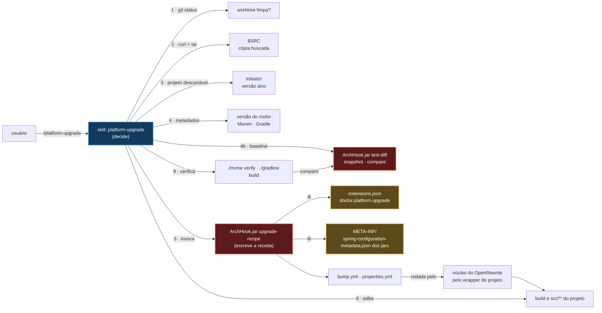

# `/platform-upgrade` — levar um projeto até o piso do Spring Boot

Fonte primária: `.claude/skills/platform-upgrade/SKILL.md`, `.claude/hooks/ArchHook.java`
(modos `upgrade-recipe` e `test-diff`), bloco `doctor.platform` de `.claude/schemas/extensions.json`.
Decisões: `@.claude/decisions/0175-platform-upgrade-below-the-floor.md`,
`@.claude/decisions/0176-platform-upgrade-baseline-context-and-runtime-starters.md`.

## O que faz

O `export` recusa um projeto cujo build declara uma linha do Spring Boot abaixo de
`doctor.platform.min_line` (`@.claude/decisions/0161-spring-boot-3-5-line-for-adopted-projects.md`),
e o `/arch-adopt`, que escreve por ele, recusa junto. Até esta skill, nada levava um projeto dessa
linha até o piso: a recusa dizia o problema e parava.

O `/platform-upgrade` é o caminho para cima. Rodado de dentro do projeto, leva o build da linha que
ele declara até a que o Initializr serve hoje, e deixa o build verde e o diff **sem commit**:

| Muda | Por onde |
|---|---|
| A versão do Spring Boot no build | passo 1 da receita |
| Starters e artefatos do Testcontainers renomeados | passo 1, de `renames.dependencies` |
| Tipos renomeados — test slices, `@MockBean` e `@SpyBean`, customizers | passo 1, de `renames.types` |
| Um starter de que o código agora precisa — `@EnableCaching` pede `spring-boot-starter-cache` | passada 1, de `requires_starter`, adicionado sem versão |
| A versão que uma coordenada antiga carregava, deixada no sucessor renomeado ou adicionado | passada 1, removida: o BOM do Boot gerencia todas |
| BOMs e bibliotecas que carregam versão própria — um train do Spring Cloud, Modulith, springdoc | passada 1, dos metadados que o Initializr serve para o alvo |
| Um wrapper Gradle mais velho do que o plugin novo do Boot aceita | passo 5b, pela recusa do próprio plugin |
| Propriedades de configuração renomeadas | passo 2, dos metadados dos próprios jars |
| O que nenhum rename cobre — um test starter, código Jackson 3, uma API que mudou de forma | o resíduo guiado, pelo modelo, um erro de compilação por vez |

Termina imprimindo `/arch-adopt`, para a pessoa digitar depois de revisar o diff.

Só manual (`disable-model-invocation: true`): reescreve o build e o código de uma pessoa, então roda
quando ela pede pelo nome. Viaja para o projeto gerado (`export.skills.include`), porque um aumento
de piso futuro manda um projeto adotado de volta para cá, e o plugin que entregou a skill pode não
estar mais lá. O plugin a entrega junto com o `arch-adopt`, como `/nerviz:platform-upgrade`.

## Dois motores, nesta ordem



**O que é mecânico é uma receita.** O `ArchHook.jar upgrade-recipe` escreve uma receita do
OpenRewrite a partir de dados, e a mesma entrada dá a mesma receita — por isso é um modo do hook
(Forma 7c) e não prosa que um modelo refaz a cada execução. O núcleo do OpenRewrite a roda pelo
wrapper Maven ou Gradle do próprio projeto. A skill nunca presume um Maven ou um Gradle no `PATH`, e
nunca adiciona um wrapper.

**O que não é mecânico é o resíduo guiado.** O modelo lê os primeiros erros de compilação, corrige a
causa contra as normas e o guia de migração do fornecedor, e compila de novo. Duas regras valem sem
exceção: um teste que falha é reportado, nunca apagado, pulado ou afrouxado; e o mesmo erro três
vezes seguidas para o laço e pergunta.

**O que estava vermelho antes é o baseline que diz.** O passo 4b roda os testes na árvore como a pessoa
a deixou; o passo 9 roda de novo, e o `ArchHook.jar test-diff` classifica cada caso — uma regressão, um
teste que sumiu, uma falha que o baseline nunca viu, uma falha que já existia, uma correção. Só as três
primeiras saem com 2. Um build vermelho que já era vermelho é reportado como isso.

### As duas passadas

A receita é escrita em duas passadas porque a segunda precisa de um classpath que só existe depois
da primeira.

| Passada | Comando | Escreve | Por que aqui |
|---|---|---|---|
| `bump` | `upgrade-recipe . --pass bump --target <x.y.z> --initializr <arquivo> --out <arquivo>` | o bump de versão; com os metadados do Initializr, um bump por BOM e por biblioteca com versão que ele lista; um rename de coordenada por entrada de `renames.dependencies`; o starter de cada entrada de `requires_starter`, adicionado sem versão onde o tipo é usado; um rename de tipo por entrada de `renames.types`; por último, a remoção da versão que uma coordenada renomeada ou adicionada carregava | A receita roda contra o classpath que o projeto **ainda tem**. Um tipo antigo deixa de resolver quando o BOM novo entra, então os renames de tipo ficam aqui, antes dele. A remoção de versão é uma edição de texto e vai por último: um arquivo de build que ela mudou é texto puro para todo passo seguinte, e foi assim que um BOM do Spring Cloud ficou na linha antiga |
| `properties` | `upgrade-recipe . --pass properties --classpath <arquivo> --out <arquivo>` | um rename por propriedade que um jar declara como `deprecation.level == "error"` com `replacement` | Os jars novos carregam os próprios renames como dado, então nenhuma tabela de propriedades é mantida à mão. Roda **sem compilar**: depois da passada 1 os testes não compilam até o starter deles entrar |

O `upgrade-recipe` sai com 2 e não escreve nada para um alvo malformado, um alvo abaixo do piso, um
projeto que já está no piso (passada 1), um bloco `recipes` ausente, ou uma entrada de dado que ele
não sabe escrever. Sai com 0 e não escreve nada quando nenhum jar declara rename de propriedade; a
skill então pula a execução. `CLAUDE_PROJECT_DIR` nomeia a fonte que guarda os dados, já que um
projeto abaixo do piso não tem dados próprios.

## O que a skill faz, passo a passo

| # | Passo | O que garante |
|---|---|---|
| 1 | Recusar worktree suja; achar a ferramenta de build e o wrapper | `git diff` é como a pessoa revisa o upgrade e `git checkout -- .` como desfaz. Sem wrapper → para |
| 2 | Buscar a fonte em `$SRC`, como o `arch-adopt` § 2-3; seguir o `SKILL.md` baixado se ele diferir (`arch-adopt` § 3b); `grep` do modo | Um projeto abaixo do piso não tem um `ArchHook.jar` desta forma. A cópia deste texto no plugin pode ser mais velha que a tag baixada e conduziria um jar e dados mais novos. Um ref anterior à skill não tem o modo, e um modo desconhecido sai com 0 — pareceria sucesso |
| 3 | Resolver o alvo a partir de um projeto descartável que o Initializr gera, e baixar os metadados de `dependencies` dele | Invariante 8: versão nunca vem da memória. Sem rede → para e pergunta. Os metadados precisam ser da mesma versão do Boot, ou o `upgrade-recipe` os recusa |
| 4 | Resolver a versão do motor no repositório que a serve | Veja a armadilha abaixo. Todo fetch segue redirecionamento (`curl -sS --fail -L`) |
| 4b | O baseline: `clean verify` / `clean build --continue` na árvore intocada, depois `test-diff snapshot` | O passo 9 distingue o que o upgrade quebrou do que já estava quebrado. Sem relatório → sem baseline, dito no relatório |
| 5 | Passada 1 | O bump, BOMs, coordenadas, starters e tipos. `git diff --stat` precisa mostrar o arquivo de build alterado; uma coordenada renomeada ou adicionada não carrega versão; cada BOM lê a versão do Initializr |
| 5b | Só Gradle: perguntar ao build, `./gradlew -q help` | O plugin novo do Boot pode recusar o Gradle do wrapper, e o `./gradlew wrapper` é recusado do mesmo jeito. A menor major aceita, seu release final mais novo, em `gradle-wrapper.properties`; depois o `./gradlew wrapper` atualiza os scripts |
| 6 | Listar o classpath novo | Maven `dependency:build-classpath`; Gradle um init script de `templates/` |
| 7 | Passada 2, sem compilar | Só o que um jar declara como erro com replacement |
| 8 | O resíduo guiado | Compila, lê, corrige a causa, compila de novo |
| 8b | O contexto sobe | As classes `@SpringBootTest` e suas subclasses concretas (a anotação é herdada; uma base abstrata não seleciona nada, em silêncio no Maven), primeiro e à parte: um starter que saiu da auto-configuração, ou uma propriedade que nenhum jar lê mais, compilam e só falham quando o contexto é montado. Nenhuma → `Not verified: context load`; a skill não escreve teste |
| 9 | Verificar | `clean verify` / `clean build`, depois `test-diff compare`: verde, não pior que o baseline, ou as regressões são o relatório |
| 10 | Entregar o diff | `git status --short`, `git diff --stat`, sem commit, imprime `/arch-adopt` |

Tudo que o procedimento baixa ou escreve fora do projeto vai em um diretório só, o `$WORK`.

### Onde ficam os dados

Os renames são dados, de dono único: `doctor.platform.upgrade` em
`@.claude/schemas/extensions.json` (invariantes 2 e 10). Um rename que falta no upgrade de um
projeto é uma entrada que falta ali, nunca uma segunda lista em outro lugar.

| Chave | Guarda |
|---|---|
| `recipes` | os nomes das receitas e no que cada tipo de entrada se transforma — modelos `{type, options}` com placeholders `${...}`. O motor é dado |
| `renames.dependencies` | renames de starters e artefatos: `starter-web` → `starter-webmvc`, `starter-aop` → `starter-aspectj`, `flyway-core` e `liquibase-core` → seus starters, os artefatos `org.testcontainers:*` |
| `renames.types` | renames de tipos: os test slices e suas anotações de auto-configure, `@MockBean` → `@MockitoBean`, `@SpyBean` → `@MockitoSpyBean`, customizers, as classes dos módulos do Testcontainers |
| `test_starters` | pacote → test starter de escopo test. Um erro de compilação que nomeia o pacote de um slice se cura com o starter para o qual a chave aponta |
| `requires_starter` | tipo → starter. No piso, a auto-configuração que age sobre um tipo foi para um módulo próprio, então um código que usa o tipo compila e o contexto não sobe |
| `test_reports` | os globs de onde o `test-diff` lê o XML JUnit: Surefire, Failsafe, Gradle |
| `engine` | onde as versões do motor são listadas, os endpoints do Initializr, onde o Gradle lista seus releases, o guia de migração, e quantas versões do plugin Gradle tentar |

Todo `to` de `renames` é um nome que um exemplar que este repositório compila no CI já usa, ou um
artefato publicado. Todo `from` foi achado no jar da linha que se deixa. Um `from` errado não
renomeia nada; um `to` errado quebra um build, então só o segundo é conferido contra um artefato
publicado.

### A linha pública do motor, e uma armadilha que ela armou

O motor é o núcleo do OpenRewrite, Apache 2.0, rodado pelo wrapper do projeto. O módulo
`rewrite-spring` nunca é usado: ele guarda as receitas prontas de Spring Boot, mas sob uma licença
source-available que proíbe um produto cujo valor derive dele. As entradas aqui foram escritas a
partir do guia de migração do Spring e dos metadados que os próprios jars do Spring publicam.

O Maven Central serve o BOM do núcleo só até uma versão que o plugin Gradle mais novo já passou, então
o plugin mais novo falha com `Could not find org.openrewrite:rewrite-bom`. O Maven não tem essa
lacuna: o plugin dele vive no Central e o `<release>` é coerente com ele. Por isso, para Gradle, a
skill pega o plugin mais novo cujo BOM o Maven Central responde 200, entre as últimas
`engine.gradle_candidates` entradas. Nenhum → para, e `engine` é o bloco a editar quando a linha
pública se mover.

## O que não faz

- **Commit.** O diff é da pessoa para revisar.
- **Escrever `.claude/`.** Isso é do `/arch-adopt`, para o qual a skill passa a vez.
- **Renomear código Jackson 3.** Uma anotação ficou, um pacote se moveu e uma exceção virou
  não verificada: uma decisão por ponto, não um rename. Fica no resíduo guiado, contra a seção de
  Jackson do guia de migração do fornecedor (`engine.migration_guide`). A allowlist do teste de
  arquitetura diz que raízes o domínio pode importar, não como migrar.
- **Alcançar um rename que nenhum exemplar nomeia.** `renames` guarda o que os exemplares deste
  repositório usam; um pacote movido que nenhum deles toca é do resíduo.
- **Contornar um build que esconde a versão.** Uma versão do Spring Boot em um POM pai que não é do
  projeto, ou em um version catalog, a receita não lê: a skill nomeia o arquivo e pede à pessoa que
  mude essa linha.
- **Rodar em um projeto que já está no piso ou acima.** Diz isso e para.

## Território de escrita

Classe `build`, com override em `skill_classes` de `extensions.json`: o arquivo de build da raiz, os
arquivos do wrapper e `src/**`, na raiz do projeto e em qualquer módulo. O `ArchHook.java guard`
impõe. `.claude/**` fica fora.

## O que o CI prova

| Job | O que prova |
|---|---|
| `validate › hooks-cross-platform › upgrade-recipe writes the bump and the property renames, and refuses what it cannot spell` | `UpgradeRecipeTest`: o bump carrega o alvo e um passo por rename do dado de produção; cada recusa sai com 2 sem escrever nada; a passada de propriedades sobre jars de teste pula um warning, uma entrada sem replacement e um jar sem metadados |
| `validate › hooks-cross-platform › test-diff separates what the upgrade broke from what was already broken` | `TestDiffTest`: uma regressão, um teste que sumiu e uma falha nova saem cada uma com 2 sozinha; uma falha que já existia, uma correção e um skip saem com 0; sem relatório, um baseline alheio, um relatório que não é XML ou que traz DOCTYPE saem com 2 |
| `templates › platform-upgrade` | `PlatformUpgradeTest`, com rede: em Maven e em Gradle, um fixture na GA mais nova abaixo do piso passa pelo procedimento da skill e builda verde na linha do Initializr — o contexto sobe com os starters de cache e de Flyway, um BOM do Spring Cloud se move, um starter fixado perde o pin, um wrapper Gradle antigo é consertado, e nenhum teste fica pior que antes |
| `validate › design › schema` | a classe da skill, seções, território e entrada em `export` |
| `validate › export-determinism` | a skill e o modo viajam iguais em todo SO |

Não provado, de propósito: uma execução agendada do job do motor, então uma deriva da linha pública
do motor aparece no próximo PR que toca os caminhos dele; builds Gradle com Kotlin DSL e
multi-módulo; e com que frequência falta um rename no dado. A seção *CI coverage* do registro lista
tudo isso.

## Como rodar

```text
/platform-upgrade [--ref <tag|sha|main>] [--source <local path>]
```

Uma worktree limpa, um JDK que o build aceita, um wrapper na raiz do projeto e acesso de rede ao
Initializr e aos repositórios do motor. Termina com o relatório:

```text
✅ upgraded — <from line> → <target>, <Maven | Gradle>

Source ....... <host>, ref <ref>
Engine ....... <engine artifact> <version>
Baseline ..... <n> test cases, <n> failing before | none — the tree ran no tests
Pass 1 ....... <n> files changed (<n> sources, <n> build)
BOMs ......... <n> moved by the recipe, <n> by hand | not moved — no Initializr metadata
Wrapper ...... <unchanged | Gradle <from> → <to>> (Gradle only)
Pass 2 ....... <n> property renames applied | none declared by the jars
Residue ...... <n> edits by hand — <one line each>
Context ...... <n> @SpringBootTest classes green | Not verified: context load
Verify ....... <green | no worse than the baseline: <n> pre-existing | the regressions, verbatim first line>
Not verified . <what no step above ran — one line each | none>

Review: git diff · Undo: git checkout -- .
Next: /arch-adopt
```

Depois, o `/arch-adopt` instala este `.claude/` no projeto já atualizado; veja
[10-arch-adopt.md](10-arch-adopt.md).
